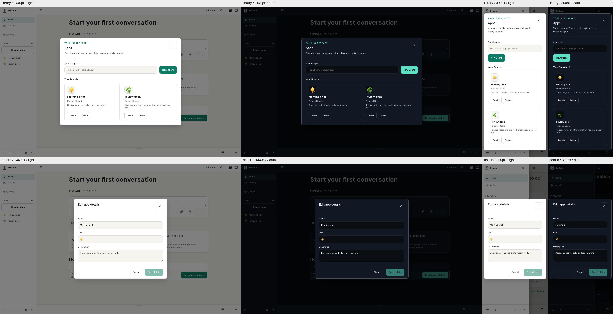
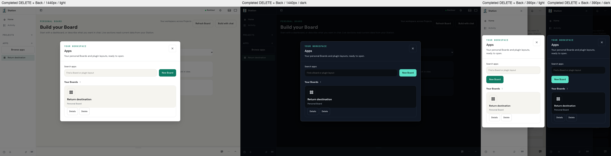

# Apps lifecycle review evidence

Retention: until 2027-02-03

Captured at `3da3d1e7c76c4726b76ea9e5acbe451cbdabbc83`, with an isolated
Station CLI `--watch` instance, temporary home, real personal Layout records,
and the normal single-use browser pairing flow. All eight source-development
PNGs were inspected at 390 and 1440 pixels in light and dark themes. The
instance and browser were stopped after capture.

The [earlier integrated captures](https://github.com/kontourai/station/pull/4621)
remain in the PR description as the before views, with their recorded revisions
and fixture limits. They include a fixture plugin Layout; this capture uses two
real personal Boards and does not qualify plugin execution.

## Executed behavior

At source revision `ae966ffe2aafa0e483a23afa52d85a34984fe921`, the four
Apps product-browser journeys passed in 39.3 seconds. They exercise creation,
metadata save, viewport changes, reload, launch, return focus after visiting a
child dialog, and cancellation/discard before deleting a real dirty Board.
The final capture revision only adds documentation review notes.

The two new dialog regressions first failed on the reviewed implementation:
discard left the metadata editor mounted, and child-dialog dismissal returned
focus to the document body. After repair, all 59 focused owner tests passed.
The dirty-Board browser regression failed before its repair because GET returned
404 while the discard decision was open, rather than the required 200.

The standard screenshot runner separately failed its unchanged 120-second
startup deadline before browser capture. That failure remains recorded; the
source-development images do not turn it into a pass. Phone-sized Chromium
renders do not establish installed-shell or physical-device behavior.

## Completion after Back

Captured at `dc3715f37ace9f756898e7b810652f43c711f70a` using a separate,
isolated CLI `--watch` runtime and real personal Layout records. All four
phone/desktop theme observations passed and were inspected. The browser and
runtime were stopped afterward.

Each observation buffers the real successful DELETE response after the server
has removed the selected Board, goes Back to a different saved Board, then
releases the response. The deletion confirmation closes, the library excludes
the removed Board, the newer URL remains, and GET the destination Board returns
200. This is source-development behavior evidence, not installed-shell proof.

The committed four-case managed product journey separately passed in 52.5 seconds,
including the prior dirty-Board Cancel/Discard, metadata and focus checks plus
this response ordering. Its first new attempt used the retired Activity URL
and failed at that invalid navigation precondition; the corrected journey uses
a second real saved Board without changing product routes or deadlines.

The mounted real-SDK/navigation regression failed on the reviewed early return
and passed after cleanup was tied to confirmed deletion. The closing owner batch
passed 66 tests. Cancellation and refusal/retry remain covered, and cleanup only
clears the confirmation belonging to the completed operation.
