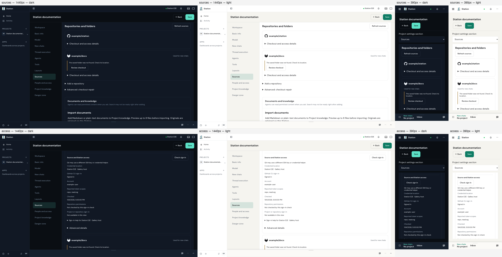
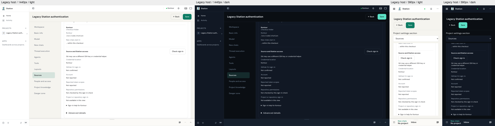

# Repository Sources layout repairs

Retention: until 2027-02-03

The eight selected Sources/access scenes were captured at
`7a021f13666374fdea277a7240a2f38978cca9fc`, using the standard screenshot
runner's isolated instance `e2e-screenshot-1793910462886-13et7p`.
The selected capture passed in 32 seconds, and its separate gallery audit
reported **zero findings in eight selected screens**, without allowlists or
waivers. This is a partial gallery capture, not whole-application qualification.

All eight saved PNG hashes were checked against their capture receipt, and
this contact sheet was inspected. The parent integration at `61fa66afe0f4`
only adds review notes and cross-runtime browser navigation updates; the
production UI at that integration remained byte-identical to the captured revision.

The earlier captures in [PR #4619](https://github.com/kontourai/station/pull/4619)
remain dated before views. They are not relabelled as current proof. Scroll
positions differ, so the contact sheets are not a pixel-comparison baseline.

## Repaired boundaries

- Workspace, disclosure and reorder controls have separate hit areas.
- Selected desktop section rails retain readable text in both themes.
- Sources keeps its body below the persistent settings header and above the
  collapsed chat dock, with an internal scrollport for the remaining controls.
- Phone journeys scroll and ordinarily click Add repository and checkout repair;
  access details keep the repository link clear of Save.

The rendered identity, repository-resolution and authentication GETs use named
fixtures; temporary Project creation/deletion and preview selection use the
isolated service. The account/scopes shown here do not establish actual provider
credentials, repository write permissions, remote execution or Peer registration.
Installed shells and physical-device input remain unverified.

The capture and audit runner stopped its instance. Independent source and
behavior review is still required before promoting the draft PR.

## Legacy authentication certainty

Captured at `686d79d4879451ff65eebf41a8a23806210be328` from an isolated
Station CLI `--watch` runtime. Named identity/resolution and valid legacy
integration-status GET fixtures supply an `unverified` action without an
`authentication` object; Project creation/deletion and preview selection use
the real isolated service. The browser and runtime were stopped after capture.

All four observations at 390/1440 pixels in light/dark themes passed and were
inspected. Sign-in stays **Not confirmed**, account/scopes stay **Not reported**,
and no error or false **Signed in** state appears. Explicit signed-in metadata
still passes the mounted consumer's existing positive case.

The consumer regression first failed for legacy `unverified` and `failed`
action responses on the reviewed code. After repair, all 13 focused UI/SDK
cases pass. The `works` action is also covered as an unknown authentication
control. These checks qualify displayed certainty; they do not perform a real
provider sign-in or grant repository permission.
