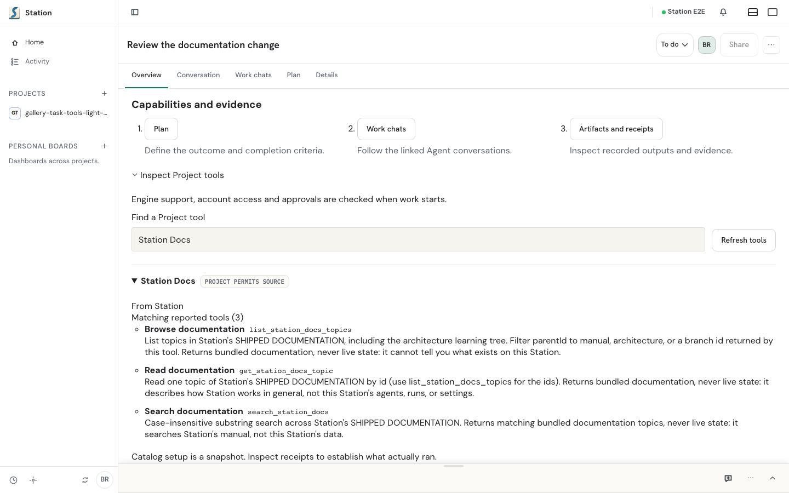
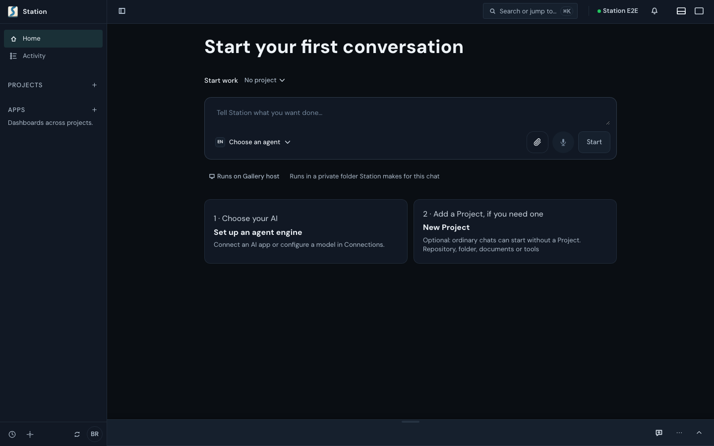
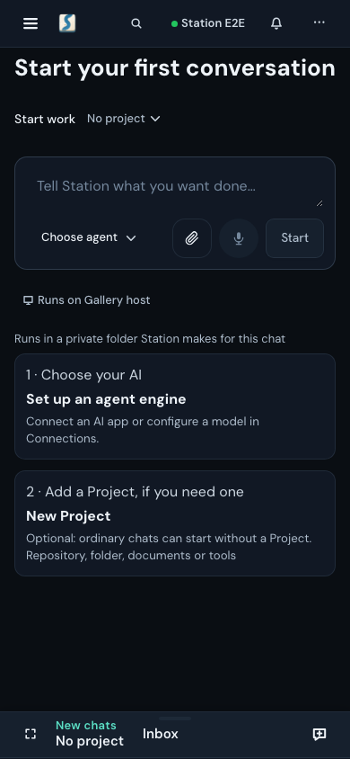
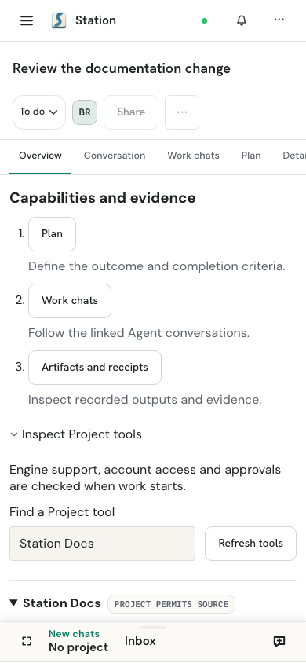

# Station

**Code from anywhere. On your own, or with your team.**

[](https://kontourai.github.io/station/)
[](https://station.kontourai.io)
[](LICENSE)

<picture>
  <source media="(prefers-color-scheme: dark)" srcset="tests/screenshots.baseline/task-capabilities-dark-desktop.png">
  <source media="(prefers-color-scheme: light)" srcset="tests/screenshots.baseline/task-capabilities-light-desktop.png">
  
</picture>

Agent work shouldn’t be trapped in one terminal or provider. Pick up where you
left off, bring your team into the work, and make what your agents produce
something you can build on together.

Station is open source, runs on a computer you control, and has a public SDK
for plugins.

<table>
  <tr>
    <td align="center" valign="top"><br>Start work from Home</td>
    <td align="center" valign="top"><br>Continue on your phone</td>
    <td align="center" valign="top"><picture><source media="(prefers-color-scheme: dark)" srcset="tests/screenshots.baseline/task-capabilities-dark-mobile.png"><source media="(prefers-color-scheme: light)" srcset="tests/screenshots.baseline/task-capabilities-light-mobile.png"></picture><br>Check a Task from anywhere</td>
  </tr>
</table>

<sub>Screens from Station’s automated UI gallery, using sample data. They are
regenerated with the gallery baseline.</sub>

[Product site](https://station.kontourai.io) ·
[Documentation](https://kontourai.github.io/station/docs/) ·
[Getting started](docs/user/getting-started.md) ·
[Concepts](docs/user/concepts.md) ·
[Contributing](CONTRIBUTING.md)

> **Status:** open source (Apache-2.0) and in active development. Install
> the Nightly with one command, use a Nightly desktop build, or run from source.
> v1 is coming soon; no stable release is published yet. See [Get Station](#get-station).

## Why Station

- **Bring the coding agents you already use.** Run a Station agent on a local
  or hosted model, or connect supported agent CLIs and compatible custom engines. Each
  engine keeps its own behavior and tool loop. Station supplies Project context,
  records its activity, and connects configured workflows.
- **Pick up where you left off.** Keep the plan, conversations, files,
  artifacts, and results linked to the work. When you reopen a Task, check that
  its recorded workspace is still available.
- **Direct work from another device.** Pair a phone, tablet, or laptop with
  scoped, revocable access. You can also send work to another computer you own
  over SSH, using that computer’s agents and credentials.
- **Review the changes and check results.** Configured workflows can attach
  gate results, missing evidence, review receipts, and exceptions to the Task.
  Creating or completing a Task doesn’t mean a gate passed.
- **Run it on your own machine.** Station data lives under `~/.station` by
  default. Networked features have their own settings and destinations; see
  [Data and privacy](#data-and-privacy).
- **Add a tool or work surface.** Plugins built on the public SDK can add
  layouts, agents, MCP tools, model providers, knowledge, and skills.

## From your first idea to what you ship

Plan, build, and ship with your coding agents. Start on your own, then bring
in teammates who can make decisions with you and take the work forward
themselves. See progress as it happens, share what you learn, and build on
work already done.

The following team experience is product direction. Current sharing limits
are described below.

### Current sharing limits

You can invite people to a Project and give them a role. After signing in and
getting their browser approved, they can read the Tasks you publish for them.
Editing Tasks and running agents from that entry aren’t available yet. Review
and member-presence UI include Feature Previews. Pairing connects your own
devices; it isn’t team access. Read [sharing setup and current limits](docs/guides/deployment-authentication.md)
before inviting someone.

Plugins can also provide team-specific work surfaces. See [integrating Station](docs/guides/integrating-station.md)
for supported extension contracts and deployment boundaries.

## What people use it for

| You want to… | In Station |
| --- | --- |
| Ship a code change you can stand behind | Open the repository as a Project, create a Task, pick an agent, and keep the commands that ran, their results, and the review receipts with the change. |
| Keep a long piece of work alive | A Task spans as many Sessions as it needs. Follow it from a paired device and come back to the same context, files, and evidence. |
| Use agents without a cloud account | A configured local model can provide inference without a cloud account. Tools, engines, and other enabled integrations retain their own network behavior. |
| Coordinate several agents | Delegate bounded work from one agent to another, or run it on a remote computer over SSH with that machine's own agents, credentials, and workspace. |
| Follow delegated work | Inspect retained child activity in the Agents pane or Background tasks sheet, distinguish returned results from provider reports, and open an authorized transcript for detail. Reports and completed turns do not establish accepted work; see [delegated-work concepts](docs/user/concepts.md#delegated-work-and-session-groups). |
| Run Station on a server you control | Review the deployment recipe, image provenance, home ownership, and authenticated ingress. |
| Build a purpose-built work surface | Write a plugin using the public SDK: a review workbench, a release console, or a domain-specific layout. |

## Get Station

### Install the app

For a first try, use the [Nightly desktop downloads](docs/user/getting-started.md#nightly-desktop-downloads)
for macOS Apple silicon or Windows x64. Download the installer for your computer,
open it, and launch Station. Nightly is a testing channel; see the linked guide
for signing and platform limitations.

### One-command server install

On macOS or Linux, paste this into Terminal:

```bash
curl -fsSL https://raw.githubusercontent.com/kontourai/station/main/install.sh | STATION_CHANNEL=nightly sh
```

The signed Nightly archive includes Node.js. You do not need Git, a GitHub
account, or a source build. The installer starts Station and prints a sign-in
link. Later, launch it with:

```bash
~/.local/bin/station-nightly start
```

Using the full path works before your shell knows the `station-nightly` command.
For Windows PowerShell, updates, and connection help, follow
[Getting started](docs/user/getting-started.md#install-nightly).

### On your phone

Connect to a Station running on a computer. The phone uses that computer’s
agents and files; it does not need Node.js or coding tools. The phone apps are
distributed through Google Play internal testing and invited TestFlight
testing, so most people open the Station's address in the phone's browser. Follow
[Connect your phone](docs/user/getting-started.md#connect-your-phone).

<a id="run-from-source-macos-linux"></a>

### For contributors: run from source

Requires Node.js 24.x, npm 10 or newer, and git. On Linux, interactive
terminal panes additionally need a C++ toolchain (`g++`, `make`, `python3`);
without one Station still runs and reports that capability as degraded.

```bash
git clone https://github.com/kontourai/station.git
cd station
npm run dependencies:ci
./station start
```

Open the UI address the command prints, then follow
[First steps](#first-steps). The [developer guide](docs/guides/development.md)
covers instances, ports, temporary homes, and the desktop app build.

### Other ways to run Station

[Getting started](docs/user/getting-started.md) is the single owner of the install
steps. Use it for:

- the Windows PowerShell Nightly install, updates and uninstall;
- the [verified installer](docs/user/getting-started.md#install-or-upgrade)
  for a published stable or beta release ring, and the signed
  prebuilt-archive path;
- [the release list](https://github.com/kontourai/station/releases) and
  [release rings](docs/guides/release-rings.md) for what is currently published.

To self-host on a server with Docker or Compose, follow the
[deployment guide](docs/guides/deployment.md). It covers building the image,
home ownership, binding a workspace, and putting Station behind your own
authenticated ingress.

## First steps

1. Open **Customize → Connections** and choose **Add model connection** (a local or
   hosted model service) or **Add engine** (an installed agent CLI). Startup
   can register supported native CLIs and their default Agents; check their
   readiness before starting work. The
   [Connections guide](docs/guides/connections.md#add-an-engine) lists the
   engines Station knows by name and how startup adopts them.
2. Open a local project.
3. Start a chat for ordinary work. Chats retain their history. Create a Task
   when you need a tracked deliverable or workflow.
4. Follow the Task's execution and inspect the evidence its workflow records.

To connect a phone, start Station on your computer and create a pairing code,
then choose **Scan QR code** on the phone. **Nearby Stations** is an optional
local-network path when the computer's discovery setting is enabled. Follow
[Connect your phone](docs/user/getting-started.md#connect-your-phone) for address,
manual-entry and approval steps.

If something is not ready, Station keeps the setup action visible. Run
`station doctor` for a local diagnosis.

## For developers

| Area | Start here |
| --- | --- |
| Plugins and the SDK | [Build your first plugin](docs/guides/build-your-first-plugin.md), [plugin guide](docs/guides/plugins.md), [SDK reference](docs/reference/sdk.md), [runnable examples](examples/README.md) |
| CLI | [CLI reference](docs/reference/cli.md) for target and credential setup; `npx @kontourai/station-cli@latest --help` shows the published client's help |
| HTTP API and contracts | [API reference](docs/reference/api.md), [endpoint authorities](docs/reference/endpoints.md), [contracts](docs/reference/contracts.md) |
| Integrating Station | [Integrating Station into your company or project](docs/guides/integrating-station.md) |
| Architecture | [System overview and reading path](docs/architecture.md), [module interfaces and evidence](docs/architecture/module-map.md), [CONTEXT.md](CONTEXT.md), [design records](docs/design/README.md) |
| Operating | [Deployment](docs/guides/deployment.md), [computer relationships](docs/guides/machine-relationships.md), [config reference](docs/reference/config.md) |
| Releases | [Release rings](docs/guides/release-rings.md), [Nightly](docs/guides/nightly.md), [channel ports](docs/guides/release-channel-ports.md) |

Published packages:
[`@kontourai/station-sdk`](https://www.npmjs.com/package/@kontourai/station-sdk) (plugin SDK),
[`@kontourai/station-cli`](https://www.npmjs.com/package/@kontourai/station-cli) (client),
[`@kontourai/station-contracts`](https://www.npmjs.com/package/@kontourai/station-contracts) and
[`@kontourai/station-shared`](https://www.npmjs.com/package/@kontourai/station-shared) (server, connection, and orchestration contracts plus shared helpers).

Station is built on Kontour's published primitives — Surface, Flow, Veritas,
Survey, and Flow Agents — through the same packages and contracts available to
any consumer. Learn more at [kontourai.io](https://kontourai.io).

## Documentation

The rendered [documentation site](https://kontourai.github.io/station/docs/)
publishes the end-user guides. The [documentation map](docs/README.md) routes
users, operators, plugin authors, contributors, and maintainers to everything
else in the repository.

For a guided overview-to-code path, use [Learn Station](docs/learn/README.md).
Its local interactive atlas connects concepts, module interfaces, canonical
documents, implementation, and evidence; Station Docs MCP draws from the same
manual and architecture sources.

## Contributing and support

- [Contributing](CONTRIBUTING.md) — issue-first, safe-direct, and
  discuss-first paths, source setup, and the pull-request contract.
- [Support](https://kontourai.io/support/) — setup and usage questions.
- [Security policy](SECURITY.md) — report vulnerabilities privately.

## Data and privacy

Networked features have their own settings and destinations: Model connections,
Engines, remote computers, notification services, authentication providers, and
telemetry exporters can exchange data outside the local home. Some configured
features make startup or background requests; desktop builds also contact
their release feed. Read the repository's [data-flow inventory and review limits](docs/privacy-policy.md)
alongside the [public privacy policy](https://kontourai.io/privacy/station/).
Generated store declarations are not proof that every data flow has been assessed.

## License

Station is available under the [Apache License 2.0](LICENSE).
