# Browser and Device UX pass

> **Reading status: dated design record (2026-11-03).** It records the audit,
> the target layout and the rendered before/after evidence for the pass that
> regrouped the Browser and Device panes. Current behaviour is owned by
> [BrowserPane](../../src-ui/src/workspace-panes/browser-pane/BrowserPane.tsx),
> [DeviceWorkspacePane](../../src-ui/src/workspace-panes/DeviceWorkspacePane.tsx),
> [PaneOverflowMenu](../../src-ui/src/workspace-panes/PaneOverflowMenu.tsx),
> [DeviceToolsDrawer](../../src-ui/src/workspace-panes/device/DeviceToolsDrawer.tsx)
> and [BrowserDevicesSection](../../src-ui/src/views/settings/BrowserDevicesSection.tsx).
> User instructions live in [the Browser guide](../guides/browser-workspace.md)
> and [the Device guide](../guides/mobile-device-workspace.md).

## Why

Five pull requests added Browser and Device controls over about a day, each
in the place that was nearest. The result was too much chrome. The Browser
toolbar carried eight controls, including a text **Network** button among
icons, and a flat sixteen-row ⋯ menu with two screenshot rows. The Device
toolbar carried nine icons, and its Tools drawer was one long form holding
apps, logs, history and every simulator setting. Configuration that a person
sets once, such as agent JavaScript and shared local servers, sat in the pane
next to the page.

The rule for this pass: the default chrome is the 90% path. Everything else
is one step away in a grouped menu, in Settings, in the command palette, or
in an agent tool. No capability was removed and no authorization, lease or
redaction check changed.

## Inventory

Frequency: **core** is used in most sessions, **occasional** is used on
purpose a few times, and **power** is diagnostics or configuration. "Agent"
names the agent tool that does the same thing, if one exists.

### Browser

| Control | Before | After | Frequency | Other route | Agent |
| --- | --- | --- | --- | --- | --- |
| Tabs, new tab, close tab | Tab strip | Tab strip | core | ⌘T / palette | `browser_open`, `browser_close` |
| Back, forward, reload | Toolbar | Toolbar | core | ⌘[ ⌘] ⌘R, palette | `browser_navigate` |
| Address bar | Toolbar | Toolbar | core | ⌘L | `browser_navigate` |
| Driver chip (Agent / You, hand back) | Toolbar | Toolbar | core | palette: Take / Hand back | n/a |
| Float over chat | Toolbar icon | ⋯ › Session | occasional | palette | n/a |
| Console (with unseen-error count) | Toolbar icon + badge | ⋯ › Inspect, dot on ⋯ | occasional | palette | `browser_snapshot` |
| Record / Stop recording | Toolbar icon + ⋯ row | ⋯ › Capture; Stop on the recording bar | occasional | palette | `browser_record_to_task` |
| Network | Toolbar text button | ⋯ › Inspect | power | palette | `browser_network` |
| Screenshot (Save, Copy, Attach to chat) | ⋯ row | ⋯ › Capture | occasional | ⇧⌘S, palette | `browser_capture_to_task` |
| Screenshot to chat (one step) | ⋯ row (second screenshot row) | Screenshot tray's **Attach to chat** | occasional | palette | `browser_capture_to_task` |
| Annotate | ⋯ row | ⋯ › Capture | occasional | palette | n/a (human input) |
| Zoom | ⋯ list | ⋯ › View | occasional | ⌘= ⌘- ⌘0 | gap |
| Appearance | ⋯ list | ⋯ › View | occasional | n/a | `browser_color_scheme` |
| Viewport presets | ⋯ list | ⋯ › View | occasional | n/a | `browser_resize` |
| Rotate viewport | ⋯ row | ⋯ › View | occasional | palette | `browser_resize` |
| Reload without cache | ⋯ row | ⋯ › Session | power | ⇧⌘R | gap |
| Stop loading | ⋯ row | ⋯ › Session | power | palette | gap |
| Sessions list | ⋯ row | ⋯ › Session | occasional | palette | `browser_status` |
| Agent JavaScript permission | ⋯ › Agent access panel | Settings › Advanced › Browser & devices | power | ⋯ › Browser settings…, palette, Settings search | no (owner decision) |
| Shared local servers | ⋯ › Local servers panel (operator) | Settings › Advanced › Browser & devices (operator) | power | same | no (operator only) |
| Local server one-click open | none | Empty state | core | n/a | `browser_open` |
| Close session | ⋯ row | ⋯, last, on its own | occasional | n/a | `browser_close` |
| Codec diagnostic ("JPEG", "H.264…") | Always under the page | On hover or focus of the live view | power | n/a | n/a |

### Device

| Control | Before | After | Frequency | Other route | Agent |
| --- | --- | --- | --- | --- | --- |
| Device screen, take control | Stage | Stage | core | n/a | `device_input` |
| Home | Toolbar | Toolbar | core | n/a | `device_input` |
| Back (Android) | Toolbar | Toolbar | core | n/a | `device_input` |
| Rotate (iOS) | Toolbar | Toolbar | core | n/a | `device_input` |
| Recents (Android) | Toolbar | ⋯ › Session | occasional | n/a | `device_input` |
| Save screenshot | Toolbar | ⋯ › Capture | occasional | n/a | `device_screenshot`, `device_capture_to_task` |
| Record to Task / Stop | Toolbar | ⋯ › Capture; Stop on the stage while recording | occasional | n/a | `device_record_to_task` |
| Tools drawer (one long form) | Toolbar | Split into ⋯ › Logs, Apps, Device settings | occasional | n/a | see rows below |
| Logs | Drawer section | ⋯ › Logs | occasional | n/a | `device_logs` |
| App install, launch, terminate, open URL, repro, history | Drawer section | ⋯ › Apps | occasional | n/a | `device_install_app`, `device_launch_app`, `device_terminate_app`, `device_open_url` |
| Appearance, accessibility, push, location, permissions | Drawer sections, all open | ⋯ › Device settings, folded | power | n/a | gap, except accessibility (`device_snapshot`) |
| Float over chat | Toolbar | ⋯ › Session | occasional | n/a | n/a |
| Close (this viewer) | Toolbar | ⋯ › Session | occasional | pane chrome | `device_close` |
| Power off, End for everyone (manager only) | Toolbar | ⋯, last, on their own (manager only) | power | n/a | gap (owner-gated) |
| Device helper, sharing, agent device access | Setup wizard only, unreachable once set up | Settings › Advanced › Browser & devices › Open device setup | power | Settings search | no |
| SSH device hosts | Settings › Devices | Settings › Advanced › Device hosts | power | Settings search | no |
| Recording limits | Server constants, no UI | Unchanged; documented in reference | power | n/a | n/a |

### Gaps

These hidden capabilities have no agent tool. Each remains reachable by a
person through the menu, a shortcut or the palette.

- Browser zoom, reload without cache and stop loading. These are human view
  controls; an agent reloads by navigating.
- Device appearance, push, location and permissions. Agents reach them only
  through the Device tools HTTP routes a person's session uses.
- Device power off and end for everyone. These stay with the operator on
  purpose.
- Device controls have no keyboard shortcut or palette command. The ⋯ menu is
  keyboard reachable: it is the toolbar's roving tab stop, and its rows take
  arrow keys.

## Target layout

**Browser default chrome:** tabs, back/forward/reload, the address bar, the
driver chip and one ⋯. The ⋯ menu has four named groups:

- **Capture:** Screenshot, Annotate, Record.
- **View:** Zoom, Appearance, Viewport, Rotate viewport.
- **Inspect:** Console (its row shows new errors; a dot on ⋯ says there are
  some), Network.
- **Session:** Float over chat, Reload without cache, Stop loading,
  Sessions, Browser settings….
- **Close session**, alone and last, in a group of its own.

**Device default chrome:** the screen, Home, Back (Android) or Rotate (iOS),
and one ⋯. The ⋯ menu has three named groups:

- **Capture:** Save screenshot, Record to Task.
- **Tools:** Logs, Apps, Device settings. Each opens the drawer on that view
  alone; Device settings sections start folded.
- **Session:** Recents (Android), Float over chat, Close.
- **Power off** and **End for everyone** (managers only), last, in a group of
  their own.

**Settings › Advanced › Browser & devices:** agent JavaScript and shared
local servers for a chosen Project (the Browser's link opens on its own
Project), and **Open device setup** for the device helper, sharing and agent
device access. **Device hosts** moved from Settings › Devices to Advanced.

**Empty states:** the Browser says "Enter a URL or pick a local server" and
offers each shared local server as a button. The Device list heading reads
"Start a simulator" until one is running. With no hub, it reads "Set up
devices to start a simulator" and offers **Set up devices**.

**Visual:** one icon-only ⋯ per pane, one screenshot row, 12px minimum text
(menu hints and headings are 12px, and the 9.5px badge is gone), and no
motion was added. A pane menu now draws above the dock. Inside the phone
sheet it uses the full height.

## Decisions taken

- **One screenshot row.** Screenshot opens the tray (Save, Copy, Attach to
  chat). The one-step "Screenshot to chat" became a palette command instead
  of a second menu row.
- **Recording stops from the recording bar.** While recording, the bar under
  the page (Browser) or the stage (Device) shows **Stop recording**, so the
  stop is visible without opening a menu.
- **Device Close moved into ⋯.** The brief's default chrome has no Close;
  the pane host's own chrome still closes the pane.
- **Recording limits stay server constants.** There was no setting to move,
  and inventing one would name a state that nothing computes. The limits are
  documented in the reference.
- **Agent device access is reached through the existing setup wizard.** It
  was unreachable after first setup; Settings now opens the same wizard.
  The wizard's consent and install steps are unchanged.
- **The codec label shows on hover or focus**, rather than being removed: it
  is a diagnostic.
- **The menu became a shared component** (`PaneOverflowMenu`), so both panes
  use one grouping, focus and placement rule.

## Evidence

Rendered on an isolated Station (ports 3742/3776, temporary home) with a
local test page and an iOS simulator created for this pass. The before set
renders the starting branch's UI. API responses were intercepted only for
states that are hard to reach live: view only, hub not configured, and
nothing running.

| State | Before → after |
| --- | --- |
| Browser empty | 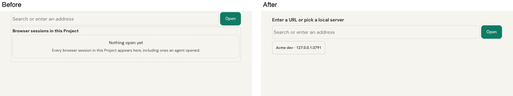 |
| Browser toolbar | 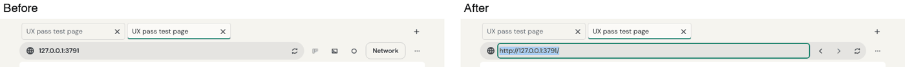 |
| Browser ⋯ menu | 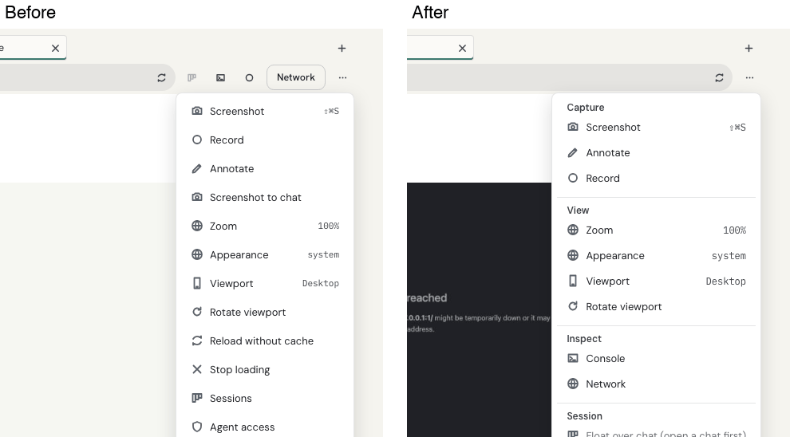 |
| Browser ⋯ menu, dark | 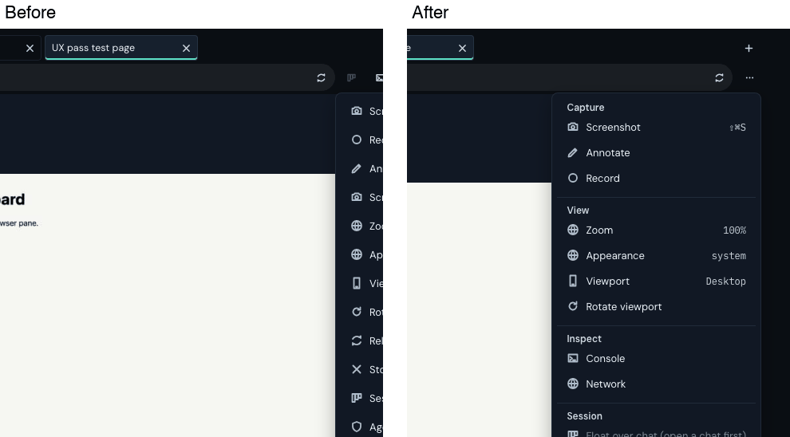 |
| Browser at 390px | 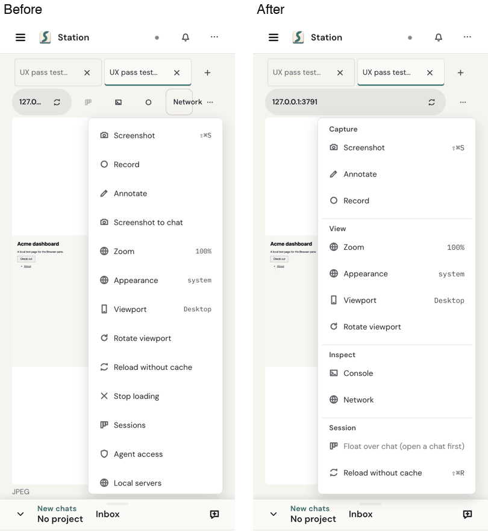 |
| Console | 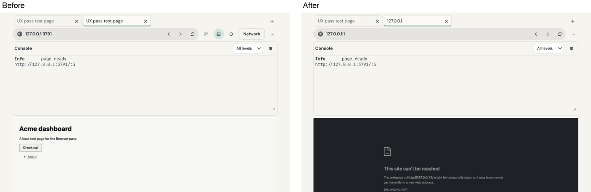 |
| Network | 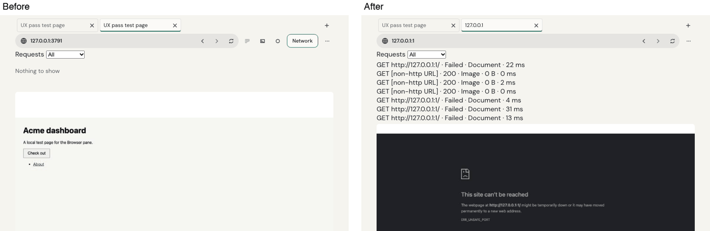 |
| Recording | 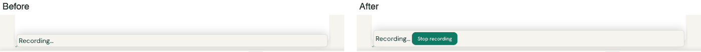 |
| Recording ready | 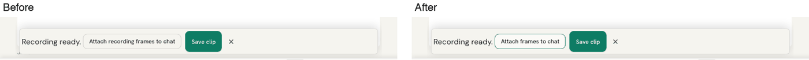 |
| View only (paired device) | 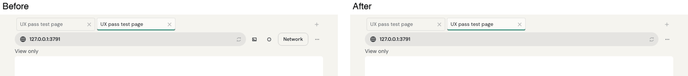 |
| Agent JavaScript → Settings | 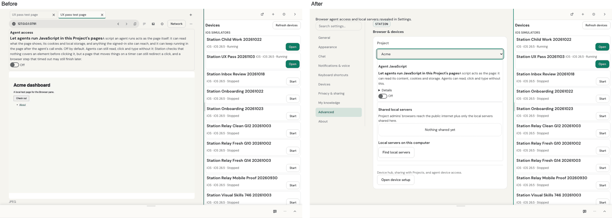 |
| Device, no hub | 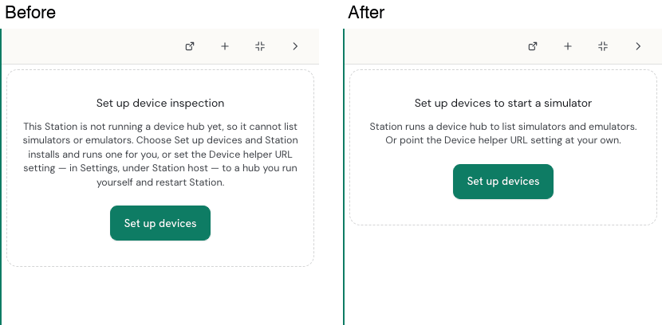 |
| Device list, nothing running | 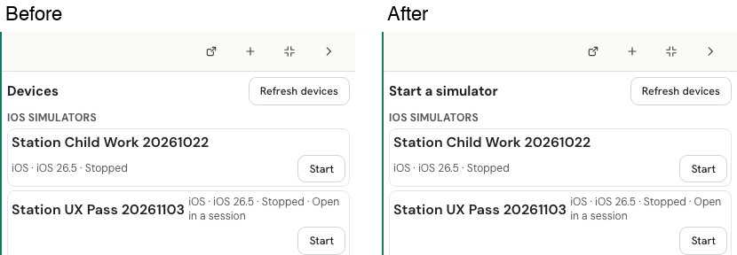 |
| Device toolbar | 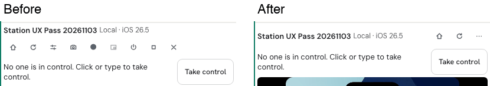 |
| Device ⋯ menu | 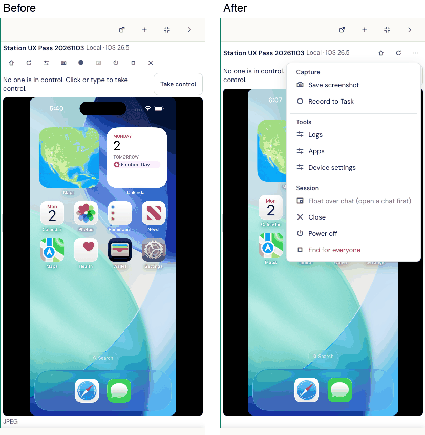 |
| Tools → Device settings | 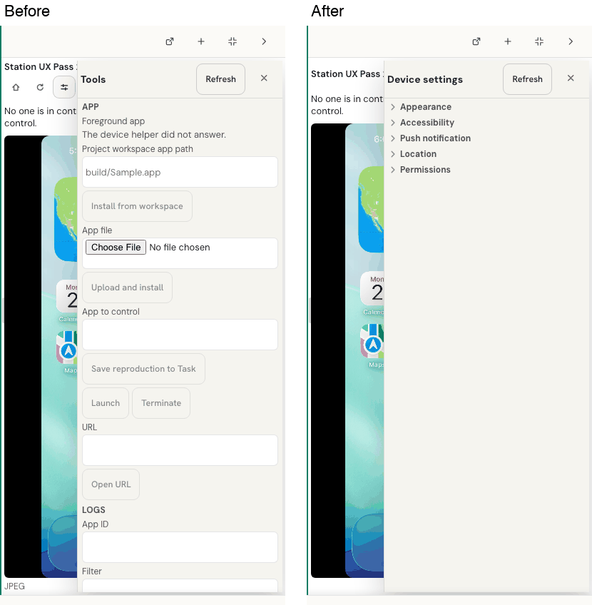 |
| Tools → Apps | 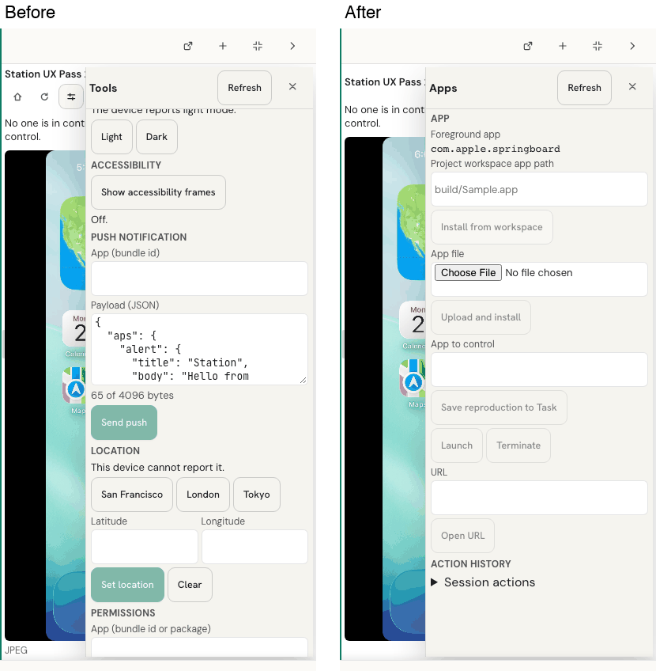 |
| Device, dark | 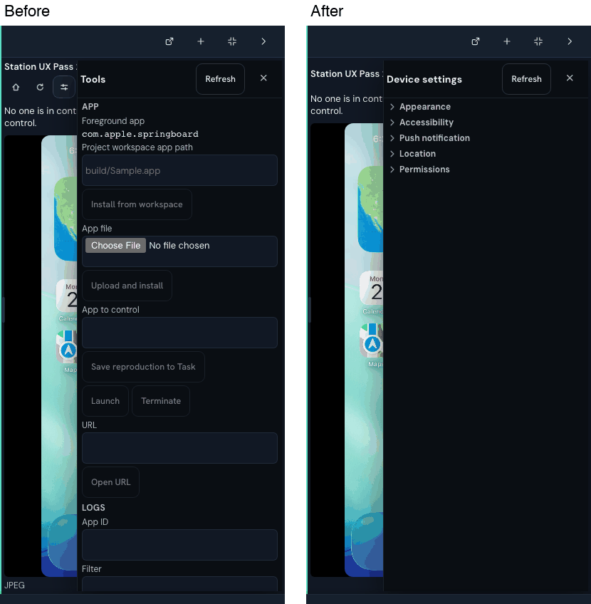 |
| Device at 390px | 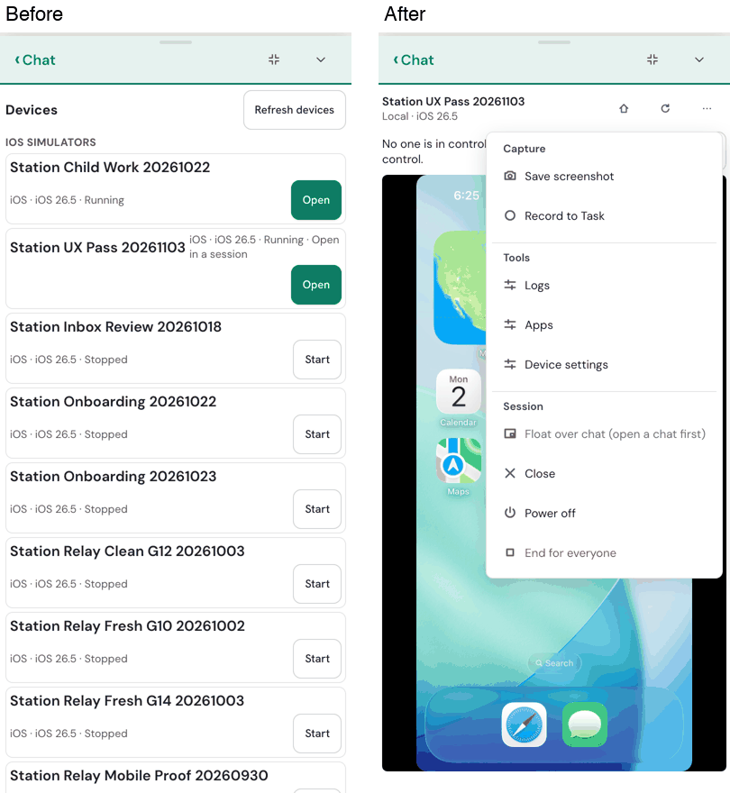 |

**NOT_VERIFIED:**

- The agent-driving chip state. No agent drove the session during capture.
- Android-only rows (Back in the toolbar, Recents in ⋯). No emulator was
  available; unit tests cover them.
- The Tauri desktop shell. The coordinator checks desktop on Windows.

The Playwright journey `tests/device-pane.spec.ts` ran once through
`npm run test:e2e:product -- --spec=tests/device-pane.spec.ts` on the suite's
own isolated server: 4 passed. Its first run found the Device settings fold
toggles under the 44px phone tap floor; they are now 44px rows. The
not-configured "after" capture above predates the final copy, which now names
Settings › Advanced › Host options.
