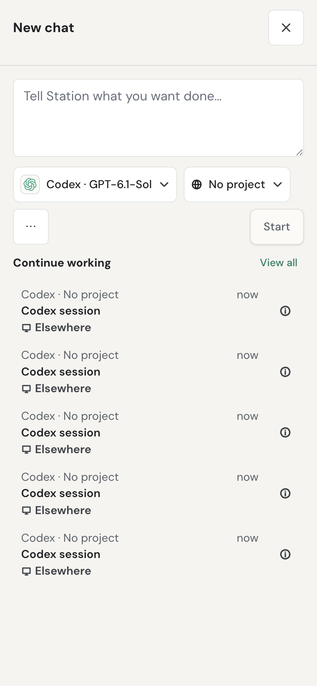
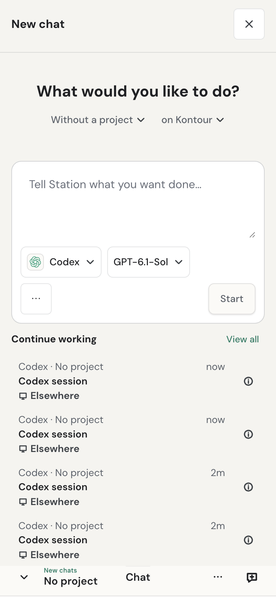
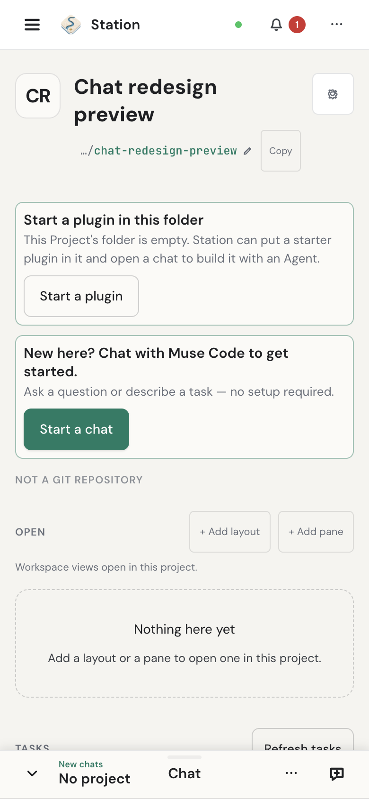
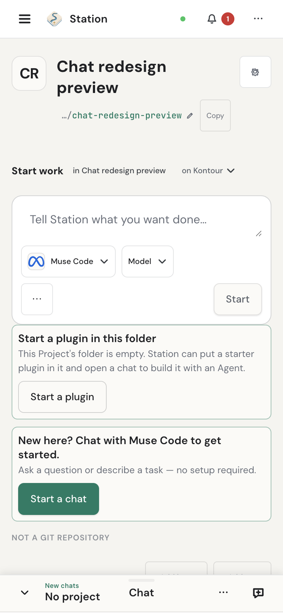

# Design: Chat composer & the agent-navigability principle

> **Reading status: interaction policy with dated design evidence.** Section 2
> records the 2026-07-26 audit; the sequencing and shipped-status statements
> belong to their recorded work. Section 4 below describes the current public
> HTTP entry points. Current control rendering and sending are owned by
> [ChatDockBody](../../src-ui/src/components/chat-dock/ChatDockBody.tsx) and
> [foreground dispatch](../../src-ui/src/lib/foregroundMessageDispatch.ts).
> The mobile product decisions remain binding; this document is not a fresh
> browser, accessibility, or native-device test result.

> Status: **composer hierarchy, the provider/model picker, prerequisite
> guidance, shortcuts, and final Settings polish shipped through archive#1354.**
> This is the contract for the chat composer/dock and for the principle it
> enforces. Revise this doc — not just the code — when direction changes.

## Agent & model in the composer toolbar

Reply and start composers share one bottom row inside the input box: attachment,
voice and other tools on the left, then Agent & model immediately beside Send or
Start on the right. If Start wraps, it stays at the trailing edge of the
toolbar. The reply's next-turn destination notice and conversation status/resync
action stay above the box when present.

Agent & model is a quiet ghost pill with overlapping Agent and engine marks, a
secondary-weight model label, and the shared caret. The Agent mark names the
Agent, so the label spends its text on the model; without an Agent mark it reads
Agent · model and the Agent name truncates first, but never below about eight
characters: where that and the model do not both fit, the name is left out of the
label rather than cut to a stub (the accessible name keeps it). A requested reasoning effort
follows the model ("Opus · High") and truncates before it; with no effort
requested the engine default applies and no level is named. Safety warnings stay
on the marks, and the open panel repeats the mark on the choice that raised it. When the
Agent now points at another engine (and its Session has not ended; see 3.1), the trigger
adds "· Default differs" at every width, 8px after the label and with a plain space after
the dot. The label gives way before it, and in narrow composers the label hides,
keeping marks, the hint without its dot, and caret. The trigger’s accessible
description names the session engine and Agent default. On phones, More draft options groups Saved drafts
and Clear message to preserve the toolbar targets. The full summary remains in the accessible name
and hover title, and the touch target stays at least 44px. The existing setup
owner opens above the toolbar on desktop and as a bottom sheet on phones.

## Interaction stability and conversation continuity

For a memory-exhausted turn restored from history, the dock offers Continue
only when the conversation window reports that turn eligible. An older server
without that fact leaves the failure visible without the action. The server
checks eligibility again when Continue is requested.

Every conversation uses the chat dock's reading surface and header, including
conversations discovered in another coding app. A quiet "Started in Claude Code"
(or the observed app name) identifies origin. Discovery is not evidence of running
work; history uses source-event time and remains separate from active work.

Opening a conversation or typing does not migrate it. One compact
**Continue in Station** action sits with the origin (the dock title bar, a
phone's origin row, or the Activity header) and needs no message; its reason
when unavailable, or a conversation's own-folder choice with **Add a project
instead**, follows on one quiet line. The composer is the plain **Message…**
with **Send**: Send (or the configured Return shortcut, except during IME
composition) continues with the draft; Shift+Return adds a line. Either way the continuation opens
through the normal dock controller, and a draft, when there is one, goes to the
normal sender once. The original conversation
remains available in its original app. When the server reads the original as
still mid-turn (`attachedSourceActivity` is `active`), or refuses the
continuation for that reason, a caution row appears under the origin, at
the top of the content area rather than in the title bar's action slot:
"Still running in Claude Code. Continuing now forks it", with **Continue
anyway** and **Not now**; it is not a dialog. Focus moves to **Continue anyway**,
which the caution describes, and returns to **Continue in Station** on **Not
now** or when Continue anyway fails; the caution is a status announcement, so a
refusal of a stale read is heard too. Station offers no take-over: it cannot
stop the original app. A failed opening retains the reader and offers a
retry that does not create another continuation. Metadata is available through
an explicit Details action.

While a conversation's first load is in flight, an empty transcript shows a
quiet loading stage: the Station mark and one status line naming the read in
flight (**Opening conversation**, **Loading messages** or **Catching up**). A
load that lands within a fraction of a second paints nothing. Past six seconds the stage adds
**Taking longer than usual. Waiting on** the Station's name. A slow load offers
no **Start new chat**. The exits belong to a load that failed: the recovery
notice (Retry and Start new chat, which carries the draft) and the
history-failure notice (Retry). While the open read is pending, the composer
stays editable for a draft but runs nothing: Send, Enter and slash commands
wait, and with a draft Send says it can send once the chat opens
([stage](../../src-ui/src/components/conversation/ConversationLoadingStage.tsx),
[body](../../src-ui/src/components/conversation/ConversationBody.tsx)). A skill
shortcut follows the composer's rule: it runs a command only where the
composer could send, and otherwise says why in a toast
([registrar](../../src-ui/src/components/SkillShortcutRegistrar.tsx)).

Message action rows reserve their layout space. Hover and keyboard focus may
reveal controls, but must not change bubble size or the position of later messages.
The desktop chat header's **Inventory** button opens the full Chat inventory
directly; on a phone it is the **Chat inventory** row of the header's **⋯**
sheet, because a third trailing control wrapped the one-row header (#4192).
Select **View details** on an item to read its authored
message, attachment metadata or safe tool result; the cue then reads **Hide
details** and a second press closes it. Recorded decisions and other
rows expose their metadata and link to the Session for surrounding context.
No input or result body is read until that row is selected. The compact answer
inspection remains a separate entry point.

On phones, **Answer details and actions** contains **Basis**. On desktop, the
settled answer's **Basis** chip stays visible. Both open Chat inventory scoped to that answer
([#926 amendment](https://github.com/kontourai/station/issues/926#issuecomment-6273381066)).
It reads plain **Basis** for an unassessed answer, which is nearly every answer
today, and states that standing only in its accessible name. A notable standing
(policy met, assessed with gaps, or unresolved) adds Surface's own label, such as
**Basis · Policy met**
([owner decision](https://github.com/kontourai/station/issues/926#issuecomment-6281195632)).
The answer footer wraps when its controls need more space. In a narrow dock
or phone row, a long Surface label can end in an ellipsis after a whole
**Basis ·**. The full label stays in the chip's accessible name and tooltip.
The chip reads an answer's standing only after the answer has stayed on screen
for about 150ms, so a fling through history sends no read for answers it only
passes. It cancels a read that scrolls off screen unanswered, does not re-read a
standing it holds while it stays mounted, and refreshes on an assessment or
narrative update. A long
transcript unmounts far-off answers; one that returns is read again, because the
Basis read re-checks access for each new chip. Pending or failed, it stays
**Basis** and still opens.
During an authorized active-turn continuation wait, the composer accepts and
preserves a draft. While this tab sees the turn in flight (a chat reopened
mid-turn), Send steers or queues into that turn as it does in the tab that
started it. A wait with no turn in flight here keeps Send blocked behind Check
again until continuation is writable.
The shared popover shell opens toward the roomier viewport edge, including when
the dock is maximized. Slash commands, `/model` and `@` file results all open
through one anchored popup outside the composer, so no composer clipping can cut
them off. The `@` list closes when the input loses focus (pressing inside the
list does not take focus) and reopens when focus returns with the caret in an
`@` query. Child transcripts use the chat pane. Its title becomes an ancestor breadcrumb while the dock controls stay visible. Back, Escape and system Back return to the parent; each child keeps its own reader. Engine tool results join their recorded call IDs in the shared tool rows. Live child-work state refreshes the reader and stops polling when the child settles.
A child reader names its parent above the transcript. A running engine child
with a reported steer target can receive text in its own bottom composer when
the operator can continue its parent conversation. The child's reported model
appears there. Read-only records keep their existing limits.
While a child covers its parent, the parent retains its draft but publishes no
header controls or active-reader shortcuts.

The [working-chat focus owner](../../src-ui/src/hooks/useWorkingChatFocus.ts)
requests composer focus once after selection, when the conversation
and its textarea become writable. The request expires 60 seconds after selection,
allowing a slow remote open without retaining focus intent indefinitely. Moving
focus elsewhere, opening a dialog, or selecting another chat cancels it. A
read-only, missing-session, failed-open, or replay selection cancels it and moves
focus to the selected transcript when focus is still in the working-chat control
or on the page body.

## Starting and resuming work

The phone-width captures compare the baseline and redesigned controls in the
same isolated sample home and light theme. They show appearance, not task
execution or native-shell qualification. Capture revisions and limits are in
[the media manifest](../learn/media.json).
These historical comparisons predate the paperclip and mic added to the start
composer; they are not current references for its attachment controls.

| Surface | Before | After |
| --- | --- | --- |
| New chat |  |  |
| Project page |  |  |

These frozen comparisons record #3490's redesign at the revisions in the media
manifest. Later Project identity marks, server run-location updates, Agent
grouping and Engine & model overrides are not pictured; the images are not captures or visual qualification of the current
composer.
The **⋯** they show held only **Use a visual skill**; that action now appears
only while the `visual-skills` Feature Preview is on, so by default the
current composer has no **⋯**.

The Project comparison captures also precede the shared Project Room and
Overview-first navigation. They retain their original revisions. Direct Agent
chat now stays in Home/the dock; Project Room speech is shared discussion and
only an explicit Agent request starts Agent work. Files & connections contains
source and workspace controls, with specialist management still in Settings.

Home and the chat dock share one start composer (`StartComposer`, driven in
the dock by `NewChatModal`). Both use a centered heading, a compact Agent & model
control beside Start inside the message box, and a Station/location line below
it. First-run Home uses **Start your first conversation** with the Project picker
beneath it. Other drafts put the selected Project in **What would you like to do?**
and keep **No project** available. Compact Home drafts shorten the message box.

On the current Station, **Create project** in the Project picker opens the
standard Project form with **Blank workspace** selected. After creation, the draft
selects that Project and keeps its message and attachments. Canceling keeps the
previous Project. A draft targeting another Station uses that Station's existing
Project list.

**New chat** is not a dialog. It opens a draft in the chat dock's body, in place
of the chat on screen, in any dock region or placement (full screen on a phone):

- **Layout.** The heading includes the selected Project and a **start without
  a project** action. The composer is centered in the available space; in a
  short dock its heading, spacing and text box shrink so the Station line stays
  visible. **Runs on <Station>** opens the Station chooser when another
  permitted destination is available; choosing one continues to its Engine &
  model. Setup, repair and read errors scroll above the composer.
- **Header.** The dock's title slot (and the phone header) reads **New chat**,
  **New Task** or **Fork from here** (**Regenerate** or **Edit and resend**
  for a fork a message action started). A fork starts with the source Agent
  selected. Moving the pointer over a different Agent or using the arrow keys
  changes the selection. The start composer's Project chip
  is the single owner of destination choice; dock headers have no project picker.
- **Leaving.** Escape, Back, **Cancel return** or Cancel fork dismisses the
  draft and hands back its text; on a phone this restores the dock size the
  draft replaced. Start (and a fork's open) closes it as started before
  navigating, opening the chat at the size the dock had, as `focusSession`
  does. Going to another chat (tab, inbox, toast, `?chat=`, history),
  compared by chat identity, leaves the draft and keeps the dock as that
  navigation set it. Back uses a history entry held only while the draft is on
  screen; collapsing releases it in place (not by travelling back, which could
  cancel a concurrent navigation, #2414), which can cost one extra Back press.
- **Persistence.** Collapsing the dock keeps the draft mounted but hidden, so
  text, files, chips and setup return survive and it never restarts itself.
  A plain New chat while a draft is open focuses it; a request carrying a
  prompt, files, choices, a hand-off or a Task replaces it. Idle auto-hide
  waits while a draft is open.
- **Covered chat.** It stays mounted, hidden and inert, takes no dropped files
  (the whole draft takes them), and does not count as on screen for turn
  notifications.
- **Focus.** Dismissal returns focus to the control that opened the draft,
  else the chat composer. After Start the new chat's composer takes focus and
  regains it across its loading disables until the chat is writable, unless
  the person moves focus or clicks away (a window switch does not count).

The Project page opens on Overview and keeps its shared Project Room separate
from direct Agent conversations. The shared Agent & model control sits
inside the composer beside Start and, while the `visual-skills` Feature Preview
is on, the overflow for visual skills. The Agent list retains each Agent's repair action: a row that cannot start is
dimmed and disabled with its one fixing button, and shows a state badge only
when it has no fix of its own; a ready row shows none. Custom Agents keep a
short purpose. The engine that runs an Agent
reads as a quiet pill right after its name, not on a line of its own. A row does not repeat what the list already states: the Station every row runs on, an engine name that is only
the Agent's name plus a qualifier (the row keeps the qualifier), or "Model not
reported": a row with a model catalog but no reported model offers **Choose
model**, and one with neither shows no model control. A row that cannot start
keeps its Model control, so a choice made before its repair carries through it.
The Model picker offers search, Favorites, Recent and provider collections.
Filter by capability and adjust the current model's supported settings beside
the list; on phones, **Models** and **Settings** are separate views. Effort and
speed remain separate controls. Speed uses reported tier ids and names, so a
runtime can offer Standard, Fast, Ultrafast or another supported tier.
Reviewed canonical model identities still own grouping across provider routes;
similar names do not establish equivalence.

Agent choices are grouped as **Station**, **Coding apps**, and **My agents**;
recent use orders rows inside their group. Bundled engine and model marks identify
known brands. Selecting a model closes the picker; runtime changes keep it open.
Home and New Chat share its menu
controller; `/model` shares filtering, availability and choice memory with the popup.

With **Stage chat Agent changes** enabled, choose an Agent and review what
will carry over. The composer shows the destination engine and requested model
for the next message. The Model picker uses the staged Agent's bound engine connection. A Station
Agent uses its configured model defaults for this Send.
Choose the original Agent or **Undo** to restore the current composer settings.
The transcript and current Session remain in place until Send.

Send starts a fresh Session with recent authorized conversation text and the
draft as its first message. The selected connection and source Session are
checked again at dispatch. Busy or queued work is resolved before switching.
A refused send leaves the draft and attachments in the composer. If delivery is
unconfirmed, **Retry Send** uses the same request. After reload, **Check status**
looks up that attempt before offering a retry. Station retains the exact request
in browser storage under the verified Station and person. If the retained
request expires before Station reserves it, **Withdraw Send** fences that request
and leaves the draft in the composer.
Attachments whose bytes are unavailable can be reattached to the draft.
A queued approval choice must settle before switching Agents.

A dedicated engine-default coding Agent offers the models on its own connection.
Use **Agent** to switch coding engines. Compatible engine overrides remain
available for general-purpose Agent profiles.

When this preview is off, the immediate handoff works as described below.

Choosing another engine is a conversation override of the selected Agent's
execution binding. It retains the authored profile rather than substituting the
coding app's default profile, and does not edit saved Agent defaults. Known
capability incompatibilities remain visible with a refusal reason; live resource
and adapter delivery checks still decide admission. In an existing conversation,
changing or resetting the engine opens a compact **Switch engine** (or
**Switch agent**) picker; on a phone it replaces Agent & model. Its one action
switches now, sending the composer's draft as the first turn, prepared like
any send (mentions, quotes and the size limit), or, with no draft, a fixed
catch-up turn (the route starts the target Session with a real turn, so
nothing is switched without one); attachments are never carried and stay in
the composer. A busy current agent is refused with a reason saying to wait. A retried earlier request leaves a newer
draft in the composer. The first message (including the exact catch-up text)
and what carries over and resets are under **Details**. There the picker lists
only the other engines this client can start (an unready or incompatible one is
left out rather than shown with a refusal), lists none when the conversation's
open resolution does not allow changes (read-only, unverified, busy on the
server or still resolving), and shows them disabled with the reason while a
turn, queued message or pending check blocks the switch; the handoff's
**Switch to …** action is disabled for the same reasons ([entry
point](../../src-ui/src/components/chat-dock/ChatDockBody.tsx),
[dialog](../../src-ui/src/components/chat-dock/ConversationHandoffDialog.tsx)).
An idle chat whose saved engine was removed keeps its transcript readable and
offers **Continue with another agent** to callers allowed to continue. A first
handoff to a different Agent starts a fresh Session in the same Conversation
with a bounded excerpt from the transcript, even if both Agents use the same
connection. Returning to an earlier Session of the selected Agent can resume
its engine context when Station verifies the original binding and engine
support.

New chat, the active composer and the handoff dialog use the shared model picker.
Their catalogs prefer the executing engine's models; another engine's profile
aliases are not offered. Handoff runtime settings are retained with the exact
request when a lost response requires a safe retry.
On an engine override, **Use Agent defaults** returns to the authored engine and
model through that handoff when the switch is open. Whenever it is not, the
picker's reset is disabled with the reason (the open resolution's refusal reads
"This conversation can’t change its engine right now."). The composer's reset
chip is not shown when the open resolution denies changes. While the reset is
temporarily blocked (a turn running, or queued or offline messages unresolved,
still being checked or with their state unavailable) the chip stays in place,
disabled, with the reason as its accessible description, and the picker states
the reason as text, so the row does not shift each turn. It never falls
back to a model-only reset that would leave the engine override in place. In a
new-start
picker, resetting also clears an explicit Station choice, restoring configured
placement defaults rather than leaving a remote destination without its verified
binding. An explicit This Station choice is carried independently of engine
selection, including for a plain Agent whose Project has a remote default.

The Station choice scopes remote engine discovery. A remote counterpart must
have the same Agent ID and receiver-computed definition fingerprint; names do
not establish equivalence. The fingerprint covers the authored definition and
referenced resource IDs, not the installed contents of those resources. An
unverified counterpart or failed inventory read stays an explicit gap. Selecting
a paired route starts a new foreground conversation when the Paired Station
chats preview is enabled; its Project is explicitly selected from that Station.
The existing task launcher and portable Project consent remain the path for
SSH and when that preview is off. Neither route relocates an existing conversation. Runtime and native-device execution
of these routes require separate evidence from the source and controlled tests.

Home keeps a screen-reader page title while the shared composer owns the
visible start heading. A confirmed empty Station shows a first-conversation
heading and two next steps: review available agents (or open engine setup when
none can run), and optionally open a Project. The same compact inline composer
starts the conversation. Empty Recent work is omitted only for this confirmed
first session; loading and failed reads retain their status and recovery.

The **Runs on <Station>** control names where this start runs: the explicit
Station choice, else the Project's saved default environment, else the
answering Station's host projection. When the server reports another Station
this caller may run on, it opens a **Where this work runs** list with
the current Station marked. The list offers only what the task launcher
accepts. A failed Station-list read keeps the chooser reachable, with an
access/version explanation and a Retry action rather than hiding the control.
The list uses one shared rule set: a verified SSH environment when no
Project is selected (a Project is never placed over SSH), or a paired Station
the caller may list whose credential holds `orchestration:operate`. An
offered Station that cannot take work right now stays listed but disabled,
with its reason in place of its kind: a paired Station whose public handshake
is not `online` (**Recovering · server down or restarting**, **Unreachable**,
**Unconfirmed · not answering as a Station**, or an identity mismatch). An
SSH environment whose last connection failed stays choosable and reads
**Disconnected · reconnects when used**, because launching work
there reconnects it. The
server keeps each paired Station's last handshake answer and returns it with
`GET /api/environments/peers` without waiting on a probe
([peer readiness](../../src-server/services/peers/peer-readiness-service.ts));
each read refreshes stale answers in the background, and the open list re-reads
every 5 seconds. A peer not yet probed, or one from an older host that reports
no readiness, stays choosable. The
current choice is never hidden. A caller
whose authority observation reports a grant without `orchestration:operate`
is offered This Station only; any failed read of the observation (an older
Station without it, a refusal, a server error or an unreadable body) hides
nothing, since starting the task still needs `orchestration:operate` and the
launcher and the server refuse what is not allowed. It only chooses the destination: This Station
closes the list, and another Station continues into that Station's Engine &
model picker, because a remote route needs a verified engine there. **Start**
then opens the task launcher with the message, Project, Agent and selection
when Paired Station chats is off or the destination uses SSH,
retaining portable Project/resource admission and the explicit no-fallback
refusals; **Run task** starts a task and does not place or migrate a
foreground chat on a peer. Once the task is accepted the composer closes
and the dock shows **Task started on <Station>.** with **Open task** into
Chat. **Connect a Station for this task** keeps the
task draft, chosen Station and Project resource while setup opens; returning
refreshes discovery and still requires an explicit **Run task** action.
Editing the task message updates the originating draft, so Cancel retains
those edits. A successful launch clears only the text submitted; newly typed
text stays. Remote task submission and Escape do not submit or dismiss the
underlying foreground composer. With nothing else to choose, before the Station
reads answer, or when a read is refused (a scoped Device without
`access:manage` cannot list paired Stations), the control is plain text with
no caret. Prepared visual skills and coding-context drafts keep their
existing chat-only path.

### Paired Station foreground chats

The `paired-station-chats` Feature Preview is off by default and offered only
on personal hosts. [Peer chat routes](../../src-server/routes/environments/peer-chat-routes.ts)
own its server branch. Every read and write rechecks the preview and source
request authority. The existing `access:manage` peer-family boundary and the
agent-origin refusal prevent a delegated agent from using another Station’s
saved credential for an onward hop. The enumerated mutations in the shared
[tunnel policy](../../src-server/routes/environments/peer-chat-policy.ts) admit
the operator and the owner's own devices with
[owner-device standing](../security/remote-access-threat-model.md#owner-device-standing-2026-11-02);
every other peer-family write stays operator-only. The receiver still applies its credential,
Project, engine, approval and full-access checks.

New Chat reads the receiver’s Projects through that bridge. It never sends the
source Project’s slug as a receiver selection. This is an explicit foreground
chat under the existing personal-peer grant, not portable Task placement;
portable Project offers retain their existing separate consent. The bridge
allows bounded conversation, request, media and catalog reads, live events,
typed foreground sends, inbox changes, Stop, steering, request decisions and
checkpoint restores. It confirms the saved environment identity,
forwards only the saved peer credential, refuses redirects, withholds results
after authority or credential rotation, and publishes no remote cookies.

The normal dock uses [ConversationBody](../../src-ui/src/components/conversation/ConversationBody.tsx)
for host, direct and relayed chats. One header says `Via <Station>`; message rows
do not repeat that attribution. The modal leases the selected connection until
the new tab takes ownership. Its versioned binding pins Station, principal and
route lineage; pairing a direct route later cannot silently switch an existing
relay chat's owner. New chats prefer a verified direct connection.

The shared controller binds transcript, media, stats, inbox, steering, current-turn
Stop and approval answers to that connection. Approval inspection proofs bind
the request URL, content and authority; unsupported trust choices stay unavailable.
The approval picker reads that Station's managed ceiling, not the host's. Server
enforcement still applies when its summary cannot be read. A failed Stop stays
visible and retryable; a failed Task stop keeps the confirmation open.
Full access, arbitrary folders, remote mentions, offline copies/replay, personal
defaults and local skill/workspace integrations are unavailable on relayed chats.

### Continuing a chat on a paired Station

The Agent handoff picker ([ConversationHandoffDialog](../../src-ui/src/components/chat-dock/ConversationHandoffDialog.tsx))
offers paired Stations when the preview is on, this Station advertises
`conversationStationHandoff` and the caller is offered one. The chat must be
this Station's own. [ConversationStationHandoff](../../src-ui/src/components/chat-dock/ConversationStationHandoff.tsx)
keeps the Agent, which that Station must have under the same definition
fingerprint, and offers its verified engines and its own Projects. Nothing is
inferred from the source Project's slug.

A conversation identity does not cross Stations. The source's
[handoff route](../../src-server/routes/environments/peer-chat-routes.ts) reads the
history with the caller's authority, through the lineage and text projection an
Agent/engine handoff seeds from
(`ConversationLineage.readConversationCarriedMessages`). It sends that history,
bounded, to the receiver's [import](../../src-server/routes/chat/conversations.ts),
which saves it as a fork context. Only an authenticated paired Station may
import, and the receiver names it from that credential. That Station's first
`/chat` start and every later continuation and handoff seed from it, and it
discloses what the sender left out. The copied rows carry `importedFrom`;
`transcriptSeedSource` quotes every such row, so each seed and the target
Agent's memory copy quote each carried line, and shortening keeps whole quoted
lines. Its transcript views show them as ordinary rows; the tunnel admits no
conversation-messages read. A peer added by hand with a person's device
credential is refused with `peer_conversation_handoff_pairing_required`, and
the picker asks to pair it as a Station. A relayed tab
therefore shows messages from the handoff on, and the source chat keeps the
earlier ones. The source conversation is left as it was.

Recovery matches the Agent handoff. The request is kept in session storage under
one key until a definite answer, and the receiver answers a repeated key with the
conversation it created. The dock then opens a tab bound to that Station's
connection under the imported id. The first turn goes through the tab's own
durable sender and relay `chat` leaf, like any paired chat message.

No files cross. The picker names uncommitted changes and unpushed commits in the
chat's Project folder, read with `git status`, that stay on this machine, and
asks for a commit and push first. It does not read a worktree-isolated chat's
own folder. SSH environments are not offered; they have no relay connection.

Dock, attached records and coding tabs use the same conversation body.
Attached records retain their read-only access and explicit **Continue in Station**
action, which confirms continuation into an owned child.
Owner, member and guest Task histories share record rendering and pagination;
publication removal still clears a member's readable records. Desktop and mobile
Inbox share search, activation currency, snooze, dismissal and Undo.
Child-work results retain their Station and result source inside the shared
subagent expander. When a spawn is outside loaded history, its completion uses
the same expander without a dismissible message wrapper. A structured tool
return updates the earlier provider summary. Successfully finished groups and
cards use a quieter surface; failures and unknown outcomes retain their warnings.

Request failures use the owning Station's shared translator. Source and target
access failures name the appropriate Station; provider repair hints keep their
existing access restrictions. Unknown codes and parser text stay out of normal
copy. Exact input requests use the common reply editor with their original request
reference; an older unbound request directs the reader to its session.

A definite refusal appears inside the ordinary not-sent user bubble with Retry
and Edit, a short target-aware reason and closed Details. An uncertain send keeps
its key and offers **Check**; it is never automatically replayed remotely.
Retry requires safe non-delivery evidence. **Edit a copy** retains the uncertain
original; Discard requires confirmation. Legacy chats without a source receipt
retain text and draft and offer **Reconnect chat**, with explicit source confirmation
before import and receiver lookup before any possibly dispatched resend.
Preview off stops non-host operations and streams while keeping local content and
drafts readable. See [Station connections](station-connection.md) for the full contract.

Home and New Chat share the heading with its inline Project picker, optional
No project action, compact Agent/Model row, and Station/location line below the
message. They reuse the same menus and selection memory. Responsive browser
captures establish layout only; two-machine provider execution, reconnect,
Windows lifecycle, and approval journeys require separate qualification before
promoting this preview.

The Project header leads with its name, description and observed Git branch,
and with the `project-coordination` preview on, the Project's one-line goal.
Files & connections holds source controls and the **Where Agent work starts**
workspace selector; specialist management remains in Project Settings. A branch badge does not claim a GitHub integration or whole
Project synchronization: portable Project identity and per-Station resource
bindings remain separate from Git content synchronization.

**Build with chat** on a Personal Board offers a removable composer draft in
a new, explicitly projectless chat. Only one ambient pane on the captured
Station may claim it; a Project-bound pane cannot reinterpret its scope.
Choosing an Agent stages the text without sending it. The Agent uses the
Personal Board proposal tools, and the person previews and applies the result
in the Board. See [Personal Boards](../user/personal-boards.md).

The Project page’s **New Task** action opens task shaping in the chat dock for
that Project. Project Room messages remain shared discussion; only an explicit
**Bring an Agent** request starts Agent work from the Room.
A project with no folder can still be chosen and runs where the server puts it:
the home folder, an ACP connection folder or private workspace, or a private
workspace for a confined Codex session. A No project chat runs in its own
scratch folder, `<Station home>/scratch/<conversation>` (#4389), unless
`AppConfig.noProjectChatFolder` is `home`; the server reads that once, at the
conversation's first start, and a conversation that already recorded a folder
keeps it. On Windows, new scratch and managed folders use
`~/.station-workspaces/<Station home hash>/` instead of the private Station
data root, so PowerShell can establish cwd without access to private data.
Those Windows workspace files require separate backup and retention. On other
platforms they remain under the Station home. Existing folders are retained.
The scratch folder is prepared with the same safeguards as the
managed engine workspaces, and the Codex adapter keeps it rather than making a
second one, so a no-project Codex chat has one private folder. With the
`home` choice a confined Codex chat is still unbound and gets its private
workspace (#4448); other engines, and Codex on the host, run in home. The chip
puts “Runs in a private folder Station makes for this chat” in the folder info
tip for the scratch
case, and the session card names any Station-made folder "Chat workspace"
(`cwdManagedWorkspace`). The Project control draws its chosen icon, or a
12px accent dot when none is displayable. The project menu states the
server-resolved run location from `GET /api/projects/run-locations`; the
Project catalogue and boot do not wait on folder checks. Until the separate
read answers, the stored folder is shown. A manifest-bound Project names its
execution root, an unavailable location states the refusal reason, and an
unchecked location keeps Start available for the real start-time check.
Up to five recent chats from the
selected project or No project follow; with none, the composer stands alone.
A start or hand-off from Home is taken only by the ambient dock, which says
so (the intent is cancelable); Home keeps its message until the chat starts,
then removes only the text it sent. A dismissed dock draft returns as edited
there without overwriting newer Home text. A waiting draft offers Restore your
earlier draft (a swap) and Discard it, with a polite announcement. Personal
Home returns stay with the verified authority that sent them, including late
callbacks after a switch; another authority does not receive that draft.
Verified personal Home uses authority-scoped v2 tab session storage when
available, so waiting drafts can survive reloads under the same authority.
Closing the tab drops them; blocked or failed storage cannot guarantee reload
persistence. Unverified personal Home keeps them only in that component
instance, without reload or remount persistence. Legacy unscoped drafts remain
untouched and unassigned, never restored into Home; current access does not
prove who wrote them, and no safe legacy recovery control is implemented.
Project held-draft behavior is separate and unchanged.
The desktop Inbox, embedded mobile Inbox, and start surface share their row anatomy. Touch
cards allow two title lines while status and metadata keep predictable positions.
Inbox dismissal is independent of an open tab: desktop keeps its hover-revealed
clock and ×, while × hides any conversation without stopping work or deleting
history. Undo restores it on this device; inbox search reveals dismissed work with Restore.
A hold opens Details on touch Home rows. In the mobile Inbox it selects a conversation, with Details available for a single selection. One action definition supplies the desktop shortcuts, Details sheet and
swipe tray, including availability, labels and pending state.
With Sheet gestures preview enabled, mobile rows follow the finger on a left
swipe and snap to reveal labelled actions. Only one row's tray stays open.
Swiping only reveals; Snooze still opens its duration picker. Eligible
conversations also offer Settle or Reopen when Open and Settled inbox is
enabled. Dismiss from inbox hides work on this device; settling records the
person's resolution across devices, and neither stops a running engine. With
that preview on, owned conversations offer Settle and no Dismiss, and
third-party Sessions offer Hide, kept per person on the host (see
[Inbox shelves](#inbox-shelves-and-conversation-resolution)).
The Details sheet retains the complete available action set, including actions
also offered as shortcuts. Destructive draft discard stays outside the swipe
tray. A server Draft remains present for an eight-second Undo window before
discard is sent. Unmounting the discard control or changing authority cancels
that pending deletion; success is published only after the server confirms it.
Snooze retains a session copy when browser storage cannot be written, and
storage events refresh snoozes in other tabs of the same browser.
The implementation is shared by both Inbox presentations; Home and
sidebar hosts retain their own actions.
When Continue holds Home's only item of work, Recent work is not shown and
Recent work and the inbox provide the work list.
Home's Recent work rows use a recorded Directory label when no Project label
is available and a working folder is known. For a Project, the decorative mark
before its name is its chosen icon, or, without one, a dot in its sidebar colour
(the name stays plain text). A row read from another Station uses neutral
initials, never this Station's icon or colour, since the Project belongs there. The hover card's Project row
repeats that mark, and its Git section reads the row's local session folder, as
in the dock.
The shared New chat action remains directly reachable in mobile chrome and
the desktop Inbox header. The phone Inbox is the dock's initial reader, not
a modal reached through the title. Its explicit icon returns to the retained
Inbox without unmounting the conversation. Completed answers expose an
icon-only Branch action beside Copy, using the recorded turn's existing fork
eligibility and execution identity. The timestamp stays on that action row. Child-work status says **Run finished**
when its execution ends; its result remains separate and can report unfinished work.

Choosing on a chip does not start an engine; a choice is remembered (Agent per
context, Model per binding, project as the dock's binding). A Project set to
**Last model used in this project** puts the model its person's last chat there
started with (server-recorded, per Agent) above that memory, and its approval
layer replaces the personal default in **Permissions**
([Project new-chat defaults](../reference/api.md#project-new-chat-defaults)). Start hands the
message to the dock’s existing sender once; Home's Start hands the dock its
exact chip selection, which the dock starts through the same path. Setup actions retain the draft
through the authority-fenced return journey. A removed preference requires an
explicit replacement. Only an Agent that can start is remembered or chosen by
default: a remembered, recent or configured Agent that cannot start yields to
the next one that can, and an Agent chosen on the way into setup shows only
once setup makes it ready. An Agent picked from the menu in this tab still
shows with its repair, so it can run on another Station. The dock's setup card appears
only when no Agent can start, with each reason under **Details**.
Home’s composer shows the same Agent and offers setup only for a menu pick that cannot start; with no Agent to offer, its Start runs the quick-start preparation instead. The mobile overflow holds
chat actions rather than repeating the app header’s connection-health row.
When fullscreen chat hides that header, its actions sheet retains Station
management and connection state.

## Chat controls and attention

Live approval, connection, and working status sit above the composer, on the
right of the Agent, Model, and Approval controls. Scroll to bottom appears
immediately to the right of that status and moves with it as the draft grows.
When the chat pane is narrow, the status and scroll control are centered
together in a row above the settings. In a dock too short to show the transcript
(the composer has priority), there is nothing to scroll back to, so Scroll to
bottom is not shown and a row left with no status or scheduled notes takes no height. Scroll-button hover changes its background
without enlarging its target. The desktop header exposes Hide inbox /
Show inbox directly, as an icon button whose pressed state is available to assistive technology; its one labelled action is New, and "Open chat…" is the first row of its ⋯ menu.

Pending tool permissions feed Needs approval; questions and forms feed Needs
answer. Permission takes priority when both wait. The action opens the
conversation's request sheet. Opening the sheet asks Station about each
request it lists and drops any already settled, from the sheet and the pill
alike; a failed check keeps the request. While a reconnect replays missed
events, the sheet and the pill hold what they showed (at most five seconds),
so requests opened and resolved in the gap do not run the count up and down.
With two or more permissions waiting, the sheet's pinned actions offer
**Allow all (N)** and, in its menu, **Allow all for this session**; each
answer is its own authority check, and one refusal does not stop the rest.
An in-flight decision shows on its chosen button (Allowing…, Denying…) with no
status sentence. Background work keeps the pill visible after the
main turn ends, using the server count and oldest reported start. Failed history or
continuation observation shows Status unavailable and withholds the cached
working clock; the remote turn may still be running. Already loaded transcript
content stays visible through a failed refresh. A failed continuation check owns
one compact, neutral notice with Retry and Start new chat actions. It omits the
chat title and supersedes historical failure and agent-availability banners at
the composer; the transcript still retains actual provider failures. Outside
that recovery state, an unavailable engine links to its engine settings rather
than suggesting a model change. A successful empty history read
replaces that retained content, and switching conversations clears it. Its Resync action
reconnects the Station's orchestration stream and re-runs the failed history or
conversation-open read. Resync is disabled and announces “Resyncing conversation”
until those reads settle. History reads abort after 120 seconds and show a
retryable error; the JSON reader exposes no progress signal. This bound allows
slow remote reads beyond 30 seconds. Successful recovery announces “Conversation
resynced” once, including after reconnecting or catching up. It moves focus to
the composer (textarea when writable, otherwise its labelled composer group)
only while this conversation is active, no dialog is open, and focus is still
on Resync or was orphaned on the document body. Focus moved elsewhere stays there.
Connection recovery and failed-read recovery outrank retained approvals, whose
current state has not been verified. Check connection, Reconnecting, and Catching up take
priority while the transport needs recovery; explicit stream resync respects
the 30-second auth-refusal retry floor. Background work the session record last reported
reads as "Last known: …" without animated dots while its observation is
unverified. The inbox, Home, and mobile picker share this freshness:
a failed conversation read marks only that conversation; a failed inbox read
marks the retained list. Rows prefix the computed status with "Last known:"
and suppress pulsing and elapsed clocks. Each observation source clears only its own failed read. A newer stream
activity within the same stream epoch supersedes each failed source whose watermark it exceeds, even when
another source has a higher watermark. Each read captures its watermark when it
starts. The highest stream sequence also supersedes older pending failures that
settle later, so completion order cannot change current status. Reader generation
tokens stop released or replaced readers from publishing. A stream epoch change
resets the authority client’s sequence fences and invalidates old-epoch read
tokens while retaining unresolved failures until a new-epoch observation.
History and binding-revalidation response publishers use the read token's
`current()` check before applying activity or chat patches (option B).
Picker opens and active retries capture the stream epoch generation separately:
an epoch change before resolution settles discards the result, without opening,
patching the chat, or publishing activity. Within the same epoch, inventory
pruning may retire the observation token but cannot discard an imperative open
or its chat update. Only a current observation token publishes read success or
failure; mounting the opened chat re-establishes observation. Picker selection and cold URL reader intent are captured before asynchronous
resolution. External conversation focus uses the same selection fence. Closing the picker,
choosing another chat, or opening New chat retires that selection's focus and
visible completion. History publication instead checks caller authority and the
stream epoch; changing the visible reader does not cancel healthy history data. Focusing or
reopening a hydrating tab adopts its cleanup ownership without cancelling a
healthy same-epoch response; a superseded command cannot remove that adopted
tab. These commands add no deadline or abort signal to resolution or transcript
hydration.
Mounted revalidators and history readers retain it through their subscription. The same
boundary resets and cancels cached inventory and sessions queries; their
activity feed accepts only rows still held by the current query cache. Stream
and snapshot activity remain synchronous publishers in the current epoch.
Cache clear invalidates
outstanding publishers too. This proves current status, not history
reader recovery; the history pane retains its own error UI. Unmounting a row
preserves failures and sequence fences. Pruning requires absence from the loaded
inventory and no subscribed rows or mounted readers; authority cache clear also
releases them. Other conversations and Station authorities remain independent. History
Retry refreshes the capability observation before reloading. The desktop
inbox overflow offers Refresh, which reconnects the same stream and re-reads the
session list and conversation inventory; a failed read shows a direct retry
and says the rows are the last known list.

A conversation's pane offers only what this caller can do there, as the
server's open read for that conversation reports it. When it says this caller
may not continue the conversation (`callerAccess.continue`), the composer is
disabled with "You can read this chat but can't send to it." and no
placeholder, a busy wait keeps no draft, the failure banner drops its "send a
message" note, the error card offers neither Send again nor Continue, and an
empty chat shows "This chat is empty" instead of inviting typing. When it
says this caller may not start a chat (`callerAccess.startChat`), the pane's
own new-chat offers are withheld: the recovery notices' Start new chat, the
terminal-session and error-card New chat and Switch agent actions, the
refused queued turn's New chat, the workspace-refused composer's Start new
chat (the composer is then disabled with "This chat can only continue in its
original workspace, and you can't start a new chat here."), and Enable it in
a new chat. Error hints follow one default-deny rule on every chat error copy
surface (the error card, the reply bubble live and after a reload, and the
send-failure notice). Full access sees each hint unchanged. A caller refused a
send or a new chat sees only a hint the error's translation declares for that
kind of caller (a hand-written alternative, or the hint itself where it asks
for nothing the caller lacks); any other hint is not shown. A declared hint
never recommends something that caller was refused, and an unconfirmed session
start keeps its "Station may already have started this session" warning for
every caller. The live bubble's hint is fixed when the error arrives and
refreshes when the chat reloads. Not covered: the approval-delivery failure
line on a tool call, which has its own copy. A read-only verdict says only
"Retry resolution to check again." A session
that cannot take another message (`terminalSession`) offers Send again to no
caller. A failed turn's error card also offers **Troubleshoot this**, outside a
replay, to a caller who may start a chat: it opens a new Station Assistant
conversation seeded with the error and this conversation's ids
([troubleshoot with an agent](troubleshoot-in-app.md)), and sends nothing to
this one. A failed retry from the picker keeps the last answer for that
conversation. Not gated: the app-wide New chat entry points (toolbar,
shortcut, inbox, task switcher), because the answer is per conversation, and
Fork from turn (and Regenerate and Edit and resend, which fork the same way),
which posts `POST /agents/:slug/conversations/:id/fork`, a route the answer
does not cover. The client does not re-derive scopes; when
the server sent no answer, everything shows and the server still enforces.
The answer is as of the last open read, so a scope changed mid-session shows
on the next one. The agent-turn
toast's session chord (⌘1/Ctrl+1) and the composer menu's command-launcher
chord are not shown on a coarse primary pointer. A touch tablet with a hardware
keyboard loses them too; Station has no keyboard-presence signal, and that
limit is accepted.

The pill uses compact state labels such as Sending, Starting, Working,
Thinking, and Reconnecting; it does not expand to display tool names.
**Sending** covers the chat's own send until Station's delivery lookup says it
has the message; from then until the agent has its turn (no turn open on the
server yet) the pill says **Starting**, and its detail uses the same words as
the bubble: "Received. You can close the app." only when that Station keeps
running without the app, "Received. Keep the app open." for the desktop's own
Station that stops with it, and "Received" while the desktop has not reported
it. Both labels are one pill kind, so the word swaps while the width eases.
The user's own bubble carries the same state until the agent has the message
(`MessageDeliveryNote`). The happy path has no text: sending is a dimmed dashed
outline with a turning ring beside the bubble, received is the full dashed
outline with a check, and delivered fills the bubble while the check fades out.
The glyph's SVG title is its tooltip and accessible name, and one status region
announces the received fact. Exceptions keep one short line with their action,
folded open in place (grid rows `0fr` to `1fr`, so neighbours do not jump):
"Sends when connected", "No answer yet. Resends only if it never arrived.",
"Waits for the unsent message above", "Waits for its own Station", "Queued.
Sends after this reply.", "Not sent" with Retry and Edit (Discard is in the
bubble's ⋯ menu), "May have reached the agent" with Check and Discard…, and
"Not confirmed" for this window's send with no answer. The outline stays solid
for not sent and may-have-reached, and caution-coloured for a send with no
answer. An assistant row with nothing to draw renders no bubble: the streaming
row appears with its first text, reasoning or tool row (the pill carries the
starting state before that) and eases in, and a settled row whose only content
is reasoning keeps a collapsed **Reasoning · N words** disclosure. On a
phone, live reasoning disclosures also start collapsed. A turn that
ended with nothing to draw (no text, tool or file rows, or only reasoning the
reader hides) keeps its row as one line, **No reply**, or **Stopped** when it
was stopped, with the turn's actions at the end of that line, so both are the
same height. The engine's stop reason is not drawn in its place. When the
person did not stop it, a second short line says why: "No progress for too
long" when Station's stall detection stopped it, "Station restarted mid-turn"
after recovery, or the engine's own reason (a known one as a short line, any
other cut to one line with the full text as its tooltip). Who stopped it comes
from Station's `session.stop-settled` record and the recovery abort's marker,
not from the reason text. Recovery's restart notice is dropped under a row that
already says "Station restarted mid-turn"; a partial answer keeps it as its own
line. Behind the `continue-interrupted-turn` Feature Preview, that notice (or
the row that took its place) offers **Continue** while the latest row carries
the same interruption, the transcript has caught up, the conversation can take
a send, and nothing is running or waiting to send. Continue sends a fixed
note as an ordinary turn, keyed `continue-interrupted:<boundary id>` from the
notice's `interruptedTurnBoundary`, so a second tap or another device names the
same turn and the server's turn deduplication starts it once. Every send
under that key (the tap, a Retry, an outbox replay) leaves the composer out:
the draft, quotes, attachments and visual skill stay there, a refusal puts
nothing there, and a turn running by the time it is sent makes it send nothing
rather than steer or queue under a new key. Station refusing it as busy before
sending holds it in the queue under the same key; an engine that refuses it as
busy after Station began sending spends that key, and Continue for that
interruption then only reports the refusal (type a message instead). Only a person's tap
starts it; the outbox may replay an unanswered tap under the same key, as it
does any send. Behind the separate `continue-unattended-after-restart`
preview, Station itself may send that note for Task-dispatched or delegated
work after a restart (#4512), under the same key, so a tap after it joins the
same turn. Its turn, sent with Station's internal origin, renders as Station's
row labelled **Continued after restart** (`stationRestartContinuation`), and
like any newer row it retires the Continue action. A row without answer text has no Basis chip. The pill's state changes animate its width with
the shared motion token, while the clock reserves a stable text column. A running
tool call's label carries a highlight moving through its text; settled calls
and approval requests stay still. The streaming row's "Running <tool>" line
use the same running rule as the tool rows, so a call waiting on approval
never reads as running in one place and not another. A queued steer's
"Waiting for tools to finish" reads the server's record of the open turn's
running calls, the same fact the status pill reads, so the two agree after a
reload. A running batch keeps one summary row ("4 commands · 3 done", where
"done" counts calls that finished successfully, past tense only once every
call settled) and shows each running call on its own row beneath it, at most
two and then "+N more", with its elapsed time after ten seconds; a single
running call shows it too. Such a row shows what is running ("npm run build")
without the "Running" its highlight already says; the full label is its
tooltip and what a screen reader hears. The batch fills the answer's column for its whole
life, so its running calls changing never resize the card, and the elapsed time
holds its column from the start, so its appearing never widens it. A call is shown running only inside
the turn the server reports open, or, once settled, while this Station's live tool record still
holds it open (`tool.started` seen, no `tool.completed`, not closed by the turn's end): the record the
Agents pane lists as running. Batches, inline call rows and browser activity summaries all read it.
A reconnect snapshot keeps such a call running while the conversation still reports running child
work; with none, it settles `unresolved` everywhere at once. A settled call with neither reads
"no result". A chat reopened while a call runs reads "no result" until the call's next event, since
the live record is not seeded from history. Reduced motion disables the highlight and
makes pill size changes immediate.

On a phone, a settled answer without anchored child work shows its tool work as one row. Every call from
the first to the last, and the narration between them, folds into a single
summary where the first call was. The intent before it and the outcome after it
stay visible. Opening the row lists the calls with that narration in its
original order. Files, UI blocks, MCP app preview candidates, runtime errors
appearance proposal cards and calls still waiting on a grant stay outside the fold, and so does the last narration when no text
follows the last call. While the turn is live it keeps the shape it streamed
with. Messages with anchored subagents keep their original tool runs at every
width, preserving each child card's expansion and keyboard focus during resizing.
A call that spawned child work is drawn as that child's card, not also as its
own tool row or inside an activity summary. A Claude background shell command
(`local_bash`, including one a Monitor launched) is child work of kind
`command`/`monitor`, not a subagent: its card shows a terminal mark, the
command line and its exit code, with no model, instructions or transcript.
After the turn ends, a strip says background work continues. It and the status
pill read one list of the chat's running work and count it by kind ("9 agents
and 3 tools running"), even before Station's own count catches up; only a single
task is named. Each running task appears once in the transcript: work the
transcript already shows (a subagent card, a call in a tool batch) is counted
"above" ("9 agents above · 3 tools running"), and the strip's card lists only
the rest, each with a kind glyph and the activity line the Background tasks
sheet and Agents pane show (latest tool, progress, elapsed time), ticking live.
With everything shown above, no list renders.
A chat that recorded a local failure (a send refused during a restart, an
earlier session's error) still reads Running in the inbox and header while the
server reports the conversation's current execution running a turn or
background work.
Adjacent tool calls and visible reasoning share an activity summary on every
screen size, live and settled. A brain glyph marks reasoning and mixed groups;
the summary counts reasoning steps separately from tools. Opening the group
keeps reasoning disclosures among the calls in their original order. The
**Show reasoning** setting removes both the steps and their count. Standalone
reasoning keeps its existing disclosure; commentary, artifacts, errors and
approval controls retain their visible boundaries.

In the summary, a failure is counted as **retried** rather than
**failed** when a later call in the same summary ran the same tool with
identical, recorded arguments and succeeded. A steer inside a turn does not
start a new exchange. Under each settled answer, a muted time beside the copy
and ⋯ buttons gives the turn's completion time from its provenance envelope. An
answer without a readable envelope time shows no time. Exchanges are divided
by a thin rule.

On every screen size, a failed command, read or search row keeps the
completed verb ("Ran …") beside its Failed badge, because that verb only says
the call ran. A failed edit, delete or other tool keeps the bare verb
("Edit …"), because the change may not have happened. Tool summaries follow
the same split per kind: when every edit, delete or other call of a kind
failed, the settled summary names them without a completed verb ("2 file
edits"); one success keeps the completed phrase, and the failed and retried
counts disclose the rest.

Station's own tool calls carry Station's mark (named "Station" for screen
readers) and read as actions, such as "Waited for “Fix login”" instead of "Used
`wait_session`" (#3418). The words come from
[`station-tool-phrases`](../../packages/contracts/src/station-tool-phrases.ts)
and follow the same tense rule: past only after success, bare while pending or
failed. Summaries say "used 2 Station tools"; the expanded row keeps the raw
name.

User-message action menus reserve padding before hover so their targets cannot
cover the text. Individual tool failures remain on their transcript rows rather
than creating global toasts. Turn attention and approval notifications keep their
existing ownership. Toasts show a short headline, explicit actions where available,
and a closed Details disclosure for longer messages or diagnostics; opening the
chat is a button. Tool approval previews remain visible before a decision.

These controls are owned by [ChatInputArea](../../src-ui/src/components/chat/ChatInputArea.tsx),
[ChatMessageList](../../src-ui/src/components/chat/ChatMessageList.tsx),
[ChatDockHeader](../../src-ui/src/components/chat-dock/ChatDockHeader.tsx), and
[NotificationContainer](../../src-ui/src/components/notifications/NotificationContainer.tsx).

### Turn navigation

While a turn or its background work is running, its status leads the composer.
Expand the activity pill to see armed check-backs and their Cancel controls.
Reported running subagents use overlapping identity marks in the pill and
show their own model and elapsed time in its details. Open a child with a
transcript to read it in the same dock. Expanded activity is centered above
the status pill. A writable child uses the regular message editor, Send arrow,
Return-key preference and run identity control. Sending addresses the current
child turn. A child that advertises image steering shows the usual paperclip for images and screenshots. The text-only child composer omits it. The child’s reported model is available in Agent & model.
Once work finishes, the pill shows **Waiting** and the earliest armed check-back
time. Approval requests keep their own actions.
The shared work-status selector keeps a settled conversation with an armed
check-back in **Working**, labelled **Waiting**. Running work, failures and
requests for the person retain their existing priority; an unapproved proposal
does not claim that the conversation will resume.

A live transcript gets turn navigation from its first user turn (#342;
[TranscriptTurnRail](../../src-ui/src/components/chat/TranscriptTurnRail.tsx)).
Its full turn map comes from the owning Station's paged turn directory,
independent of loaded transcript bodies. Each page reads at most 100 prompt
excerpts and outcomes through indexed queries. The first page counts turns;
subsequent pages reuse that authorized count snapshot without recounting history. The rail and **Browse turns**
share one authority-scoped query. The loaded row model
([transcriptTurnLandmarks](../../src-ui/src/components/chat/transcriptTurnLandmarks.ts))
still locates the reader and supplies previews for loaded replies. Older hosts
without the directory retain the explicitly labelled loaded-window map.

- **Turn rail.** A 16px gutter over the transcript's right edge, inside its
  scrollbar, with one tick per indexed turn placed by its ordinal position. The loaded
  fallback places ticks by their positions among transcript rows. The rows on screen are drawn as a band, and their turns' ticks are
  highlighted; both are written from the scroll handler, once per frame. At rest
  the ticks are faint, so a long chat's packed ticks do not read as a dashed
  bar; pointing at or focusing the rail brings them up, and the current turn
  and marked turns stay at full strength. Hover
  or keyboard focus previews a turn: its prompt and, when loaded, the start of its first
  reply. Escape dismisses the preview without moving focus or the pointer:
  while it shows, the preview carries `data-escape-owner`, so the app's
  shortcuts (such as "Go up one level") leave that Escape to it. Pointing at
  or focusing another turn shows previews again. A press or drag jumps to the nearest turn without taking focus from
  the composer. The ticks are one tab stop: arrow keys move between turns
  (jumping as they go), Home and End reach the ends. The rail is hidden when
  the transcript column is narrower than 560px or shorter than 200px
  (measured on the column, not the viewport); a hidden rail unmounts its
  preview, so no Escape is spent on a preview nobody can see. A chat switch
  starts the rail over, dropping any hover, focus or dismissed preview.
- **Markers.** A tick carries at most one marker. An indexed failed outcome,
  or a loaded reply carrying the projected runtime error (`runtimeError`),
  marks the turn as ended with an error; otherwise a loaded standalone sub-agent row marks
  it as having started a sub-agent. Sub-agents shown inside a reply's tool
  call, and interrupted turns, are not marked.
- **Previous turn / Next turn.** Previous and next controls sit at the top and bottom of the turn rail.
  They appear on hover or keyboard focus on desktop. On touch they keep 44px
  targets but reserve no gutter: they float stacked in the transcript's
  bottom-right corner only while the reader has scrolled away from the latest
  message (when **Scroll to bottom** appears), and a step with no turn to go
  to is not drawn.
  **Browse turns** remains in the conversation overflow. The browser pages indexed turn summaries independently
  of transcript bodies; selecting a turn loads older bounded history pages until
  its complete prompt/body window is available, then reveals it. Each request
  is bounded to 64 pages; a retry continues from the retained cursor. Switching
  conversations or closing the browser cancels further page requests.

- **Positions.** A turn is named "Turn N of M". The indexed map includes older turns before their bodies load. While the
  directory is loading or unavailable on an older host, the fallback map is
  named "Loaded turn N of M".
- **Jumping.** A jump reveals the turn's prompt row, centred, through the same
  path a message link uses (`revealRowId`, then the virtualizer's
  `scrollToIndex`); a short transcript, with every row mounted, is scrolled
  directly. A jump marks the reader as away from the latest message, so text
  still streaming does not pull the transcript back to the end, and it
  clears a followed `#station-message=` link, which would otherwise hold the
  transcript on its message. Scroll to bottom returns to
  the latest; if focus was on it or the steps, focus moves to the transcript.

History replay has its own timeline and shows no rail.

## 1. The principle: if an agent can't drive it, it's broken

Station's thesis is agents doing real work with receipts. That obligates Station's own UI
to be **agent-navigable**: every action a human can take in the composer must be equally
available to an agent, a script, and assistive technology. Navigability failures during
the 2026-07-26 MCP-passthrough spike are the motivating evidence — each one is an
architecture signal, not automation flakiness:

- **Pointer interception:** the session model menu rendered with unrelated layers
  (task-panel empty state, task input) intercepting its clicks. The repo's own e2e suite
  works around this class with a `forceClickRole` synthetic-dispatch helper — when the
  tests can't click the buttons, humans are getting marginal hit targets too.
- **No API parity (discoverability):** programmatic chat must accept the same persisted
  Agent identity the picker exposes and enter the same binding-based orchestration
  path. Capability that only the UI can reach is invisible to agents, automation, and
  the scheduler.
- **Missing semantics:** the model/connection selector is text, not a labeled control —
  reachable only by fuzzy text match, invisible to `getByRole` and screen readers.

Enforcement posture: the existing a11y ratchet (counts only decrease) plus the repo rule
that Playwright specs use role-based selectors. A new spec that needs `forceClickRole` or
a text-match against an interactive control is treating a defect as a convention — fix
the control instead.

## 2. Current-state audit (chat dock, 2026-07-26)

The composer row carries, at roughly equal visual weight: Delegate, Commands, Files,
Task-context buttons; attach; mic; Send; a model/connection selector rendered as three
lines of small text ("OpenCode · OpenCode Zen/Big Pickle", "runtime", "Connection
default"); a context-percent meter; plus the session tab strip above. Problems:

- No hierarchy: the input competes with eight peer affordances.
- The model selector is the highest-consequence control (spike: the default selection was
  an unauthenticated provider while an authenticated one existed) and the least legible.
- Vocabulary leak: the selector surfaces internal words ("runtime") banned from
  user-facing strings.
- Agent identity is ambiguous where sessions/agents render (two entries named "OpenCode":
  the engine-managed external agent and the ACP-connected one).

## 3. Target composer

1. **Input primary.** The textarea is the visually dominant element; everything else is
   secondary chrome.
2. **One grouped secondary-actions affordance.** The composer's actions collapse into
   a single "+" menu next to attach + mic, in three labelled groups divided by a rule
   (2026-11-15): **Add to message** (Reference chat…, Commands); **Work in this
   project** (Open terminal, which places the Project's Terminal in the bottom dock
   region with a shell open, adopting a running one, even where the pane would
   otherwise show its kind picker (`requestProjectShell`); Open in Coding, which switches to the chat's coding layout, where the same
   chat shows; Delegate…); and **This conversation** (Continue with another agent…,
   then Reset agent context… last, in the error tone). Open terminal is offered on a
   desktop region host only, and is disabled with its reason as visible row text when
   the chat has no working directory or the dock is bound to another Project (the
   Terminal pane binds to the dock's Project). Panel toggles (Changed files, Task
   context) are not composer actions: they are rows of the dock header's More menu
   and of the phone's Actions sheet.
   Send stays a labeled primary button. Every item: real `button` role, accessible name,
   44px target (the ResponsiveDialogSurface/actions floor already owns this on mobile).
   A disabled row states why in its own text, since a touch screen has no tooltip.
3. **Model/connection selector is a value-only dialog button.** Its accessible name names Model and the active Provider/model;
   popover on the dialog-surface layer (no interception); shows model + connection with
   auth state; glossary vocabulary only. Default selection must prefer an
   *authenticated* provider when one exists (spike finding).
4. **Agent-type badges — superseded.** This item is superseded by
   `agent-engine-unification.md` §8.1: every resolved agent gets one **engine chip**
   naming its engine ("Station", "Claude Code", "OpenCode · GLM-4.7") instead of an
   External/ACP badge pair; "External" and "ACP" never render. Shipped in archive#894. The
   navigability principle (§1) and the §4 API-parity table remain binding as written.
5. **Context meter and session chrome** stay out of the input row. The context meter
   sits in the composer's meta row beside the model picker it measures (2026-10-20:
   it had moved to the dock header, where it crowded the chat's identity); the dock
   header holds session identity only (see placement.md, "What the dock header
   holds"). On a phone the meta row scrolls sideways and hides while typing on a
   short screen, so the dock's Actions sheet (⋯) repeats the meter as a
   Conversation stats row naming the share used; it opens the same stats panel.

### 3.1 Provider and model picker

- Chat replies, Home and dock starts share one **Agent & model** button, with the
  Agent and engine marks and a compact model label (Agent · model when no
  Agent mark is shown). Identical marks appear
  once; different marks overlap with the smaller engine mark underneath. A missing
  Agent mark uses the generic Agent glyph. Its accessible name starts with the full Agent · model label and adds only
  available approval and mode values. The trigger has no setup caption. Full access,
  pending or refused approval changes add a corner warning badge with matching
  accessible text; inside the open panel the same mark follows that choice's
  value, outside its visible label so Label in Name still holds. The trigger and Model row name a requested reasoning effort after the
  model only when the model reports that level. Conversation overrides use a neutral dot, announced as
  "changed for this conversation". ACP uses the connection engine mark when its
  command resolves a known engine; unknown engines omit the engine mark. It opens a sheet on phones
  and a popover on desktop containing the existing Agent, Model, Approval and
  advertised Mode controls. Picker ownership, unavailable reasons, pending
  approval states and engine-owned approval disclosures are preserved.
  When the Agent name is visible it truncates first to keep the model visible
  inside the button; the full values remain accessible.
  Once a chat has a Session, the Engine & model
  caption names the engine that Session runs on (its own connection for a generic ACP
  engine), not the Agent's current connection: repointing an Agent does not move an
  open Session, and only a successor Session starts on the new engine. A
  model override the requested engine cannot apply per turn also starts a successor on
  it. A designated coordinator can likewise start a successor to acquire Station tools
  when its engine cannot refresh that Session in place. The Agent's own connection name is kept while the Session runs on the Agent's
  current connection. The dock header's engine label follows the same rule
  (`chatEngineIdentity`), judged against a conversation override's execution Agent when
  there is one. The chat's connection counts as the Session's only when it was observed
  for that Session (conversation open, the Session's own `session.started`, or the
  receipt of the send that started it); otherwise the caption names only a native
  engine's product and claims no move. When the Agent now points elsewhere, the caption
  marks the Agent row. The stacked engine icon opens the current engine and Agent default. On narrow phones a dot replaces the text badge.
  The picker identifies the connection in scope. Saving a model choice says
  "Model selected" while the engine has yet to serve a turn. The closed Run
  setup trigger says "Default differs" (see Agent & model in the composer toolbar). Once the Session's
  engine binding has ended (`exited`, `closed`, `dead` or `error`), the caption says
  "Next turn on …", because the next turn starts a successor
  there. Since the closed trigger has no room for a destination name, the composer also
  says this on its own line above the box ("Next turn starts on …"), and the trigger's
  description gives the sentence. A tab that has observed no status for the Session, such as a freshly opened
  conversation, reads that from the open read's `nextTurnStartsSession` (#4179), the
  server's continuation rule, while it still describes the chat's current Session.
  Both surfaces resolve the execution Agent with `chatExecutionBinding`: an override
  whose Agent is deleted or not loaded borrows nothing from the chat's own Agent, so
  both name only the Session's engine. The picker distinguishes duplicate model
  names by Provider identity. Compact neutral controls use clear hover/focus states and
  preserve the 44px mobile touch floor.
- Choosing or resetting a Model closes the picker, in a chat, in the start
  composer and in a fork's Agent list; changing a runtime option such as
  effort keeps it open. The reset names the default it restores by its source
  (**Use project default**, **Use agent default**), or **Use source turn** for
  a fork's own Agent, never the choice it clears.
- Search spans all ready Providers. A compact rail exposes Favorites, All, and
  each Provider without teaching internal connection categories.
- Unavailable Providers explain their status and are disabled. They can never
  create a new invalid chat selection.
- Favorites, recents, hidden models, and explicit order use one versioned
  account preference on this Station when signed in, with a device-local fallback.
  Pending actions compose locally; a stale composite replacement is refused
  rather than dropping another device’s favorites. Provider details and the
  picker use the same preference owner.
- Compact value pickers use the shared `.choice-trigger` / `.choice-caret` styles
  and `ArrowDownGlyph`, also used by the layout switcher and scheduler agent picker.
  Standard actions continue to use `Button`.
- Startup permissions show only the requested mode before Start; the picker
  explains its source. Default uses the engine’s saved permissions,
  confirmed after startup. The chip opens the same approval picker as a running chat (full access still
  takes its confirmation); the pick is the new chat's own and rides its first
  send. In the dock's New chat draft the picker opens on the popover layer, as
  on Home.
  On desktop a picker opened from Agent & model (approval, model) replaces the
  panel rather than stacking on it: Agent & model hides, the picker opens at the Run
  setup trigger and stays inside the composer's column, Escape returns to Run
  setup and a click outside closes both. The approval picker's first line says
  the mode in effect as the engine confirmed it, or that the engine has not
  confirmed one yet; its list and the chip both call the broadest mode
  **Full access**.
  The running chip shows engine-confirmed values or a pending/restart state. Personal defaults
  apply to new interactive chats; saving a future default is explicit.
- New-chat and running-chat selectors use `ComposerChoice` for the caption,
  value, optional Agent icon, and chevron; picker behavior stays with each caller.
  Agent, Model, and approval mode share control geometry and chevrons. Values size
  naturally and truncate with an ellipsis before the chevron, never under it;
  Model does not stretch into unused space. Both composers share the horizontal
  selector rail. Selectors keep an 88px minimum (112px for Model or with an icon).
  The rail scrolls instead of wrapping, its trailing edge faded until scrolled
  to the end. A model caption with an Agent-move hint keeps 144px so the hint
  remains visible.
- On an ACP engine the approval control says who decides which actions ask
  (#3290). OpenCode, whose rules Station sets at launch, offers Station's
  approval modes, with OpenCode-specific descriptions. Its Default says
  OpenCode's own settings decide until a mode is picked (the chip's name reads
  "Default — OpenCode's own settings"), and "Ask — Ask first" after
  Station has taken over. A pick the engine could not be switched to is never
  shown as applied: the chip shows what still runs, marked pending, with text
  that differs from Default ("Own settings", or "Ask · kept"), and its name
  says the pick was not applied. A newly recorded decision clears that.
  Other ACP engines, including Antigravity, use Station's approval modes for
  the requests they send while keeping their own tool rules. If the host
  has no request-mode support, the chip shows **Approval: Set by engine**.
  Signed-in users can save personal approval defaults for Codex, Claude, and
  Muse where the selected Station permits personal defaults.
  Codex's Default likewise names the engine's own settings
  ("Default — Codex's own settings"), and its description states what
  an unconfigured Codex does there, as a bound on which commands run unasked:
  none that uses the network or writes outside the chat's folder and temp.
  Hosted web search and MCP tool calls are not sandboxed commands and fall
  outside that bound (EXECUTED against
  codex-cli 0.164.0 with policy `on-request`: read-only for a host session in
  a folder with no trust entry; workspace-write without network, temp
  writable, for a trusted host folder and under Station's `station-workspace`
  profile).
  An engine's advertised Mode (OpenCode's build or plan agent)
  is a separate picker beside it. In an existing chat, the picker stages the
  request for the next send even when the model is engine-selected. The chip
  shows it as pending until the engine reports the mode. If the model picker
  is available only at start, the composer offers the model and its advertised
  thinking effort when starting a new chat. While Station
  governs OpenCode it offers only build and plan; on OpenCode's own settings
  it lists every agent. A refusal because Station's approval mode cannot
  apply names the OpenCode setting and the next step, and offers no Retry.
  Confirming Full access closes Run Setup. If Station refuses, the notice shows
  the outcome first and keeps the operator's instructions under **Full access
  recovery**.
- The capsule owns one textarea focus ring. Keyboard-focused toolbar controls retain
  their individual focus indicator.
- Drafts and Clear message are icon actions in the secondary row, leaving the
  textarea its full width. Hover, keyboard focus and touch hold reveal their
  labels; accessible names remain available. Drafts retains unsent composer
  content, distinct from Message history and Playbooks. Clear appears only
  when there is text.
- Model controls render only when the Provider reports support. A named reset
  restores the original default Provider and model for the chat.
- Station-managed chats may switch Model Providers. Externally managed agent
  chats remain bound to their engine so resume semantics stay intact.
- An ACP engine applies a model only when its session starts, so Model stays
  closed on an ACP conversation that has run a turn. The same holds for a chat
  on the `opencode` engine, on either of its transports (`isAcpFamilyEngine`). In the chat dock, a
  conversation that has never run one (a Draft, or one whose only sends were
  refused or failed) keeps Model open. The next send starts a successor session with the chosen
  model, and there is no engine history to carry over. The session list that
  says so is re-read after every send that did not take, and a turn in flight
  outranks it, so a running first turn never reopens Model.

- An ACP mode pick stays pending until the engine confirms it. Station records
  confirmed ACP and native OpenCode modes as Session observations without
  changing the Session's model, directory or lifecycle. The Session summary
  restores the last confirmed mode after reconnecting.

### Turn activity and follow-up delivery

On desktop, Send remains available beside a separate Stop action during a turn.
During a turn the mode picker is the trailing segment of Send, one split
control that takes Send's accent while Send is ready. With no turn, Send alone
sits at the row's trailing edge. On mobile, Send is an arrow and its mode
picker a chevron. They appear once the
composer holds text, an attachment or quoted context. Until then they take no
room, so Agent & model keeps the width an empty draft has no use for. On mobile,
Stop follows them at the row's trailing edge, so it does not move when they
appear; Agent & model narrows instead. At 390px a running turn's full row (Clear,
Send, mode picker and Stop) still wraps to a second line once the draft holds
text. Names and the selected mode remain accessible, and the opened picker
uses explicit Queue and Steer labels. Stop stays visible throughout the turn.
The mode picker defaults to **Queue** for every engine. Station holds a
follow-up for the next turn when the current one is still running. A chosen
mode holds until the conversation changes. Claude Code, Codex, Muse on `muse serve` and the GitHub Copilot (SDK)
preview engine have additive steering. A Muse Session on `muse exec` reports no
steering in its Session summary and refuses a steer.
ACP sessions report their live handshake's native channel, or an interrupting
cancel-and-reprompt fallback. Explicit Steer on the fallback cancels the current
prompt, waits for its terminal answer, and continues the same task with the
additional instruction. It does not claim additive native steering.
After a device's full access is revoked, a turn that started unconfined cannot
take new steering input. The next turn runs confined (#2898).

Station-owned steering waits durably for the next post-tool boundary in the
turn Station accepted. If the turn ends first, the pending row explains why
Steer was refused. Its wording says **Steer when safe**.
Claude, Codex and the GitHub Copilot (SDK) preview engine retain engine-defined native placement. The composer reads the
current adapter declaration sent by session snapshots and conversation-open
responses. A missing declaration is unknown; the client does not infer it from
provider names. While the Session projection is pending, the mode picker and
pending list show **Loading steering support…**. Once that read settles without
a declaration, they disclose that steering is unavailable; neither Send-as-steer
nor Retry-steering is offered. Follow-up Retry remains available. A durable
steer already queued waits while Session materialization has not registered an
adapter. A registered adapter without a declaration, or a declared placement of
`none`, refuses it with `unsupported-engine` before any handoff.
ACP's cancel-and-reprompt extension does not become an additive
native composer action. Profile observations are not persisted in browser session
state. After post-tool injection the entry remains claimed until model dispatch,
memory storage and the canonical steer event have been acknowledged. A request
error or the turn ending first surfaces **May have been sent** immediately;
reviewing and dismissing it releases following input without a restart. Its
position stays after the triggering tool result and before later model replies,
rather than moving to the newest position on every step.

Named-conversation steers first save text, the observed `expectedHead` and an
authority-scoped key in IndexedDB, then submit to the server inbox. Missing
conversation identity or an unobserved offline head keeps the draft. The server
persists the text, head and turn's opening event before claiming a handoff.
A restart before the claim can still deliver to the same open turn. After
acknowledgement, Station retains the receipt for retries. A claim without an
acknowledgement shows **May have been sent**. Engine receipts can settle it.
**Review and resend** restores text into an empty composer and requires a new
explicit Send. Station retains the old key after dismissal.

Follow-ups Station holds in the open conversation's server inbox share the
pending-message list with this browser's outbox and retained legacy input
([wrapper](../../src-ui/src/components/chat/ConversationInboxMessages.tsx)).
It reads the existing [inbox API](../reference/session-api.md#let-station-hold-a-follow-up)
for that conversation and verified Station identity, including messages submitted
by another client. Held rows read **Held by Station** and sit at the bottom of
the list, in the server's send order. A message both queued locally and held by
Station (the same `clientTurnId`) appears once, as the held row. The count is
every row the list shows, whatever its state (waiting, sending, unknown or
refused delivery), and the chat's context card shows the same count from the
same rule ([pendingMessages](../../src-ui/src/components/chat/pendingMessages.ts)). While neither holds anything the
list renders nothing. Reads are silent: polling (every 2s while the
conversation is working or holds messages, every 15s otherwise), turn-fact
invalidation and focus/reconnect change the list only when the answer changes.
A failed read is retried twice, 400ms apart, while the last rows stay shown;
401, 403 and 404 are final and not retried. Only when every attempt fails do
held rows give way to a **Couldn't load inbox entries** line and its **Retry**,
never a zero count.
**Remove** or **Dismiss** uses the original message key and the server's
authorization and placement checks; rows without a permitted key are
read-only. Held rows offer no local edit, reorder, send-now or steer action; an
owned unconfirmed steer offers explicit Review and resend.
A busy-composer Queue submission requests inbox admission. Eligible submissions
may be held; Station may instead return a started-turn receipt if the turn has
ended or the request takes the live path. Apply a pending approval choice before
queuing. The browser shows a matching held receipt in the open inbox before
retiring its in-flight outbox row. The receipt confirms custody while the
inbox read determines queue order. A started-turn receipt also retires the
outbox row.
If the answer is lost, it retains the original key for delivery inspection.
This browser's durable outbox for
the chat (a send that failed or got no answer, and copies queued in another
window or one that closed) leads the same list, not a second list, and its rows
keep their own Send, Retry, Check and Discard actions. Order numbers follow the
order Station sends its eligible held entries, 1 at the bottom. Legacy
review records do not authorize a send. Outbox rows carry no
number: reconnect may hand one to Station while the turn is busy, and the
relative delivery order is not known ahead. Needs review marks a row only the person can settle: a send that failed
or may have reached the agent, unconfirmed delivery, or a copy from a window
proven closed (its Web Lock is gone; liveness that cannot be read is not
closed). A failed send marks it **Not sent** instead. A copy another open
window holds reads **Queued in another window.** (that window sends it), one
from a closed window **From a closed window. Not sent.**; both offer **Send**.
When a held outbox message restores an unopened chat, Home and Inbox use the
conversation title and Agent from Station’s inventory and catalog when available.
Send on a closed window's copy releases its original durable outbox key for
server handoff. It never moves into a new per-tab automatic queue. Restored
sessionStorage input has no originating Station/authority and is held for
**Review destination**; it cannot drain, interrupt or steer automatically.
Review and resend transfers its text into an empty composer before removing
the retained row, preserving any existing draft.
Rows, and the list itself, grow in and collapse out (height and opacity) rather
than popping.
In a dock too short for the list and the draft, the list yields before the
draft does, down to its toggle row (and, while open, its first row); the rest
scrolls inside it.

A no-project composer can omit its workspace when the conversation already
runs in a Station-managed chat folder. Station holds that follow-up for the
Session and folder it observed at admission. If a different Session takes
over before placement, the held message is refused. A request that names an
explicit directory or Project still has to match the conversation's binding.
While an automatic turn prepares a successor in the same conversation, Queue
can use the existing binding for that ordinary continuation. The held
follow-up waits for startup and the earlier turn. A handoff or a fresh-context
reservation must establish its own binding before this path can admit a message.

The pending-message section starts collapsed, showing only its
count and a Needs review (or Not sent) indicator; a live region outside the
collapsed rows announces it when it appears. The region mounts empty and takes
its text after mount, so a list that first appears already failed is announced
too, once. Its disclosure
reveals message content, mode, status and actions; it does not auto-expand during
a turn. Local queued rows retain their selected mode. Their **Send now** is an explicit
stop override: Station waits for a settled interruption receipt before sending
the selected row, keeps other rows in order, and retains the message if stopping
cannot be confirmed. Steering carries text only (`steerTurn` takes an input
string), so a draft with files is queued, never steered. On a host that
advertises `followUpAttachments` (the connected host, not a route to another
Station), Queue carries the files: Station stores their bytes in its attachment
blob store, the pending row names them, and they are sent with the message when
the turn ends; a file no longer stored then refuses the row
(`attachment_unavailable`) rather than sending it without the file. On any other
host the paperclip and mic stay usable during a turn, so the next message can
be prepared: a file added then waits in the draft, and the line above the draft
says that Steer and Queue carry text only, with **Remove attachments**. Send
stays disabled until the turn ends or the files go.

Activity is engine-reported. Claude Code SDK API retries supply attempt and delay
with a bounded reason category; Codex's `willRetry` reports retry intent without
attempt or delay. OpenCode 1.18.28 has internal retry status, but its
[ACP translator](https://github.com/anomalyco/opencode/blob/v1.18.28/packages/opencode/src/acp/event.ts#L93-L106)
does not forward it. Station therefore reports **No progress from OpenCode for
…** from its server silence observation, in the status ladder's word. Elapsed silence never
establishes a retry. New text, reasoning, tool progress and terminal events clear
transient waiting/retry status; raw logs and engine error payloads are not chat
activity labels.

A person's first start, cold follow-up or credential-profile restart may
wait behind another engine start for up to 60 seconds (#4568). The dock shows
**Waiting for another engine to start** while the send is in flight. Existing
Sessions carry `engineStartWait` on their summaries. For a first start with
no Session yet, the authorized orchestration stream carries the wait and its
server-owned pending-start identity. That identity permits Stop without
inventing a Session record, including after admission while preparation is
still pending. Stop before the provider call prevents the engine from starting.
The badge clears on admission, cancellation, timeout or failure. Reconnection
and replacement snapshots replace transient status with the current owned
starts. A timeout returns the usual "Another engine is already starting"
refusal. An automatic send keeps the immediate refusal and shows no wait.
Disconnecting a `/chat` request does not cancel a send Station has accepted.

Targeted Stop carries the pending submission's own key or the recovery source's
recorded turn/key. A delayed Stop for another invocation cannot be retargeted by
thread identity alone. Before the adapter call, Stop retires owned preparation
even if a workspace or receiver check never returns; a late completion cannot
launch the engine. After adapter invocation, the existing provider outcome and
indeterminate-delivery rules still apply. A credential restart waits for
admission before it tears down the current provider process.

### Return on this device

**Agent & model → Return in chat** is saved in the existing device-settings
record and applies to software and attached keyboards. Automatic sends on a
fine-pointer desktop and inserts a new line on coarse-pointer touch devices,
including tablets and landscape phones. Narrow desktop windows retain desktop
keyboard behavior. Explicit **Return sends** and **Return inserts a new line**
override that default. Shift+Return always inserts a line; Ctrl/Cmd+Return sends.
IME composition keeps ownership of Return until composition ends. Browser APIs
do not reliably distinguish hardware from software keyboards; Station uses the
simple per-device preference rather than claiming to detect an attached keyboard.

### 3.2 Attachments

- A new chat or New Task's start composer accepts file drops, clipboard images
  and its paperclip picker, shows image thumbnails with removal controls, and
  dictates through its mic, like a reply. Folder drops show a file-selection
  error; ordinary text paste keeps its normal behavior. It cannot know what the new chat's
  engine accepts, so Start hands the files to the chat it opens, which runs
  them through its own intake and staging before its first send. While they
  upload, that chat's composer shows their progress and **Sends when uploads
  finish**, with Send disabled so the message cannot go twice. If that
  engine refuses a file or a file does not stage, the message waits in the
  chat's composer with the reason instead of going out without it. A task
  started on another Station takes text only, so Start with files attached
  refuses that and says why. Each composer owns its own dictation: a transcript goes only to
  the composer whose mic started it, and a composer that closes stops its
  dictation and takes the transcript with it. An unavailable mic stays focusable;
  tapping or activating it opens its reason, including when the composer cannot
  accept dictation.
  Reply and start composers accept images delivered by the browser's paste
  event into the textarea, including Ctrl/Cmd+V on desktop. They do not offer
  a separate clipboard-reading button. The room composer retains its existing
  clipboard action and hook. Real-device keyboard image insertion remains
  separately qualified; see [native capabilities](native-capabilities.md#clipboard-images-and-the-share-target).
- The composer decides image support before Send from the engine's declared
  and observed answers (`resolveComposerImageSupport`). When images cannot be
  sent, image chips say so and Send is disabled with the reason until the
  images are removed. When nothing can be attached, tapping the paperclip
  shows the reason instead of opening a file picker, so a touch user sees it
  too.
- When support is not confirmed, attaching an image shows a non-blocking
  note: an ACP engine that has not reported its answer yet, or OpenCode with a
  selected model whose image input is unknown (its engine-wide "yes" says
  nothing about the model: it swaps an image for an error text when the model
  lacks image input). Other engines get no per-model note.
- OpenCode's per-model answer comes from OpenCode itself. After an ACP
  handshake the server reads `opencode models --verbose` in the background,
  caches `capabilities.input.image` per connection, and puts it on each model
  option as `capabilities.imageInput`. The composer maps `true` to no note,
  `false` to the pre-send refusal naming the model, and an absent value (not
  listed, listing unavailable or not yet read) to the note above; absent is
  never treated as "no". It outranks the Bedrock-only capability catalog,
  which has no row for an OpenCode model id.
- The chip strip above the draft is the one place attachments are reviewed.
  An image thumbnail (reply, room and start composers) is a **Preview**
  button that opens the same previewer as an image in a sent message, with
  prev/next across the draft's images. The paperclip always opens the file
  picker and adds to what is attached; there is no separate attachments
  panel and no bulk clear, since each chip has its own **Remove**.
- An upload in progress is not an error. Its chip reads **Uploading N%**
  with a progress bar (or **Waiting to upload**) and **Stop**, and Send stays
  enabled. Sending (button or Return) while a file is still uploading holds
  the message: Send is disabled, the line under the chips reads **Sends when
  uploads finish** with **Don't send**, and the message goes by itself once
  every upload completes (or joins Queue then, during a running turn). The
  hold is dropped, and nothing is sent, when an upload fails, expires or is
  stopped (the chip then shows why, with Retry or Remove), when a file is
  removed, or when the chat changes. Dispatch independently refuses any
  attachment that is not completely staged, so a message never goes without
  its files.
- Each chip shows one short status that names what happened, such as
  **Upload expired**, **Upload didn't finish** or **Upload limit reached**, and
  its action (**Upload again**, **Retry**, **Remove**). A full staging capacity
  (5 unsent uploads per login) offers no Retry: the line under the chips names
  the limit and how to free it, with **Remove attachments**, and wins over the
  generic upload failure. A Station that cannot tell who is uploading
  (`principal_unresolved`) offers no Retry either: the chip reads **Couldn't
  confirm who you are**, and the line says to remove the attachment, then
  reconnect or pair again, with **Remove attachments**. Chips wrap to a second row (two per row on a phone)
  instead of scrolling sideways.
- Attachment messages sit between the chips and the draft. When Send is
  blocked only by the attachments, that line carries **Remove attachments**,
  so the fix stays reachable in a short dock where the chat error may be out
  of view. The composer reserves room for a two-line draft; in a short dock
  the failure banner and the transcript yield first (down to zero; in a dock
  too short even for their padding the banner steps aside, the transcript
  gives up its padding and the composer repeats the latest send-failure notice
  as one line: a refused or failed send or steer, a dropped queued message or a
  blocked send; slash-command output and status notices are not repeated, and
  a later accepted send clears it. A message queued to retry automatically is
  not a failure, so its notice is not repeated. The queue panel in the dock
  body already lists the queued turn with a "×" (**Discard message**) that
  discards it, so discarding was never impossible; but that control is an
  unlabelled icon, and the notice it explained stayed in the transcript. The
  notice's own **Discard** sits in that hidden transcript, so while the chat is
  still queued and the dock gives the composer priority, the controls row
  repeats a labelled **Discard**: a 44px touch target that adds no height (the
  row is already a touch row), described by the notice's words, doing what the
  transcript's Discard does. When the message may already have reached
  Station, that control reads **Discard…** and asks first, with the shared
  risk statement. The composer clips what overflows it in such a dock, so the
  question opens as the composer's own popover (a sheet on a phone) rather
  than inside it: focus moves to **Keep it**, and Keep it, Escape or a tap
  outside returns focus to Discard…. Both controls leave the same state: the
  turn is discarded and, when none remains, the stale notice is dropped. The
  transcript's Discard, like every transcript notice action, is also 44px on a
  phone or touch screen. The queued turn and its Retry stay in
  the dock body), the chip strip drops to one scrolling row, and only then does
  the draft shrink below two lines — scrolling, never overlapped, with Send
  always on screen. The transcript is never taken out of the layout, and the
  composer re-measures whenever a sibling in the dock appears, leaves or
  resizes.
- A send the engine refuses because of its attachments
  (`attachment_input_unsupported`) is shown as one chat error with **Remove
  attachments** instead of Retry, because the same send would be refused
  again. On a conversation whose sends never took, the session failure banner
  defers to that error instead of repeating it.

## 4. API parity contract

Composer sends use the canonical foreground execution surface. The internal
orchestration command union is broader than the public `/commands` schema:
`startSession` and `sendTurn` are not accepted public HTTP commands.

| Composer action | Programmatic surface |
| --- | --- |
| Start/send through an authored Agent, including an external-engine binding | `POST /api/orchestration/chat` with `target` and `message` |
| Continue an existing conversation | `POST /api/orchestration/chat/:conversationId/continue` with `message`; the persisted binding owns execution identity |
| Request model/options for a turn | `target.model.override` / `target.model.options` on `/chat`, or a `model` object on `/continue`; support is engine-specific |
| Respond to permission request | `POST /api/orchestration/commands` with `type:'respondToRequest'`, `threadId`, `requestId`, and `decision` (an `acceptForSession` may add the typed `sessionGrantScope:'server'` for the Station browser or `'rule'` for suggested Bash command prefixes; allowing a request whose content was stored out of line also needs `viewedContentDigest`, see [Session API](../reference/session-api.md)) |

The [Session API](../reference/session-api.md) owns request details and refusal
behavior. `POST /api/agents/:id/chat` is the Station-engine route; an
external-engine binding receives HTTP 409 with orchestration guidance, not a
forwarded request. The [public schemas](../../src-server/routes/orchestration/orchestration.ts)
and [per-Agent route](../../src-server/routes/chat/chat.ts) enforce this distinction.
The original slice's proof standard—a scripted nonce round-trip using only
documented endpoints—is retained as an acceptance criterion, not a new live result.

## 5. Sequencing

Owner-directed API-first: session-api parity slice → detection/back-end slices → this
composer overhaul + badges land together in the final UI-confirm pass, verified live
with role-based Playwright selectors (no forceClickRole in the new specs) and
screenshots.

## Mobile conversation focus (2026-09-05)

Conversation switching stays a direct phone-header action with a 44px target.
Project selection belongs to the New chat composer's Project chip; it does not
change an existing conversation's binding. The future-project switcher is absent
from every dock header, including empty and Inbox states. This reflects the October 30 product
decision to remove a competing project hierarchy, while retaining project
context in the conversation's session details.
The mobile **Inbox** is embedded in Chat. Use the leading arrow to return to
Inbox, or open it from Chat actions. **New chat** floats at the lower right of
the Inbox list. A tap opens the start composer. The Home and Inbox rows lead
with the conversation title. The next line groups engine marks and project
artwork with their names. A pencil identifies an unsent draft on this device.
The right edge aligns the status with one time beneath it. A live clock uses
the start of the observed activity, a scheduled check shows its due time, and
other rows show recency. Opening Inbox does not reset these times. On Home,
hold a row for Details. In Inbox, hold to select, then use Details for a single
row or an available bulk action.

The start composer's **Project** chip opens **Choose project**. Choosing a
Project changes the new-chat default without starting a chat or navigating.

Selecting a workspace through the sidebar also sets the default project for
new chats after navigation guards admit the route. It preserves the active
chat and its original project. Opening an existing conversation also preserves
this default. Project choice belongs to the start composer. All dock
headers omit the future-chat Project control; the conversation's own project
remains in its session context card's Workspace row.

**New Task** opens the shared start composer inside the chat dock, focused, with a compact, removable **Shaping a Task** chip and **Describe the idea…** placeholder. The existing Project and Agent chips retain their normal defaults; the global entry uses the same Project chip. The chat retains shaping mode across clarification turns and reloads, sending the instructions as model context on each turn until acceptance or mode removal. The dock is titled **New Task** with a **Shape a Task** heading; on phones it covers the page composer.

Chat actions offers **New Task from this** for a writable Station conversation,
sending shaping instructions immediately in the same conversation. Further focus can be typed as the next message. The
agent shapes a proposal; only **Create Task** on its card accepts the brief
and links the source Session without assigning an Agent or execution Session. The Goal sentence is the description; the complete accepted markdown seeds the shared Task document through its authorized human edit path. Acceptance also clears shaping mode when the conversation has moved to another Session. A mismatched proposal asks for a fresh proposal; an oversized brief asks for a shorter one, including a brief over the 12,000-character proposal limit and one the Task document cannot hold (413, about 5,400 characters of plain text). The accepted brief is a replaceable revision candidate; a full immutable revision ledger no longer prevents seeding ([freeze policy](../decisions/revision-evidence-freeze-policy.md)). When the Task was created without its brief, the card offers **Open Task**. A transient seed failure retains the Task and shows a recoverable acceptance error; retry reuses the source identity and never overwrites a populated document. Shaping instructions use model context, leaving
the person's idea as the visible message. The answer/input **Add to Task**
picker offers **New Task from this** even with an empty Task catalog.

In a chat, **Browse all conversations** opens the saved conversation list
with rename and delete actions. **History** opens the current conversation's
read-only timeline. Chat actions also keeps background tasks, connection
management where needed, and chat settings. Its geometry action is **Full screen**
or **Exit full screen**; the open phone bar also shows the same switch as a
44px **Full screen chat** / **Restore chat size** control (#4391). Collapse
stays on the header control. No resize or
navigation action requires a gesture.

Mobile message rows prioritize the authored text and essential live approval or
error state. Each row with text has a 44px copy button beside a separate 44px
actions button; the actions button opens attribution, model facts, provenance,
ratings, and Task references on demand, and omits itself from a user message
that has none of them. On desktop a durable user message lists **Add input to
Task** in its ⋯ menu, as an answer lists **Add to Task**, rather than as a
button under every message. These details retain their original event-backed
identities. Desktop attribution stays inline. On every screen size a message's
copy control is one icon button, named "Copy your message" or "Copy answer";
no menu repeats it as text.

The executable contracts are `ChatDockMobileHeader.test.tsx` and the mobile
project-switcher journey in `tests/cross-runtime-chat-switching.spec.ts`.
Changing or removing these primary actions requires an explicit product-contract
change; a fixed button count is not the acceptance criterion. The required
pre-merge browser smoke must exercise the journey rather than wait for Nightly.

An indeterminate wait may show elapsed observation time, clearly identified as time waiting in this view. It must not invent a completion estimate. Access requests with a persisted expiry show a countdown from that expiry; the clock itself is not a live-region announcement.

Discovered Codex rollouts continue through app-server `thread/fork`, returning a distinct native child ID. Cleanup archives the confirmed child. This is separate from resuming an existing Station-owned Codex session, which uses `thread/resume`.

## Header simplification, October 2026

The desktop chat title leads, with assistant and reported engine/model context
on a second line. Coding keeps the title in its own breadcrumb. Its bar omits the assistant,
engine/model, future-chat Project and Git strip; Agent and engine/model controls
stay beside the composer, while Project and file context remain in their owning
surfaces. Imported conversations retain their origin. Phone Coding leaves the conversation
title in the chat header and uses its breadcrumb for Inbox and pane navigation.
Working chats are the first rows of the dock's
keyboard-operable More menu; their count rides the inbox toggle, and is the
number of distinct running conversations, including folded work chats and
excluding Task rows. On mobile, the title is one line with assistant context beneath it. The
Project control is available before a conversation starts. The active
conversation header leaves Project selection to the start composer.

Earlier Project before/after illustrations on this page are historical
comparisons. Their duplicate callout and older dock chrome are not current
acceptance evidence. See the [current improvement round](../plans/onboarding-improvement-rounds.md)
for actual captures and remaining Terminal and pairing work.

## Inbox shelves and conversation resolution

The `conversation-resolution` Feature Preview groups actionable work under
Needs attention, Working, Open, Snoozed, Third-party and Settled. An owed
decision takes precedence over Working; running turns and monitoring work stay
in Working. An unsent draft is an indicator on its chat row and does not change
its status. A chat that has never started stays in Open. A completed or failed
agent turn leaves a standalone conversation Open. Settle and Reopen record the person's explicit decision on
the host, shared across their owner devices, separately from last-viewed state,
snoozing, dismissal and deletion. A closed Task is Settled; automatic Task closure
continues to follow its existing close-on-merge setting. Linked pull requests
alone do not automatically settle standalone conversations.

Settled stays a decision about the conversation's current state, so the host
clears it when the conversation needs the person again. The person's own
message (a send, a steer or a queued message, from any client including the
CLI) clears that person's record at the send route
([`createSenderReopen`](../../src-server/services/orchestration/conversation-resolution-reopen.ts));
another person's record is untouched. A question or approval request, a failed
turn or a stop clears every person's record for the conversation through an
event observer (`wireConversationResolutionReopen`). A turn the engine opens on
its own (a background-task reply, a scheduled wake-up) that starts and finishes
normally keeps it settled, as it keeps a dismissal. A delegated, automatic
background or agent-sent message is not the person's and reopens nothing. The
end of a settled conversation's transcript reads "Settled 2h ago · Reopen", and
the composer says "Sending reopens this conversation". Agents settle or reopen
with Station Control's `settle_conversation` only when the person asks; people
can also use `station conversation settle|reopen`.

Every populated shelf can be collapsed; collapsed shelves sit below expanded
work, with Settled at the bottom by default. With no shelf expanded they stack
from the top of the list. A collapsed shelf still lists the row of the chat on
screen, so the open chat is never hidden from the inbox. Shelf menus offer Move up and
Move down; that order is saved on this device within expanded and collapsed
shelves. The inbox header is one line: search, the
work scope picker (its "Show work" label kept for assistive technology), and
New chat. Work the scope hides that needs the person is a count badge on the
picker, which shows all work (2026-11-16); the phone keeps its "Show all"
notice. Search also finds dismissed work; there is no Dismissed shelf in
the normal list. Third-party sessions can be hidden without stopping the
external harness, and stay hidden through its status updates. Adoption into
Station restores their normal status handling. Task family summaries use an
explicit Open task control; chat rows open chats. Browse all conversations
sits at the end of the list and retains paginated history, rename and delete.
The inbox has no overflow menu: a failed read offers Retry, disabled while the
re-read runs. A card row reads its title and time first. On a hover row the
second and last line is the agent's mark, the status and the project (the
project gives way first); the mark's tooltip and the hover card name the
agent, and a row with no mark keeps the agent in words. A touch row keeps
the agent named in words beside its mark (#4266). Dismissal offers a
transient Undo toast and the configurable inbox Undo shortcut. Native editor
and terminal undo retain their keys.

With the preview on, Settle is the one way to put an owned conversation away:
its row offers no Dismiss. A third-party Session of this host offers **Hide**
instead, kept on the host per person by Session thread id
(`PUT /api/conversations/:id/inbox-hidden`, in `conversation-inbox-hidden.json`
beside the settled records), so it is hidden on every device of that person.
It stays hidden through its status updates and returns when the row is no
longer third-party (adopted into Station), which also clears the record, or
when the person restores it from search, where hidden rows are listed as
Hidden. Hide and Restore share the dismissal Undo toast and shortcut. A host
whose work-state read carries no `hidden` map, and a row from another Station,
keep local Dismiss. Existing local third-party dismissals of this host move to
the host when it first offers hiding and are then removed from the browser; a
Session the host refuses as unreadable is dropped. Deleting a conversation
removes every person's settled and hidden record for it, and each person keeps
at most 1,000 hidden Sessions, newest first. The Settled shelf shows work
settled in the last seven days (the settled record, else when the work ended,
as for a closed Task) and the Third-party shelf Sessions active in the last
seven days; older rows sit behind **Show older**, and search shows every row.
The window is a default, not a setting. With the preview off, Dismiss and both
shelves behave as before.

Customize → Appearance offers Comfortable, Wide and Full answer widths.
The compact context ring places its percentage inside the ring beside Send;
Agent, model, Mode and Approval remain choices inside Agent & model. Basis stays
answer-scoped. Chat inventory and Browse turns are conversation overflow actions.

The dev UI proxy uses the production unavailable envelope during API restarts.
The access screen retries temporary unavailability while visible, preserving
the existing session; an authentication refusal still requires sign-in.

When permissions and input requests both wait, the status pill says **Needs approval**. Its badge counts permissions only; opening the requests shows both kinds. Home, Inbox and Sessions refine a `review_pending` summary to **Needs input** only when every remaining blocking request is known to be input. Home and Inbox exclude requests already answered on this device; mixed or unknown request kinds remain approvals. The replay transcript keeps **Waiting for approval** for permissions and uses **Needs input** for known questions. This is display wording; it does not change the runtime lifecycle.
