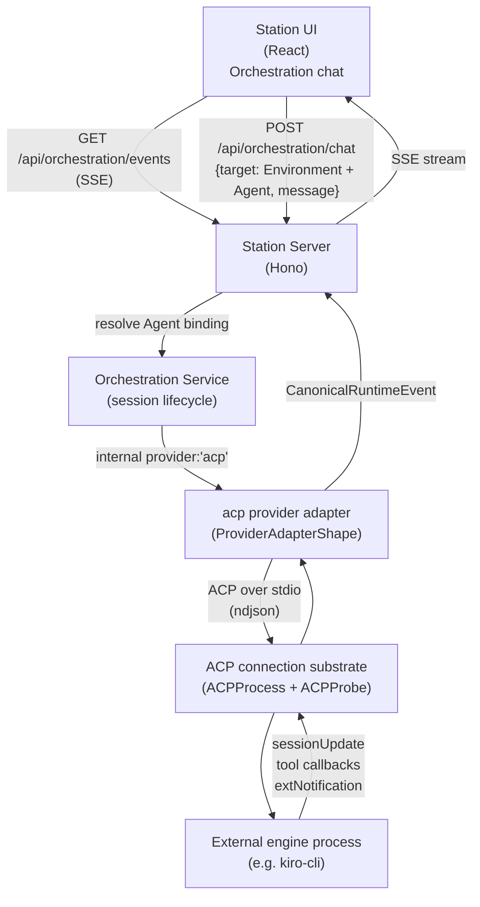

# Agent Communication Protocol (ACP) Guide

ACP is a **connection method** for [External agents](../glossary.md) — it lets Station drive an external agent app (like `kiro-cli`) as a subprocess over stdio, the same way it drives Claude Code or Codex over their native SDKs. ACP is not a separate agent type; it is just *how* Station is wired to that Agent app connection.

This guide is for developers who want to connect their own external engine to Station.

---

## What is ACP?

Station is a UI and session-management layer. It handles conversations, memory, tool approval, and streaming responses. ACP is the protocol that lets an external engine plug into all of that as an Agent app connection.

When an ACP connection is active, Station:
- Spawns the external engine process (or connects to one)
- Translates ACP protocol events into Station's canonical runtime event contract
- Exposes each connection as one External agent in the agent registry
- Proxies tool calls, file system access, and terminal execution through the bridge
- Persists orchestration session/turn events through the same pipeline every
  other provider uses (see [docs/reference/session-api.md](../reference/session-api.md))
  — not the retired `.station/agents/` conversation-record path (see
  [ACP adapter cutover](../adr/0008-drive-acp-through-the-canonical-adapter-seam.md))

The external engine only needs to implement the [Agent Client Protocol SDK](https://github.com/agentclientprotocol/sdk). For a chat turn it never talks to Station's HTTP API directly.

One deliberate exception exists, and only for a runtime that opts into it by
advertising `mcpCapabilities.http` at `initialize`: Station may hand that
runtime a `type: 'http'` MCP server entry pointing at Station's own
loopback `station-control` MCP endpoint, which the runtime then connects to
itself. See
[Station-control over HTTP MCP](#station-control-over-http-mcp) below — it is
one named, credentialed, loopback-only endpoint, not general access to
Station's API.

---

## Architecture



There is no `.station/agents/` write path in this pipeline — that was the
pre-cutover chat-SSE substrate's persistence, retired (see
[ACP adapter cutover](../adr/0008-drive-acp-through-the-canonical-adapter-seam.md)). Orchestration session/turn
events are persisted through the orchestration event store instead, replayed
via `GET /api/orchestration/sessions/:threadId/events` (see
[docs/reference/session-api.md](../reference/session-api.md)).

ACP chats use the orchestration Session/event pipeline. The UI sends an
Environment + Agent target, the server resolves the persisted Agent's ACP
binding, and `src-server/providers/adapters/acp-adapter.ts` drives the external
process using the ACP SDK. Supported protocol updates become canonical events
for shared chat rendering. The publication path can reject or coalesce updates;
persisted history is not a recording of every raw protocol emission.

The connection-management substrate — `ACPProbe`, `ACPProcess`, `createACPBridgeClient`, and `ACPManager`'s probe-backed status/lifecycle tracking — is unchanged from before this cutover and is reused directly by the adapter. It is what backs the Connections Hub (`/acp/status`, `/acp/connections`, `/acp/registry`) and periodic availability probing; it is unrelated to how a chat turn is executed.

---

## Sessions

### Creation

When Station resolves a new execution for an ACP-bound Agent, the adapter:

1. Receives the server-resolved ACP connection binding (the raw connection id never comes from the UI request)
2. Spawns the configured command as a subprocess via `ACPProcess`
3. Calls `connection.initialize()` with `clientCapabilities` (fs read/write, terminal)
4. For a fresh start, calls `connection.newSession()`. A restored Session uses
   its persisted resume cursor only after validating the connection identity
   and execution fingerprint, and that the engine advertises a way to
   reattach. When the engine advertises `sessionCapabilities.resume`, the
   adapter calls `session/resume`, which restores the native session without
   replaying it. It falls back to `connection.loadSession()` when `resume` is
   not advertised, or when the engine answers it with method-not-found and
   advertises `loadSession`. Any other resume failure fails the start rather
   than loading: the fallback is closed, so an unexplained resume failure is
   reported instead of hidden behind a replayed load.
   On `session/load`, ACP has the agent replay the whole conversation as
   `session/update` notifications before it answers. Station already stored
   that history, so while the session reattaches the adapter does not publish
   message, thought, tool or plan updates; commands, mode, config and usage
   updates still apply. A turn sent before the start finishes waits for it
   (up to 15 seconds, before orchestration takes the thread's turn-start
   claim, so Stop is never held behind it) instead of racing it. A Stop or
   an explicit cancel ends the wait with nothing sent. Past the wait it is
   refused with the retryable code `provider_session_starting`, which the
   client queues and re-sends. If the start fails, the send is refused with
   `provider_session_start_failed` and stays queued with a Retry.
   Station's restore eligibility upstream of the adapter still requires
   `loadSession` (`src-server/runtime/bootstrap/acp-resume-cursor-support.ts`).

`OrchestrationService` reconstructs the start input with `existing.resumeCursor`
when it must re-establish an adapter Session. A malformed cursor, changed
connection fingerprint, or unsupported loading capability refuses restoration.
It never silently substitutes a fresh native session with empty engine context.
See `src-server/providers/adapters/acp-adapter.ts` and
`src-server/services/orchestration/orchestration-service.ts`.

### Connection Lifecycle (Connections Hub)

Independently of any chat session, each configured connection is periodically probed for availability by spawning a short-lived subprocess, completing `initialize` and opening a session to read its modes and config options, then tearing it down. This is what backs the Connections Hub UI and `GET /acp/status`, and is unaffected by chat activity.

The probe does not leave a new stored session behind on each run (#3411). Agents that persist sessions would otherwise collect one per probe, about 240 a day per connection. If the agent advertises `session/delete`, the probe deletes its session after reading it. Otherwise, if it advertises `session/resume` or `loadSession`, the background sweep reattaches to the session the probe created earlier.

A reattached session can answer from its own stored state rather than the agent's current defaults. Grok Build, for example, reports the model and reasoning effort saved in the session. The probe therefore mints a fresh session, and reattaches to that one from then on, in four cases: every user-initiated probe (Reconnect, a connection edit, a provider change), a change in the agent name or version reported at `initialize`, a retained session six hours old, and a Station restart or connection re-registration. A changed default can therefore show up to six hours late unless the user presses Reconnect.

Stored sessions now grow by a few a day per connection instead of one per probe. Reattaching still writes to the agent's store: Grok appends about 670 bytes to the session's update log per resume, roughly 160 KB a day per connection, compared with about 30 MB a day before. An agent that advertises none of these methods still gets a new session on every probe, and Station logs a warning once per connection. `session/close` is not used, because it frees runtime resources and does not remove the stored session. Station does not delete sessions that leaked before this change; remove them with the agent's own tooling. The owner is `src-server/services/acp/acp-probe-session.ts`.

| Status | Meaning |
|---|---|
| `available` | Last probe succeeded — command found, handshake completed |
| `unavailable` | Last probe failed (command not found, handshake error, etc.) |
| `probing` | No probe has completed yet (first probe still in flight) |

## Agent List

Each configured ACP engine connection owns **one persisted default Agent** in the picker, not one per mode. For a connection configured with `id: "kiro"`, both the `EngineConnectionId` and its distinct `AgentId` have the clean text value `kiro`.

This is a deliberate, adapter-inherited scope reduction: per-mode virtual agents (the previous `{connectionId}-{modeId}` slug shape, e.g. `kiro-chat` / `kiro-agent`) could not be routed through the orchestration seam regardless of slug format, so collapsing to one agent per connection is the shape the adapter can serve today.

Advertised session modes are honored on that one agent (station#1945). `ProviderSessionStartInput`/`ProviderSendTurnInput` carry the requested id as `modelOptions.mode`. The adapter prefers `session/set_config_option` when the fresh session advertised a `category: "mode"` config option, and otherwise calls `session/set_mode`. Ids and labels are whatever the agent advertised — Station does not map them onto `ask`/`auto`/`never`. The composer shows that advertised picker, captioned Mode, when the connection has modes, and shows nothing when it advertised none. It sits beside the approval control, not in place of it: OpenCode's `build` and `plan` are agents, a choice separate from how much asks ([which side decides](#which-side-decides-which-calls-ask)). Remaining permission-policy gaps (engines that never advertise modes, ACP v2 dropping `session/set_mode`, `_meta.permission`) are tracked in station#1944.

The current Agent catalog reports `engineId`, `engineDisplayName` and
`engineConnectionType` for engine grouping and connection-method display. For an
ACP-bound Agent `engineId` is always `acp` and `engineConnectionType` is `acp`,
read from the connection record even when the live inspection fails, so its
icon keeps its initials.
`execution.agentConnectionId` is the persisted binding. The Agent ID remains
independent of how the connection is implemented; do not use a legacy
`source: 'acp'` discriminator. Model choices and image support depend on the
connection's current capability observations, not the name of its default Agent.

Image support is **not** carried on the Agent row. It was, as `supportsAttachments`, but no server code ever wrote that field — the composer read `undefined` and refused every image while the adapter declared `image-input` and built real image `ContentBlock`s (station#3344). It is now derived from two places that are actually written: the connection's `capabilities` (the adapter's own declaration, spread from `ACP_ADAPTER_CAPABILITIES`) and, for the per-connection answer, `capabilityInventory.sessionSurfaces.promptImage` — this connection's live `initialize` handshake reporting `agentCapabilities.promptCapabilities.image`.

Both the chat dock and the ACP chat panel read that handshake answer from the engine connection inventory (`useEngineConnectionsQuery`); the model picker's connection projection does not carry it. A reported `false` refuses images at attach time. Images already in the draft are marked on their chips and block Send until they are removed, and when nothing else can be attached the paperclip explains the refusal when tapped. For OpenCode the selected model's own answer is known when available: after a successful handshake Station reads OpenCode's `models --verbose` listing off the request path (the connection's configured binary, argv only, bounded by a timeout and an output cap, launched as an owned child so its whole process group is killed on timeout, cached per connection, cleared on reconnect or removal, and ignored for a connection whose launch settings changed; a failed refresh keeps the last good answers) and publishes `capabilities.imageInput` on each model option in the runtime catalog. `true` shows no note, `false` refuses images before Send with the model named. Until the handshake has answered, or when it answers yes for an engine whose catalog spans several model providers (OpenCode) while the selected model's own image support is unknown (not listed, or the listing failed), the composer still accepts images but shows a note saying what is unconfirmed (`ComposerImageSupport.caveat` from `resolveComposerImageSupport`, `modelSupportVaries`). The adapter checks again at send time. A send carrying images to an engine whose handshake did not advertise image support, or carrying any non-image file, is refused before anything reaches the engine with `attachment_input_unsupported` (`ATTACHMENT_INPUT_UNSUPPORTED_CODE`). The same send would be refused again, so the chat error offers **Remove attachments** instead of Retry, and the client re-reads the engine inventory so the composer shows the engine's answer.

The default exists independently of probe/readiness state. The Agent row carries explicit availability and reason fields; Station never encodes connection kind into the Agent ID.

---

## Message Flow

Sending a message to an ACP-connected agent is identical, from the UI's perspective, to sending a message to any other External agent:

1. The UI selects the persisted Agent profile. An explicit conversation override can additionally name a receiver-owned default execution Agent; it does not submit engine URLs or credentials.
2. The UI posts the profile and any explicit execution binding through `POST /api/orchestration/chat`; the server resolves and validates that binding and supplies the ACP adapter with its connection ID — see [`docs/reference/session-api.md`](../reference/session-api.md).
3. A later turn uses the bound continuation endpoint. The `acp` adapter forwards it to the runtime via `connection.prompt()`.
4. The runtime's ACP session-update and extension notifications are translated by the adapter into [Canonical runtime events](../glossary.md) and streamed back over `GET /api/orchestration/events` (SSE), exactly like any other provider.

The chat composer defaults to Queue while a turn runs. Its Steer mode uses a
conservative safe-waiting fallback for ACP connections: the current adapters
provide no confirmed safe execution boundary, so the composer waits for the turn
to finish. Attachments remain in the draft until then. See the
[composer contract](../design/chat-composer.md#turn-activity-and-follow-up-delivery).

An explicit adapter `steerTurn` command can still steer the open turn. Kiro and Grok receive it through their own extension methods. Every other ACP engine, and a native method that returns JSON-RPC -32601, is steered by cancelling the in-flight prompt, including any tool call it was running, and re-prompting on the same turn. That fallback's steer `turn.started` carries `steerInterruptedRun: true`, and the transcript notes under the steer that it was sent by stopping the step that was running. See [queue vs steer](../design/session-tape-replay.md#queue-vs-steer) for every engine's mechanism.

### Canonical Event Vocabulary

There is no bespoke ACP SSE-chunk vocabulary anymore. The adapter emits the same canonical event methods every provider emits — see `packages/contracts/src/runtime-events.ts` (the source of truth for shapes) and `docs/adr/0008-drive-acp-through-the-canonical-adapter-seam.md` for the design rationale. The methods most relevant to ACP sessions:

| Method | Purpose |
|---|---|
| `session.started` / `session.state-changed` / `session.exited` | Session lifecycle |
| `turn.started` / `turn.completed` / `turn.aborted` | Turn lifecycle |
| `content.text-delta` | Streaming text chunk from the agent |
| `content.reasoning-delta` | Streaming thought/reasoning chunk |
| `tool.started` / `tool.progress` / `tool.completed` | Tool execution |
| `request.opened` / `request.resolved` | Tool approval / permission requests |
| `plan.updated` | The agent's current ordered plan, as a full replace (see Plan Rendering below) |
| `extension.notification` | Namespaced, app-specific payload (see Extension Rendering below) |
| `runtime.error` / `runtime.warning` | Unrecoverable or recoverable error/warning |

Do not re-document per-field shapes here — read them from the contract file directly so this guide cannot drift out of sync with the code again.

### Plan Rendering

`plan.updated` events carry the agent's full, ordered plan (`entries: { content, status }[]`, a full replace, not a delta — mirroring ACP's own `plan` session-update shape without leaking ACP vocabulary into the canonical contract). Station feeds these events directly into the existing typed Plan surface: the CodingLayout's "Plan" inspector tab renders `ChatUIState.planArtifact`, which `plan.updated` populates with `source: 'canonical'` steps (no regex/heuristic text parsing — the entries are structured data end to end). A later `content.text-delta`/`content.reasoning-delta` event does not clobber a typed plan artifact with plain prose, and neither does the turn completing (a plan sent mid-turn, before the answer is committed, stays on the surface); the heuristic parser used by other providers only fills in when no typed artifact is already present.

### Extension Rendering

`extension.notification` events carry a namespaced, app-specific payload the canonical contract does not interpret (`namespace`, `type`, `payload: unknown` — ADR-0008: the canonical contract carries no app-specific semantics). For ACP/Kiro, Station renders two functional cases from Kiro's `_kiro.dev` namespace as ephemeral system messages in the transcript:

- `_kiro.dev/mcp/oauth_request` → a clickable **Open authentication page** link to the supplied URL when an MCP server the engine depends on needs the user to sign in.
- `_kiro.dev/compaction/status` / `_kiro.dev/clear/status` → a plain status line (`"Context compacted."` / `"History cleared."`).

Cursor's `cursor/update_todos` notification is not rendered as a message: the adapter folds its todo list (`merge: true` updates entries by id, `merge: false` replaces the list) into the same typed Plan surface as `plan.updated`. Station's plan has no cancelled state, so a cancelled todo is left off the plan. A malformed or oversized update (over 200 todos, or 256 KiB of JSON) leaves the plan as it was. The binding's evidence is Cursor's published ACP contract (cursor.com/docs/cli/acp), not a live observation.

Within this ACP/Kiro transcript branch, other notifications are transcript no-ops unless the exact shared binding table assigns a handler. Other engines have separate evidenced bindings, including Claude Code API retry activity and the context-compaction and rewind markers attached-session sources record (drawn by the transcript projection as a quiet line, not an ephemeral message); namespace similarity never grants those semantics. A separate, narrower mechanism (below) does read one more shape of extension notification, but not to render it — only to enrich a later, otherwise-generic turn failure.

### Turn-failure enrichment from a co-reported notification

station#4084: a rejected `prompt()` can surface as a bare, uninformative error — a JSON-RPC `-32603` resolves to the literal string `"Internal error"` with no detail. Live evidence (kiro-cli, station#1860 verification): the engine had already sent `_kiro.dev/error/rate_limit` with `{ message: "The monthly usage limit has been reached" }` milliseconds earlier in the same turn, and that message was silently dropped.

The adapter retains an extension notification for this purpose only when it is bound to the `acp.turn-error-cause` consumer in the same **exact-tuple, evidence-backed registry** every other extension-notification behavior is driven from (`src-shared/extension-notification-bindings.ts`; see [Extension Rendering](#extension-rendering) above — "namespace similarity is never authority" is that registry's own rule, not a special case for this feature). Today that registry has exactly one such tuple: `_kiro.dev/error/rate_limit`. A structurally similar but unobserved tuple — a different `_kiro.dev/error/*` code, or an analogous notification from a different vendor — is **not** matched until it is itself observed and added with its own evidence, the same discipline `commands/available`/`oauth_request`/`compaction`/`clear` already follow. Sibling Kiro extensions that only carry an opaque `error: unknown` (e.g. `_kiro.dev/mcp/server_init_failure`, `_kiro.dev/agent/config_error`) were never candidates: there is no human-readable text to quote, exact tuple or not. The payload is still null-checked before its `message` field is read — a notification's `params` are not validated by the JSON-RPC layer, so a malformed or missing payload is treated as "no message," never as a crash or a fabricated cause.

Retention is also **suppressed** for a turn that starts while any interrupted (`interruptTurn`) prompt from this session has not yet settled. Extension notifications carry no turn id, so a notification arriving after a cancel cannot be proven to belong to the turn that is active when it arrives, or to the one that was just cancelled.

- **Decided once, when the turn starts.** If any interrupted-but-unsettled prompt exists for the session at the instant a turn starts, that turn's entire retention window is suppressed for its full duration. It is a snapshot, not re-checked per notification. A live per-notification check would let suppression lapse mid-window: the cancelled prompt's settlement handler deletes its bookkeeping entry as soon as that prompt settles (only so the bookkeeping set does not grow without bound), and that deletion can land partway through a *later* turn's window. A notification delivered after it would then read as unquarantined, although its provenance is exactly as ambiguous as one delivered before it.
- **Only enrichment is withheld.** The ordinary `extension.notification` transcript event still fires. Retention is withheld only for the turns whose provenance was ambiguous when they started; nothing blocks the user from starting such a turn, and a later turn, begun once the ambiguity has cleared, retains normally.
- **Bounded.** Retention is capped at the last few notifications per turn, so a turn that never settles cannot grow the tracked list without bound.

If the turn then fails, the adapter's `runtime.error` message is enriched with the most recently retained notification's message, framed as **co-occurrence, not causation**: `"<original error> — engine also reported during this turn: <notification message>"`. Station observed the two events in the same turn window; it did not verify that the notification caused the failure, and the wording says exactly that. This mirrors the credential-refusal `runtime.warning` mechanism above — track what was actually received, then say so — rather than inventing a parallel path: nothing here is synthesized. A bare `-32603` with no prior bound notification in that turn's window still reports the generic error unchanged. The tracked notification list is reset to empty at the start of every turn and explicitly cleared again when a turn resolves — succeeds or fails. It is deliberately NOT cleared when a turn is interrupted: an interrupted turn's stray notifications are simply overwritten by the next turn's own start-of-turn reset, and the interrupted turn's suppression-snapshot mechanism above (not this list) is what stops a late one from being read in the meantime — so a notification never enriches a turn it wasn't received during.

### Inbound extension requests (agent → Station)

An agent may also send **extension requests** to Station over the same
mechanism. Station's answer is a spec-conformant refusal:

| Inbound | Station's response |
|---|---|
| `cursor/ask_question`, `cursor/create_plan` (chat sessions only) | Answered with what a person decided; see [Cursor's blocking requests](#cursors-blocking-requests) |
| Unrecognized extension **request** | JSON-RPC `-32601` (Method not found), plus a `warn` log naming the method and a `station.acp.inbound_extension_requests` increment |
| Unrecognized extension **notification** | Ignored (per spec) |
| A request naming a token or credential | `-32601`, always — see below |

The policy lives in `src-server/services/acp/acp-inbound-extension-policy.ts`
and is wired into both the chat adapter and the availability probe. There is
no default answer: **Station never returns a value it did not compute.** The
previous behavior (`onExtMethod: () => ({})`) replied to every inbound
extension request with an empty JSON-RPC *success*, which an agent reads as
"handled."

**No-credential-bridging invariant.** Station never answers an agent's
token/credential request. What enforces it, most load-bearing first:

1. **The allowlist is a reviewed table** (`REVIEWED_INBOUND_EXTENSION_REQUESTS`),
   and extending it takes a reviewed code change. Its entries are requests
   addressed to a person, answered with that person's decision.
2. **Each call site owns a private registry** (one per session, one per
   connection) that no other code holds a reference to, so nothing can add a
   handler at runtime. Pinned by test.
3. **A credential-name tripwire**: `AcpInboundExtensionRegistry.register()`
   throws for a credential-shaped method name and `resolve()` re-checks at
   dispatch.

(3) is a **tripwire on the obvious vocabulary, not a proof of
completeness** — it misses `_vendor/session/refresh`, `_vendor/getAPIToken`
(the camelCase splitter breaks at `t|A`), non-English names, and
`_x/session/bootstrap`, which could return a credential without naming one.
It can only ever *deny*, never grant, so over-matching is free and
under-matching costs nothing while (1) holds. Do not read it as the
guarantee; (1) and (2) are.

Live motivation — this is a user-visible bug fix, not hygiene.
`_kiro/auth/getAccessToken` is Kiro's **host-mediated token-refresh
callback**: in ACP mode Kiro asks the *client* for a fresh access token
instead of re-reading its own still-valid on-disk credential
(kirodotdev/Kiro#10416). Under `--agent-engine v3` it asks eagerly, before
answering `initialize`; under the default engine it asks lazily, **on
expiry** — so a long Station chat previously received `{}` *as its refreshed
token* and then failed downstream in a confusing way.

Station holds `STATION_INTERNAL_API_TOKEN` and model-connection credentials
in the same process; an external agent is a less-trusted principal. And
Station holds no credential belonging to an engine at all: **Station does
not become an engine's auth host.** Answering that request is not a feature
to be added carefully — it is the thing that cannot be built.

After refusing the credential callback on the wire, the adapter attempts at
most one bounded re-establishment from its own validated resume cursor. It
requires the same connection/fingerprint and live `loadSession` support; it
does not read, refresh, or forward an engine credential. A missing safe cursor,
failed recovery, or repeated refusal falls back to one `runtime.warning` per
session per method (`code: acp.credential-request-refused`) telling the user
to sign in with the engine's own CLI and start a new chat, since a fresh
engine process re-reads the saved credential. It surfaces as a **5-second
toast plus a session-diagnostics row** — not a transcript message — so the
body is kept short and the method/connection ride `details`. The message
names that cause as *typical* and never asserts a diagnosis Station did not
compute.

### Measured effect of the refusal (live, `kiro-cli 2.16.0`, 2026-08-03)

This dated observation is retained as history, not qualification of a current
CLI release. `initialize` and `session/new` were driven against a real `kiro-cli` with
the client answering each way:

| engine | inbound ext requests | old `{}` | `-32601` refusal |
|---|---|---|---|
| default (`v2`) | **none** | initialize OK, session/new OK | initialize OK, **session/new OK** |
| `--agent-engine v3` | auth callback + `_kiro/terminal/shell_type` | initialize OK, session/new OK | initialize OK, **session/new FAILS** |

Two things follow, and both matter more than the intuition they replace:

- **Refusing the credential callback is survivable.** `initialize` completes
  fine after `_kiro/auth/getAccessToken` gets `-32601`.
- **What breaks `v3` is `_kiro/terminal/shell_type`** — an ordinary,
  non-credential extension request. Kiro propagates the client's `-32601`
  for it as the failure of the entire `session/new`. Station declares
  `terminal: true`, so Kiro is asking a follow-up about a capability
  Station really does advertise; Station has no contract for the response
  shape, and guessing one would be the fabrication this policy exists to
  remove. Tracked as a follow-up, where a reviewed allowlist entry is the
  correct home for it once the shape is known.

The default path is unaffected. `--agent-engine v3` is opt-in and cannot
start a session under this policy; that is disclosed rather than papered
over, and the probe and the chat path now agree — both fail, which is true.

Answering any inbound extension method at all requires a reviewed registry
entry. The only entries are Cursor's two blocking requests, below.

### Cursor's blocking requests

Cursor sends `cursor/ask_question` and `cursor/create_plan` to the client and
waits for the answer (cursor.com/docs/cli/acp). Cursor does not declare them at
`initialize` (checked against `cursor-agent` 2026.05.01), so the reviewed
table keys them by exact method name. Only the chat adapter registers them;
the availability probe has no person to ask and refuses them like any other
request. Any ACP engine may send them, so every label names the connection
that did (its display name), never Cursor. Every answer uses Cursor's
documented nested `outcome` shape.

| Request | What the person sees | Answers |
|---|---|---|
| `cursor/ask_question` | The harness-question form (`station.input-request/v1`, source `harness:cursor`), one choice or multi-choice field per question | `answered` with the chosen option ids; `skipped` when declined; `cancelled` when the prompt ends, the turn is interrupted, the engine exits or the session stops |
| `cursor/create_plan` | A plan-review form: the plan's name, overview, Markdown and todos (each phase's todos listed under the phase name) as its message, rendered as Markdown without raw HTML, and one Approve/Reject choice. When that is longer than one form message (8000 characters), the todo list becomes a count; only if the plan text alone is still too long is it cut, with a note saying how many characters were left out | `accepted` on Approve, then the todos replace the Session's plan; `rejected` on Reject or decline, with the plan left as it was; `cancelled` as above |

Both forms are published under their method name, so no surface offers a
session grant, and the approval inbox card offers no Allow/Deny decision: a
form is answered on its own card, from the Session.

A session with nobody to ask (a delegated child that may not ask a person) is
answered at once, never left waiting: the question `skipped`, the plan
`rejected`. A request Station cannot show (malformed, over 256 KiB of JSON,
over 16 questions or 32 options per question, an option id that is blank or
repeated, over 200 todos including phases) gets the same refusal outcome, a `warn` log and a
`runtime.warning` (`acp.extension-request-unreadable`). Accepting a plan
answers the request only: Station does not switch the engine out of plan mode
or send a follow-up prompt, so the Approve option says "Station doesn't resume
<engine> after approval; send a message to continue." Notifications name the
connection: "<engine> asked a question." or "<engine> wants you to review a
plan: <name>".

**Error codes are emitted, never inferred.** Station emits `-32601` because
the spec says so, and derives nothing from the codes it *receives*: the
convention is not reliably observed in the wild (one vendor answers `-32603`
with vendor-internal detail for unknown methods; an older build of the same
binary answers `-32601` to everything, including its own documented methods).
See `docs/adr/0013-bind-agent-extensions-to-the-declared-mechanism-not-method-names.md`.

---

## Tool Execution

### Tool Calls (Runtime → Station)

When the runtime invokes a tool, the adapter translates the ACP `tool_call` session update into a `tool.started` canonical event, and subsequent `tool_call_update` notifications into `tool.progress`/`tool.completed` events — rendered by the same tool-activity UI every provider uses.

The ACP `kind` the runtime reports (`read`, `edit`, `execute`, `search`, …) rides those events as `toolKind` and is kept across an update that omits it, so the terminal still says what the call was; a value outside the ACP vocabulary is dropped rather than coerced. The chat classifies a row by that kind first. A runtime that reports no programmatic `name` has its human `title` published as `toolName` — for OpenCode's shell tool the whole command line — and the chat shows such a title as written, never humanizing it the way it does an identifier-style name like `shell_exec`.

### Tool Approval (Runtime → User)

When the runtime needs permission before running a tool, it calls back via `requestPermission`. Station's staged policy, the Agent's `autoApprove` patterns and a session grant can answer a plain call first; none of them, an approval-guardian allow included, answers a plan exit ([delivery boundary](../conformance/tool-policy-delivery.md)). Otherwise the adapter emits a `request.opened` canonical event (`requestType: 'approval'`, carrying the call's `toolCallId`, `rawInput` and ACP `toolKind`), the UI shows the approval prompt, and the resolved decision is sent back to the runtime via `respondToRequest` on the adapter, mapped to the offered ACP option: `allow_once`, `allow_always` for the session grant, or `reject_once`. When the runtime reports the call's programmatic `name`, the request carries it as `toolName`, Station records its session grant under that name (every later call of that tool is allowed without asking), and the button names it ("Allow write for this session"). Without a name Station records no grant of its own: the decision is the runtime's `allow_always` rule, and the button says only "Allow for this session".

#### Which side decides which calls ask

ACP standardizes how a client answers `session/request_permission`, not which calls must reach it: each engine decides that from its own configuration. So Station's approval mode governs an ACP engine only where Station can set that configuration. Which side decides is a property of the connection (`acpApprovalControl` in `@kontourai/station-contracts/engine-capability-matrix`), read from the command it launches.

**OpenCode (`station`).** A connection whose command is the `opencode` executable (any directory; a wrapper such as `npx opencode-ai` is not recognized) is governed by Station once Station applies an approval mode to the chat. Until then it is left on its own configuration, as Claude Code and Codex are: while a chat is at Default with no Agent or Station default and Station has set no mode on it, the server sends none, OpenCode launches without Station's rules, and your OpenCode permission settings decide (including `"permission": "allow"`). The approval sheet says so ("Uses OpenCode's own permission settings until you pick a mode here"), and the chip reports no applied mode.

When Station applies a mode (a pick, or an Agent or Station default at start), OpenCode runs with `OPENCODE_CONFIG_CONTENT` carrying rules for its agents ([launch configuration](../../src-server/services/acp/opencode-approval-launch.ts)), in one of two floors:

- **Ask, Auto, and full access confined to Auto.** `bash`, `edit`, `webfetch`, `websearch`, `codesearch`, `external_directory` (any path outside the project) and every MCP tool ask before they run. Reads are left to OpenCode's defaults and your own rules; OpenCode asks before reading a `.env` file. `task` is denied, so no subagent starts: OpenCode never forwards a child session's permission request over ACP (a child that asked would wait forever), so a subagent can run only where nothing it does can ask.
- **Full access in a `host` session.** Everything is allowed, so nothing asks. `task` may start OpenCode's built-in `general` and `explore` subagents, whose rules are restated so they cannot ask either: `general` allows everything except `question` (a question asks a person) and any subagent but `explore`, `explore` keeps its read-only limits with each tool it has allowed, and `external_directory` is allowed on the parent because a child inherits that rule. Your own subagents stay denied, because their rules could ask.
- In both, `plan` keeps edits denied (except a plan file under `.opencode/plans/`), and only the built-in `explore` subagent is open to it under full access, as OpenCode's own `plan` allows.
- In both, `default_agent` is pinned to `build`, and a governed session runs only `build` or `plan`. Your own primary agents (and a project's `default_agent`) keep their own rules, so the Mode picker offers only `build` and `plan` while Station governs (once OpenCode reports running a Station mode; before that it lists every agent), the server refuses the others, and refuses to take over a chat that is running one, naming the agent. Pick Default to use them on OpenCode's own settings.

The value is merged into any `OPENCODE_CONFIG_CONTENT` Station itself was started with (an unquoted `{env:NAME}` in it is substituted first, as OpenCode does; an unquoted `{file:…}` still refuses the launch), and OpenCode still loads your configuration files.

OpenCode evaluates an agent's rules last-match-wins in key order and merges inline content over your files key by key, so a key you already have keeps your position: with `{"edit": "allow", "*": "allow"}` in your `agent.build.permission`, a plain `edit: ask` from Station would be overridden by your later `*`. Station therefore writes each rule under the permission's name with its last character as `?` (`bas?`, `edi?`, `tas?`), which OpenCode's wildcard matches against that one name and which is a key you do not already hold, so it lands after yours. The MCP rule is written under `*_**`, which matches the same names as `*_*` (an MCP tool is `<server>_<tool>`), so your own `*_*` or `github_*` allow does not land after it.

That is not relied on. Before Station claims to govern, at a start with a mode and at a takeover, it reads the rules OpenCode actually resolved for each agent it covers, with `opencode debug agent <name>` in the session's environment and directory ([verification](../../src-server/services/acp/opencode-approval-verify.ts)), and checks them per permission over every request pattern: below full access nothing it governs may resolve to allow (for MCP tools, no allow evaluated after Station's MCP rule whose pattern can match a `<server>_<tool>` name), and no subagent may start; at full access only `general` and `explore` may start, and nothing they can do may ask. The check models OpenCode's wildcard matching, and does not rely on that model alone: OpenCode hides a tool whose last matching rule denies it, so below full access Station also requires `debug agent` to report `task` (shown by default) hidden under its `tas?` deny. An agent whose own rules deny `task` shows nothing about Station's key and is not counted; if neither `build` nor `plan` can show it (for example a global `"task": "deny"`), Station does not govern. An OpenCode that reads the key otherwise is not governed, whatever its version. Nothing is observed at full access, where Station hides no tool OpenCode shows by default; a misread key there can only leave OpenCode's own stricter rules in force. If the rules are not effective (your own rules evaluated later, an organisation's managed configuration, or a binary that ignores inline content or cannot report them), Station does not govern: a start is refused, and a takeover is refused with the turn, each with the code `acp_approval_governance_refused` (no Retry is offered) and naming the cause (for example "your OpenCode configuration overrides Station's approval rules for bash in the build agent (it would run without asking)"). The start check runs before Station claims the start, so a refused start is reported as not started, never as a start that may have happened. The refusal then says what Default would do in this chat: keep OpenCode on its own settings, or, where an Agent or Station default is set or Station already applied its rules in the chat, apply a mode that needs the same change. A refused mode is not counted as applied, so after a refused first pick Default still means OpenCode's own settings. The reads add about a second per agent to such a start or takeover.

Station answers each request that does arrive by the chat's approval mode ([answer rules](../../src-server/providers/adapters/acp-approval-mode.ts)):

| Approval mode | What Station does with a request |
|---|---|
| Default, before Station takes over | Shows it to a person; your OpenCode rules decided it should ask |
| Ask | Shows it to a person |
| Auto | Allows a file edit (ACP kind `edit`); shows anything else to a person |
| Full access | Allows it (on the full-access floor nothing asks). In a session that is not `host`-confined, applies Auto instead: an ACP engine has no process sandbox |
| Default, after Station took over | Ask, reported as "Ask — Ask first", as on other engines (`resolveDefaultPick`). For OpenCode this survives the engine exiting (an idle park, a crash): the takeover is read from the engine's own durable report that it ran a Station mode, not only from memory, so a respawned OpenCode is not silently handed back to its own settings. The chip learns the applied mode from the engine's reports, which a reloaded page has not seen yet: until the next turn starts, it reads "Engine default — OpenCode's own settings" there while the server applies Ask |

A pick takes effect from the next turn, like every engine's: it is recorded as a `session.approval-mode-set` decision and reaches the adapter with that turn. Moving between Ask and Auto needs no restart. OpenCode reads its rules only at launch, so Station's first mode on a chat, and every move into or out of full access, relaunches OpenCode and resumes the same ACP session in the new process: `session/resume` when the engine advertises it (OpenCode does; no history is replayed), otherwise `session/load` with its replay dropped. The new process is started and the session resumed in it first, while the old process keeps running (two `opencode acp` processes can hold one session at once); only after the resume succeeds does the new process take over and the old one stop. The session's Mode (`build`/`plan`) and model are then re-applied if the resumed session reports others, so the conversation, Mode and model carry over.

If the switch fails (Station's rules are not effective, the chat runs your own agent, the engine cannot resume the session, refuses or fails the resume, or start plus resume outlasts the 60-second cold-start bound an engine probe already allows), the new process is discarded and the chat keeps its old one. A notice says what happened and why (`runtime.warning` code `acp-approval-takeover-failed`, for example "Couldn't switch OpenCode to Station's approval rules; it's still using its own settings: …"), and the chip marks the pick not applied ("Own settings", or "Ask · kept"). A turn runs only under rules at least as strict as the pick:

- From OpenCode's own settings, the turn is refused: those settings are not known to be as strict as the pick (OpenCode's defaults allow shell commands and edits). Pick Default to keep going on them (the refusal says so only where Default would).
- From full access toward a stricter mode, the turn is refused rather than run with full access.
- From Ask or Auto toward full access, the turn runs at the stricter mode it already had, and its `turn.started` carries `approvalTakeoverFailed`.

The recorded pick stays the conversation's decision, so the next turn tries the switch again. Authored policy (`autoApprove`, the staged evaluator, session grants) still runs first, and a plan exit or a question still goes to a person. A rule OpenCode itself denies never reaches Station, so no approval mode can allow it.

The `build`/`plan` agents are overridden in place rather than given approval copies selected through `session/set_config_option`: OpenCode attaches plan behaviour to the agent named `plan` (its plan-mode reminder, and `plan_exit` switching to the agent named `build`), so a renamed copy would lose plan mode.

**Every other ACP engine (`engine`).** Station has no channel into its permission rules. It answers the requests the engine chooses to send, but it cannot make the engine ask for others. Such a connection gets no approval mode: the server sends none, a `setApprovalMode` is refused with "This engine has no approval control.", a carried `approvalMode` is refused as an unsupported option, and the composer's approval control reads "Set by engine" and explains that the engine decides. An engine whose own modes are approval levels (claude-code-acp advertises `default`, `acceptEdits`, `plan`, `auto` and, when allowed, `bypassPermissions`) is changed through its Mode picker; Station does not map those modes onto its own, and a full-access mode is withheld outside a `host` session (#2569).

A permission request belongs to the prompt that raised it. When `session/prompt` settles while one is still open — the turn completed or failed without waiting for the answer — the adapter settles it as `cancelled` (`request.resolved`) before the turn's terminal, the same way an interrupt does, so no approval surface keeps offering a decision nothing will read.

### File System and Terminal Tools (Station → Runtime)

The adapter reuses `createACPBridgeClient`'s file-system and terminal callback handlers unchanged, so the runtime can read/write files and spawn subprocesses on the Station host exactly as before this cutover.

### Station-control over HTTP MCP

Station's built-in `station-control` MCP server is what lets the built-in
assistant operate Station itself (list agents, read config, and so on). It is
normally a child process Station spawns, authenticated with a process-local
env credential — a mechanism that cannot cross to an external agent app,
because an ACP `session/new` payload is handed to that app rather than
confined to a Station-spawned child.

Since station#1684 Station can deliver it to an ACP-connected external engine instead, over
HTTP. The rules, in full:

- **Whole integrations only.** Authored individual-tool selection or integration
  disablement cannot be enforced through this protocol. Station reports the
  restricted integration as undelivered (`engine-unsupported`) instead of
  widening its selection.

- **Gated on the live handshake.** Station delivers it only when *this*
  connection's `initialize` result advertises
  `agentCapabilities.mcpCapabilities.http === true`. There is no static
  per-CLI allowlist; the answer is read from your own handshake every
  session.
- **Delivered as an ordinary ACP MCP server entry.** It arrives in
  `session/new` (and `session/load`) `mcpServers` as
  `{ type: 'http', name: 'station-control', url, headers }`. Your runtime
  connects to it with an MCP HTTP client, exactly as it would any other HTTP
  MCP server. Nothing ACP-specific is required beyond supporting the
  transport.
- **`Authorization: Bearer <token>`.** The credential is in the header list,
  never in the URL — the URL carries no token at all. Present the header on
  every request to that endpoint.
- **Per session, and short-lived in a specific sense: 12 hours.** The token is
  scoped to one Station session, revoked when that session stops or fails to
  start, and otherwise expires 12 hours after it was minted. It is not a
  Station API key: it authorizes opening that one MCP endpoint and nothing
  else.
- **Loopback only.** The URL is always `http://127.0.0.1:<station-port>` —
  the runtime reaches it as a process on the same host, never remotely.
- **No retry if the capability is absent.** A runtime that does not advertise
  `mcpCapabilities.http` simply does not receive the entry. Station does not
  fall back to spawning the server over stdio, does not re-issue
  `session/new` with a narrower payload, and does not fail the session — the
  chat works, `station-control` is absent, and an
  `engine-capability-absent` receipt records why. Rejecting `session/new`
  because of this entry therefore ends the session start; it is not retried.

Authored (user- or agent-configured) tool servers are unaffected by this and
remain stdio-only. This is one named built-in server on its own reviewed
mechanism, not a general HTTP passthrough channel.

---

## Slash Commands

Slash commands are sent as **plain prompt text** — the adapter's `sendTurn` has no command-dispatch branch. There is no separate extension-namespaced RPC dispatch step anymore; the runtime is responsible for parsing `/command` syntax out of the prompt text itself, the same way any other agent app would.

### Static command listing

A static list of available commands is exposed through the generic, provider-agnostic orchestration route:

```
GET /api/orchestration/providers/acp/commands
```

This calls the adapter's `getCommands()` (`ProviderAdapterShape`), aggregating
commands advertised by Sessions currently held in that adapter, deduplicated
by command name. It is not a durable catalog of every configured connection;
with no held Session it can be empty. The UI's command-autocomplete hook reads
this generic provider surface.

### Accepted gap: per-keystroke argument autocomplete

`ProviderAdapterShape` has no equivalent of the old per-keystroke, per-agent argument-autocomplete endpoint (no `getCommandOptions`-style method exists on the shape). The UI offers no per-keystroke option-fetching for ACP-connected Agents; the static command list is the only ACP command surface. This is an explicitly accepted, adapter-inherited gap — filed as a follow-up, not silently absorbed into the static command list.

---

## Configuration

### acp.json

ACP connections are configured in `<station-home>/config/acp.json`:

```json
{
  "connections": [
    {
      "id": "kiro",
      "name": "Kiro",
      "command": "kiro-cli",
      "args": ["acp"],
      "icon": "🤖",
      "cwd": "/path/to/project",
      "enabled": true
    }
  ]
}
```

| Field | Required | Description |
|---|---|---|
| `id` | ✓ | Clean unique engine-connection identifier; the owned default Agent uses the same text ID in the Agent namespace. It may not be an id a native runtime engine already answers to (such as `codex` or `claude`): `POST /acp/connections` and `POST /acp/registry/:id/install` refuse one with a 400 that names the engine already using it, because engine attribution keys on the connection id and would label the native engine's Agents `acp`. A connection stored with such an id before this check still loads; attribution keeps the native engine for that id and the server logs a warning naming it, so delete that connection and add it again under a different id (an update cannot change a connection's id). |
| `name` | ✓ | Display name shown in the UI. |
| `command` | ✓ | Executable to spawn. Must be on PATH. |
| `args` | | Arguments passed to the command. |
| `icon` | | Emoji or string shown next to the agent name. Defaults to `🔌`. |
| `cwd` | | Working directory for a Session that has no workspace of its own; a Session's own working directory takes precedence. A leading `~` is expanded and a relative path is resolved. When unset, Station prepares a private managed workspace instead of inheriting its own directory. A [station-control dispatch](self-configuring-agent.md#dispatch-authority) with no workspace from an Agent in the global space, or in a Project with no working directory, starts here and is scoped by this directory; an Agent in a Project with a working directory starts it in that Project instead. |
| `enabled` | ✓ | Set to `false` to disable without removing the config. |

### Runtime API

Connections are managed at runtime via the REST API — unchanged by this cutover, since it only manages connection lifecycle, not chat turns:

```
GET    /acp/connections                List all connections with live status
POST   /acp/connections                Add a new connection
PUT    /acp/connections/:id            Update connection configuration and its probe
DELETE /acp/connections/:id            Remove and shut down a connection
POST   /acp/connections/:id/reconnect  Request an availability probe
GET    /acp/status                     Get status of all connections
```

Creating a connection, or changing its `command`, `args` or `cwd`, chooses a
command for Station to run, so a paired device needs the operator's
`coding:exec` grant (the operator in person never does); otherwise the route
answers `403` with `code: 'command-not-granted'` and saves nothing. Renaming or
toggling a connection, listing, removing and reconnecting keep their ordinary
tier. Reconnect only re-probes the stored command and cannot change it.

### SSE Status Events

The `/events` SSE stream replays ACP connection status on connect and emits updates as connections change:

```
event: acp:status
data: {
  "connections": [
    { "id": "kiro", "name": "Kiro", "status": "available", "sessionId": null }
  ],
  "activeSessions": 0
}
```

This is a shortened status example: entries also carry model/config options,
capability observations and, when unavailable, the latest `lastError`. The
probe manager currently supplies `activeSessions: 0`; it does not count the
ACP adapter’s execution Sessions. There is no top-level `connected` boolean.
The `agents:changed` event reports Agent registry changes separately.

---

## Troubleshooting

### Connection stays `unavailable`

Read the connection’s `lastError` first: unavailable can mean a missing command,
a handshake failure, or another probe failure. For a missing binary, verify it
is installed and accessible to the Station process:

```bash
which kiro-cli
```

If the binary is installed but not on the server's PATH, use an absolute path in `command`.

### Probe does not establish availability

Check server logs for `[ACPProcess]` entries and `ACPProbe failed` warnings. Common causes:

- The subprocess exits immediately — run the command manually to see its output
- The runtime doesn't speak ACP ndjson on stdio — verify it implements the ACP SDK server side
- Protocol version mismatch — the adapter sends `PROTOCOL_VERSION` from the ACP SDK; ensure the runtime supports it

### Agent not appearing in the New Chat picker

Every configured connection should surface as one External agent with the same clean ID, even while disabled, unprobed, unavailable, or in error. If it is missing, inspect `config/agent-registry.json` and the connection lifecycle error; probe state should change availability, never Agent existence.

### A previous ACP session cannot be restored

Fresh starts use `newSession`; restoration uses the persisted ACP session ID
and connection fingerprint with `loadSession`. Inspect the refusal when the
CLI does not advertise loading, the cursor is missing/invalid, or the connection
identity changed. Visible Station history alone does not prove that the engine
can restore its private context. Start a new conversation explicitly if safe
restoration is unavailable.

### Refreshing an unavailable connection

Reconnect requests a probe and may join an already-running probe. It does not
restart every chat Session. Background refresh also reprobes stale observations;
status remains `available`, `probing`, or `unavailable`. Read `lastError` and the
server’s `ACPProbe` diagnostics instead of looking for a connection-level
`maxReconnectAttempts` counter or `error` state. The owners are
`src-server/services/acp/acp-manager-orchestration.ts` and
`src-server/services/acp/acp-manager-view.ts`.

### When delegation reports an unavailable ACP connection

A discovered model catalogue does not establish that an ACP engine can accept
work. If `station delegate targets --json` reports an unavailable engine, inspect
its current handshake result with `station acp connections list --json`. Retry
initialization with `station acp connections reconnect <connection-id>` after
addressing the reported failure. A failed reconnect returns an explicit error;
its bounded diagnostic describes the latest attempt. A missing connection
returns not-found.

A new session on a model the engine's fresh `session/new` options did not offer
is refused by the adapter with the `model_not_advertised` code
(`SessionStartRefusedError`). The start is settled rather than uncertain: the
receipt is `rejected`, the thread is not fenced behind "Station may already have
started this session", and a fresh start's session ends with the engine's
refusal as its cause (lifecycle `failed`, which survives a reload). In the chat
composer the
error offers no Retry (the same model is refused again), re-reads the Agent
catalog, the ACP connection list and the engine inventory, because the
composer's snapshot of those is what let the model be chosen, and keeps the
draft: choose another model and send again, and the conversation continues in a
successor session. This is the case where the Agent's engine changed after the
snapshot was taken (the built-in Station Agent re-binds to an external engine
once its ACP handshake completes). The engine is still spawned and handshaked
before it can refuse: Station does not refuse from the connection list's cached
model options, because those come from a probe session that can differ from the
session a start actually creates. A refusal whose process teardown cannot be
confirmed stays an uncertain start.

OpenCode's own model listing and Station's ACP model listing are different
observations. Station obtains model options through its ACP connection. An
initialization timeout can therefore leave Station's model list empty even when
`opencode models` works. Do not treat that listing as a readiness override.
