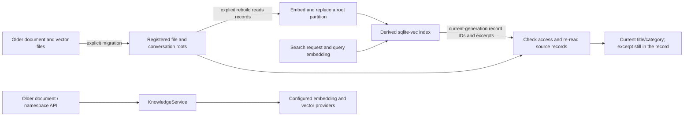

# Knowledge: stores and the retrieval index

Station's knowledge system has two layers. They are separate on purpose, and understanding the
split is the key to everything else in this guide — see
[ADR-0009](../adr/0009-treat-knowledge-stores-as-canonical-and-index-as-derived.md) for the full
rationale ("why sqlite-vec") and [docs/design/knowledge-foundation.md](../design/knowledge-foundation.md)
for the implementation contract.

## Agent tools

Add **Station Knowledge** in an agent’s Tools tab to read and capture records.
The Station role includes it by default. This small MCP contains
`list_knowledge_roots`, `list_knowledge_records`, `get_knowledge_record`,
`add_knowledge_record`, and `search_knowledge`. Search needs an embedding
connection; listing and reading records do not.
The default-off [S3 feature](#experimental-read-only-s3-prefixes) adds
`list_project_s3_sources`, `list_project_s3_objects` and `read_project_s3_object`
when enabled.

Station Control retains index rebuild and migration controls, plus its existing
search tool for compatibility. Capture creates a new raw record and never
replaces a record. A session’s owner must have access to the selected store;
Project writes also require edit access. Personal stores belong to the local
operator. Session-backed conversation stores remain read only.

Claude receives an in-process server. Codex and ACP receive separate,
short-lived Knowledge credentials for the local HTTP endpoint; ACP requires
observed HTTP MCP support. Native agents use a local HTTP connection only
inside an active, authorized turn. Credentials are scoped to the session and
server, and session stop revokes them. HTTP custody does not claim bound
session attribution; capture records its assurance and omits a session ID
unless the connection is bound. Per-tool restrictions retain the engine’s
existing support limits, including ACP’s refusal of individual selections.

The [data tool registrations](../../src-server/tools/station-knowledge-tools.ts)
and [native caller bridge](../../src-server/runtime/mcp/station-knowledge-native-tools.ts)
own these paths.

## Two layers: store vs. index

**Store records are authoritative.** File-backed roots use Station adapters
that implement the Knowledge Kit's published record and file-format contracts.
The default adapter writes Markdown records and indexes; the Obsidian adapter
uses a vault layout. A derived conversation root is different: it reads
Session history rather than owning another set of Markdown records.

Creation assigns a new identity. Station's optional caller-supplied `id` must
also be new: the default and Obsidian adapters refuse an existing ID, including
a retired record, instead of replacing its body, creation provenance, mutation
history, aliases or links. A duplicate create is an invalid input (HTTP 400).
For Obsidian, an index miss alone does not prove that an ID is unused. Creation
checks physical Markdown identities, including archived records, inside the
same file transaction. It refuses unreadable or inconsistent indexed records,
unindexed record-like frontmatter (both `type` and `provenance`), malformed
frontmatter, symlinked or unsupported directory entries, and occupied unindexed
destination paths. These identity checks refuse before publishing the create
and do not repair the path index. The shared transaction owner can still recover
an earlier interrupted write before checking the new request. The current reindex command rebuilds graph/alias indexes
from path-index entries and cannot recover a lost path index.

The physical inspection admits at most 10,000 directory entries, 16 MiB per
Markdown file and 64 MiB of Markdown in total. Exceeding a bound or being unable
to establish identity returns storage-unavailable (HTTP 503), rather than
creating over uncertain data. Ordinary unindexed notes can remain in the vault,
but creation will not overwrite them. These are coordinated transaction checks,
not a lock on edits made outside Station.

After an uncertain create response, read that exact ID and compare the intended
record before deciding what remains to do. Use the adapter's evidence-bearing
update/link operations for an intentional change, not another create request.

**The retrieval index is derived.** The store/index routes use the built-in
`sqlite-vec` provider at `<STATION_HOME>/knowledge-index/index.db`. It stores
vectors, chunk text, metadata, and references to source records. It is a copy
for retrieval, not the authority for record content. Search resolves each hit
through the owning adapter before returning it. It returns the indexed excerpt
only while the re-read record still contains it; an excerpt from an edited
record is withheld until the next rebuild.

Station also retains the older per-Project document/namespace API through
`KnowledgeService`. That service uses configured embedding and vector
providers. It is not the same interface as the store/index routes described
here; the migration section explains how their data is related.

For a concrete example, [browse Station's repository graph](repository-knowledge-graph.md)
or see [the captured Knowledge Library](../learn/walkthroughs.md#explore-repository-knowledge).
That journey uses canonical records and links without an embedding service.

[KnowledgeStoreProvider](../../src-server/knowledge-store/knowledge-store-provider.ts)
owns registered roots and adapters. [Runtime route composition](../../src-server/runtime/routes/runtime-routes.ts)
selects `sqlite-vec` for the store index, while
[KnowledgeService](../../src-server/services/knowledge/knowledge-service.ts)
resolves the older API's providers through injected functions.



The arrows show data flow. They do not imply automatic indexing or that every
caller may read or rebuild every root.

## `./station knowledge reindex` — (re)build the index

Run this any time you want the semantic-search index brought up to date with what's currently in
your knowledge stores — after a bulk import, after editing store files directly outside Station, or
just because you deleted the index file and want it back.

```bash
./station knowledge reindex
```

Rebuilds every registered store root. Example output:

```
Reindexed root root:personal: 42 record(s), 118 chunk(s).
Reindexed root root:project-station: 17 record(s), 53 chunk(s).
Knowledge reindex complete: 2 root(s), 59 record(s), 171 chunk(s).
```

Scope it to a single root with `--root`:

```bash
./station knowledge reindex --root=root:project-station
```

```
Reindexed root root:project-station: 17 record(s), 53 chunk(s).
Knowledge reindex complete: 1 root(s), 17 record(s), 53 chunk(s).
```

Rebuilding is safe to run repeatedly — it always walks the store from scratch and replaces the
root's index partition, so re-running it on an already-current root just re-derives the same
result rather than erroring or double-counting.

### The rebuildability property

Use `reindex` to rebuild from the registered roots with the currently selected
embedder. The provider reads and embeds a root before replacing that root's
rows, so an embedding failure does not first erase the existing partition.
Later write failures can still leave an incomplete rebuild; inspect each
root's result. A multi-root request can return HTTP 200 with some failed roots,
and the CLI prints their failures alongside successful counts. The CLI does
not set a failure exit code solely because some roots failed; inspect the
per-root report rather than treating exit zero as an all-roots success.

The index is rebuildable when its source records and an appropriate embedder
are available. This does not mean it repairs itself automatically: rebuild and
migration are explicit requests, not startup jobs. Do not remove an open
SQLite file from a running Station. If corruption prevents a rebuild, stop the
processes using that runtime home before an operator archives the derived database and its
sidecars; preserve the source stores. `STATION_HOME` alone does not retarget a
CLI API call—check `./station target` or pass `--station=<name>`.

The [lossless-rebuild tests](../../src-server/knowledge-index/__tests__/lossless-rebuild.test.ts)
compare results with stable fixture records and embeddings. They do not promise
identical ranking after source edits or a model change.

### Changing the embedding model

Every indexed chunk records the embedding generation that produced it: the
provider kind, model and vector width. Credentials and endpoints are not part
of it, so the same model served from another endpoint counts as the same
generation. Search embeds the query with the current connection and reads only
chunks of that generation. A root indexed under another generation is left out
of the results and named in the response's `index.staleRoots`, with reason
`embedding-changed`. `./station knowledge search` prints a warning on stderr
that names the root and the reindex command.

A rebuild is per root. After a model change, rebuilding one root makes that
root searchable again while the others stay reported until you rebuild them, so
two embedding spaces are never ranked together. Run `./station knowledge
reindex` without `--root` to rebuild every root at once.

A write with a different vector width still drops and recreates the shared
vector table, emptying every root's partition and clearing their rebuild
timestamps; vector width is fixed when the table is created. A search with the
wrong width fails rather than rebuilding automatically.

An index written by a Station release from before generations were recorded
has no generation for any chunk. Search reports each of its roots as
`unknown-generation` and returns nothing from them. The first rebuild replaces
the old table, so rebuild every root after upgrading. A third-party embedder
that does not declare `embeddingIdentity()` is identified by its provider id
and width alone, so its model changes are not detected; every built-in Station
embedder declares its model.
[The index implementation](../../src-server/knowledge-index/sqlite-vec-index-provider.ts)
and [the identity rule](../../src-server/knowledge-index/embedding-identity.ts)
own these rules.

## `./station knowledge migrate` — bring in pre-store knowledge

Before knowledge stores existed, per-project knowledge lived in an older, project-scoped vector
store (`{dataDir}/vectordb/<namespace>/vectors.json`) paired with a document tree
(`{dataDir}/projects/<slug>/knowledge/<namespace>/`). If you have any projects from that era, use
`migrate` to bring that data into the new store + index world.

```bash
./station knowledge migrate
```

Example output when there are pre-index documents or vectors to migrate:

```
Knowledge migrate complete: 12 document(s), 34 chunk(s) across 1 namespace(s) (project-acme).
```

Or, if no pre-index content is found (the common case for a project created after knowledge stores
shipped, or a fresh `~/.station` home):

```
Knowledge migrate: no pre-index documents or vectors found (no-op).
```

Scope it to a single project with `--project`:

```bash
./station knowledge migrate --project=acme
```

Migration never reuses the pre-index vectors. `vectors.json` does not record
which model produced them, and a matching width is not proof. Each migrated
root is rebuilt from its records with the current embedder, so a migration
costs one embedding pass over the migrated documents.

### The non-destructive guarantee

Migration copies records into a project Knowledge store and builds its index.
It leaves the source corpus in place and does not switch the older API to the
new root or clean up the old directories.

Reading the source first enters its normal transaction-recovery gate. If an
earlier write was interrupted, that read can restore or remove files from the
pending operation and clean up its journal. Thus source snapshot acquisition
is not a zero-write inspection. The migration's own writes target the new
store and derived index; healthy source files are retained.

Re-running migration skips destination record IDs that already exist and can
copy newly discovered records. It may write index rows again, allowing a
record-create/index-failure boundary to recover without another record write.
It does not synchronize later edits to an already-migrated record. Keep the
older data until you have checked the imported records; any later cleanup is a
separate operator action.

## Local vs. project scope

A root is tagged `personal` or `project`; a Project root names its Project slug.
The registry can allocate suffixed IDs such as `root:personal:2` or
`root:project-example:2`, and the runtime's read-only conversation root also has
personal scope. The current Settings card displays the first personal root;
its one-card UI is not a server-enforced uniqueness guarantee.

The vector table partitions entries by root ID. A scoped query restricts that
partition, but authorization is a separate boundary. Conversation-backed reads
recheck the caller's Session access. Agent-originated searches also check
whether the Session owner may read the root before resolving its records.
Rebuilding conversation-backed roots is restricted to the local operator and
runs through the Station indexer; an ordinary partial reader must not replace
the shared index with only their own visible subset.

## Searching: `./station knowledge search`

Once a root is indexed (via `reindex`, above), search it from the CLI:

```bash
./station knowledge search "release pipeline failure" --top-k=5
```

Scope it to one root with `--root`, same flag as `reindex`:

```bash
./station knowledge search "release pipeline failure" --root=root:conversations
```

Each result names the matched record's root, title, category, score, and a text excerpt — the same
`POST /api/knowledge/index/search` route the Ask tab (below) and the `search_knowledge` station-control
MCP tool both call. The route re-reads each record through its adapter and
returns the current title/category with the indexed excerpt and score.

- A missing or inaccessible record is omitted.
- An excerpt is returned only while the re-read record's body still contains it
  as a chunk. A title or category edit keeps the hit; a body edit that removes
  the indexed text withholds it. Withheld records are counted in
  `index.staleRecords`, and the CLI warns about them. Reindex to search them again.
- A retired record is still returned while its body is unchanged; the route
  does not check lifecycle status. Open the source record for its lifecycle.
- Hits the caller may not read, and withheld hits, do not shrink the answer.
  The route reads further down the ranking, up to 1,000 hits, until it has
  `topK` results. If it stops at that bound first, `index.scanLimitReached` is
  `true`.

The `search_knowledge` tool and the Ask tab return only the results, not this
report.

## `root:conversations`: past conversations as a knowledge root

Station's own conversation history — everything under `station runs`/the chat history, both
native-SDK (Claude/Codex) sessions and managed-runtime chats — is itself registered as a read-only
knowledge store root, `root:conversations`, when the `knowledgeStores` setting is on in a personal-host runtime. Hosted
tenant runtimes suppress this root. This means
`./station knowledge search`/`search_knowledge` and the K3 index cover past conversations the same
way they cover any other root: no separate "search my chat history" surface to learn.

Two things make this root different from a personal or project store:

- **Read-only.** `root:conversations` is a derived projection, not somewhere you write new records.
  Every mutation (create/update/link/etc.) is rejected — the CLI/API surfaces this as an HTTP 405,
  not a generic error.
- **Freshness is explicit, same as any other root.** New or updated conversations do not
  automatically appear in search results — run `./station knowledge reindex --root=root:conversations`
  (or a plain `./station knowledge reindex`, which covers every root) after conversations you want to
  find have happened.

See [docs/design/knowledge-foundation.md](../design/knowledge-foundation.md)'s "Derived read-only
roots" note for the implementation detail (canonical source, the `READ_ONLY` error code, and how
this differs from a Kit-format file-tree adapter).

## Optional setup in Settings

Everything above describes the store/index model once it exists. This section covers how a new
Station user actually gets a knowledge store in the first place, without reading any of it.

### Settings: My knowledge store

Settings has a **My knowledge store** section that displays the first personal
root returned by the server. A personal root is available outside a particular
Project; whether an Agent can read or write it depends on its tools, engine,
authority, and the adapter (conversation history is read-only). Knowledge is
optional: Station does not show a global setup prompt or create/import a store automatically.

**Creating one is a single click.** If you don't have a personal knowledge store yet, the section
shows a "Create recommended store" action. There's no path to type: the server defaults the
location to `{dataDir}/knowledge/personal` (typically `<STATION_HOME>/knowledge/personal`) and uses the
built-in Kit default-store adapter. Once it exists, the section shows its location, display name, and
adapter instead of the create action.

**Connecting an existing Obsidian vault.** Instead of creating a fresh store, you can connect a vault
you already keep in Obsidian, via the "Connect an existing Obsidian vault instead" affordance (only
offered while there is no personal knowledge store yet — this form stops offering creation once it finds a personal root). Enter the vault's path, then run "Validate" before "Connect" becomes available. Validation
checks that the path exists, is a directory, and looks like a real vault (it has an `.obsidian/`
folder, or is simply non-empty). An honest failure — a missing path, a path that isn't a directory,
or an empty directory with no `.obsidian/` marker — is shown as a named error with the real reason
(e.g. "storeRoot is an empty directory with no .obsidian/ vault marker"), never a generic "something
went wrong" message and never silently creates a fresh store instead. Only once
validation reports success does "Connect" register the vault as your personal knowledge store.

**Changing a registered store is not migration.** The current registry contract has separate
create and deregister operations but no atomic replace operation. Settings therefore does not offer
a change action that could briefly remove the active store or register two personal stores. A future
redefinition flow must validate and atomically switch the registered target while preserving the
old store and every file. Copying records between stores is a separate migration operation and must
not be implied by a registry switch.

Note the noun: the thing Station manages is a **knowledge store**; "vault" is reserved for the
Obsidian-specific folder structure you're pointing it at.

### Project settings → Sources

**Settings → Sources** brings repository resolution and knowledge registrations
into one section. Create a managed store without selecting a folder, or choose a
supported store format, enter its path on the Station host, check it, and
connect it. Changing the path or format requires another check. The server
also applies the adapter's check when registering the store. An adapter without
a validation hook, including the default adapter, accepts a path without
confirming that it exists or contains readable records. A connected default-format
store replaces the managed-create action so repeated clicks do not add aliases
of the same managed directory.

Refresh rereads the registry. Registration does not prove successful indexing,
live reads, or Agent access. **Disconnect** confirms the exact observed source
and removes its registry entry while retaining files. If the source changed,
refresh and review it before disconnecting again.

New Project registrations carry the durable `projectId`. Member access, Project
recall and automatic Knowledge-tool delivery match that identity, so a rename
retains the store and a replacement Project with the same name does not inherit
it. New managed stores live at
`{dataDir}/knowledge/projects/<projectId>/store`; older paths remain unchanged.
Legacy registrations without a Project ID stay unavailable to members. The
operator can review their displayed path and **Attach to this Project**, which
confirms member visibility and atomically binds the exact observed registration.
Attachment keeps its files in place; it is not a copy or migration.

Source registration, host-path checking and HTTP mutations require the Station
operator. Sources reads the current connection's capabilities before offering
management actions; failed permission reads withhold cached controls. Account-bound people can list and read stores for Projects they may
view, including graph and canonical-record reads. Personal file stores remain
operator-only. HTTP member writes stay denied until the registry can bind
current authority to publication. Project recall captures the active account's
request scope and withholds retained data when a fresh read fails. Root listings
and canonical record/graph reads recheck registration metadata and current access
before response delivery. The provider also replaces its cached adapter when a
root's registered target changes. Newly created and explicitly attached registrations
receive a server-issued `registrationId`, so reconnecting is a distinct generation
even under the same clock and path. Legacy registrations can omit it. This is not
a record-content version or an execution grant; restoring metadata can retain
its identifier.

### Import documents from your computer

In **Settings → Sources → Import documents**, choose a registered default-format
Project store and select Markdown (`.md`, `.markdown`) or plain-text (`.txt`)
files. Preview text, byte counts and SHA-256 hashes before importing. A selection
admits up to eight nonempty UTF-8 files, 256 KiB per file and 1 MiB in total.
It needs no repository, host folder or embedding connection.

The operator imports files into canonical raw records. Station retains exact
original bytes and provenance under its home, independently of the generated
record body. Importing does not rebuild the retrieval index. Agents with
authorized Knowledge tools can list and read the records without embeddings;
registration and import alone do not establish a successful Agent answer.

Before sending, the browser saves a recovery pointer scoped to the Station,
account and durable Project. It contains request/source identities and file
hashes, without document content. Separate imports retain separate pointers
across tabs. A lost response or reload checks the saved receipt without resending
documents. Pending work can be continued explicitly; uncertain publication needs
a separate retry confirmation. A confirmed record that later disappears is
unavailable and is never recreated by recovery. A replaced source registration
cannot inherit a saved import.

**Set aside** removes only the selected browser pointer. Retained originals and
records remain on the Station; keep the displayed import ID for recovery.
Receipt observation is operator-only and may repair existing store indexes or
record a publication witness. These effects recheck current authority after
lock waits. Original downloads require current root visibility and registration
identity. No original download is a public URL.

The [import service](../../src-server/services/knowledge/knowledge-document-import-service.ts),
[HTTP routes](../../src-server/routes/knowledge/knowledge-document-import-routes.ts)
and [Sources UI](../../src-ui/src/views/project-settings/ProjectDocumentImport.tsx)
own this journey. Focused service and UI tests cover bounded input, restart,
lost acknowledgement, revocation at real file locks and separate tab pointers;
they do not establish browser rendering or a live model's cited answer.

### Experimental read-only S3 prefixes

S3 sources are **disabled by default pending real AWS acceptance**. An operator
may set `STATION_EXPERIMENTAL_S3_SOURCES=1` before starting Station to expose
**Settings → Sources → S3 prefixes** and the three S3 Knowledge tools. Local
SDK/transport fixtures do not establish real AWS verification.

Choose a named AWS profile already configured on the Station host, the expected
12-digit bucket-owner account ID, region, bucket and a nonempty prefix ending
in `/`. Confirm that this Project's members and Agents may read that prefix
using the host profile. This is an explicit shared source grant, separate from
a person's connected-tool account; Station never falls back to another profile
or the AWS default credential chain. Profile names are shown to the operator;
secret values stay with the AWS credential provider. An attachment records the
selection and does not claim successful AWS access.

**Browse prefix** requests one page of at most 50 objects. Continue pagination
explicitly. **Read** fetches one selected nonempty Markdown/plain-text object,
at most 256 KiB, conditional on its listed ETag. Each operation allows one SDK
attempt and a 20-second deadline, including a bounded object body. Only valid
UTF-8 text is returned. Changed/deleted objects, permission failures and expired
credentials are errors; a failed refresh withholds cached text. The source
enforces the prefix and expected bucket owner at the AWS request seam. It does
not accept custom endpoints or follow region redirects.

Readers need current Project view access. Attachment, host-profile discovery
and disconnect require the operator. Agent requests retain their session owner;
caller revocation and membership changes are rechecked before HTTP dispatch,
during body reads and before response delivery. Read results include observed
ETag, optional returned version ID and content SHA-256. The citation string
names the bucket/key and pins either the returned version or the ETag. An ETag is a
conditional object identity, not a claim that it is a SHA-256 digest.

No S3 write/delete, whole-bucket scan, local mount, execution root, import or
index follows from attachment. **Disconnect** invalidates the registration and
retains its tombstone, so retrying an old attachment UUID cannot reconnect it.
S3 originals and any copies saved elsewhere remain intact. The registry admits
at most 1,000 retained registrations and 2 MiB serialized bytes; a capacity
rejection preserves existing sources. Prepare a new registration explicitly
if reconnecting is intended.

For least privilege, the selected profile needs `s3:ListBucket` on the bucket
restricted by `s3:prefix`, plus `s3:GetObject` on the selected prefix's objects.
It needs no S3 write permission; encrypted objects may also require the bucket's
configured KMS decrypt permissions. Configure any required profile sign-in outside
Station, then use the Sources listing/read to check current access. For a
non-production acceptance run, use a dedicated bucket/prefix containing small
UTF-8 `.md`/`.txt` objects, verify pagination and ETag changes, then disconnect
and confirm reads stop. This procedure remains unexecuted against real AWS.

The [service](../../src-server/services/projects/project-s3-sources.ts),
[route boundary](../../src-server/routes/projects/project-s3-source-routes.ts)
and [Sources UI](../../src-ui/src/views/project-settings/ProjectS3Sources.tsx)
own this feature. These sources can coexist with repository and canonical
document sources; their readiness and permission checks remain independent.

### Project settings → Older documents and migration

The Project knowledge section keeps the older document upload, indexing and
migration controls. Store creation and attachment now have one owner:
**Settings → Sources**. **Manage sources** navigates there through the ordinary
unsaved-changes guard.

**Migrate this project's existing knowledge** appears when earlier document
storage contains files. It runs the [migration described above](#the-non-destructive-guarantee),
keeps the source corpus, and does not cut over or clean it up. An unbound
migration registration still needs explicit operator attachment before members
or automatic Project tool delivery can use it.

### Project tools and automatic store detection

Project Settings → Tools adds configured MCP servers to Agents working in that
Project. The default **Use Knowledge** setting adds `station-knowledge` when a
registered Project store or enabled attached S3 source exists; disabling it
removes the Project's addition.
An Agent can still carry Knowledge independently in its own configuration.
All delivery, including automatic Knowledge additions, is subject to the
Project's [Tool permissions](agent-configuration.md#shared-projects) and operator sharing.
Defaults cannot broaden the Owner's selected source ceiling.

The [Project Knowledge panel](../../src-ui/src/views/project-page/ProjectKnowledgeStores.tsx)
detects registered stores and offers **Create store** when none exists. Expand a
store to browse its derived record graph; selecting a record reads it through
the canonical store adapter. Detection never creates, imports, or migrates a
store automatically, and records are not added wholesale to Agent prompts.

[Project tool defaults](../../src-server/services/projects/project-tools.ts)
preserve the Agent's tool selections, disabled tools, approval policy, and
explicit harness replacement choice. With no authored server list or mode,
Project additions keep inherited harness discovery. External engines capture
defaults when a new session starts; native chats read them on the next turn and
use an [Agent-owned tool view](../../src-server/routes/chat/project-tool-context.ts)
that preserves its prompt, memory, and hooks. An unavailable Agent recovered only
with a temporary model and no approval hooks cannot receive Project additions;
a Project with no additions keeps the existing recovery behavior.

Knowledge MCP access retains the session owner's store permissions. Adding it
because a Project store exists does not restrict it exclusively to that Project;
other stores remain accessible only if the owner is allowed to use them. Project
MCP choices are delivery defaults, not new approval or credential grants.
`list_knowledge_roots` returns each Project store's durable Project ID and, when
the verified session has a recorded Project identity, marks matching stores
with `isCurrentProject`. The current Project ID and slug accompany that marker.
For a question about this Project, use its marked store rather than a similarly
named policy from another accessible Project. This is source orientation, not
read confinement. Legacy sessions without a recorded Project ID receive no
current-Project hint. A caller revoked during hint resolution receives a refusal
instead of the already-read roots.


## Knowledge Library: general, read-only recall

**Knowledge Library** (`examples/knowledge-library/`) is the general Station surface for browsing
registered Knowledge Kit roots. It is an installable plugin, not a new store or a replacement for
the Knowledge Kit. Use it when you want recall without entering a domain app such as Meeting Notes.

The plugin deliberately keeps the two-layer authority boundary visible:

- its record list comes from the root-derived graph and is labeled as derived navigation;
- selecting a node resolves the canonical record again through that root's adapter;
- lifecycle, expiry, body, provenance, and links come from that canonical record response;
- it sends no knowledge mutations, index rebuilds, root changes, or Neo4j synchronization requests.

It shows personal roots plus roots for the active project only. Root choice stays explicit, so the
surface does not invent an automatic recall-routing policy. If there is no relevant root, it links
to `Settings → Knowledge` instead of showing an empty successful graph. A graph failure and a
canonical-record failure remain distinct visible errors.

From the repository root, build and install it like the other examples:

```bash
npm run dependencies:ci
npm run build --prefix examples/knowledge-library
./station plugin install examples/knowledge-library
```

The final public product label may later become **Learn** as part of the unified Task experience.
`Knowledge Library` names this standalone pilot; it does not ratify the cross-product navigation
label.

## Meeting notes: capture and recall

**Meeting Notes** (`examples/meeting-notes/`) is the first real app built on the store/index model
above — Knowledge K5 (issue #203). It is an installable plugin, not core: everything it does goes
through the two layers this guide already describes (Kit records in a knowledge store, a
retrieval index for search) plus one optional addition, a Neo4j-backed graph view. Read this section
as a worked example of the store/index model, not a third layer.

### Install it

From the repository root (see [plugin authoring](./plugins.md)):

```bash
npm run dependencies:ci
npm run build --prefix examples/meeting-notes
./station plugin install examples/meeting-notes
```

Once installed, open the **Meeting Notes** layout in a project (or your personal workspace). It
needs at least one registered knowledge store — create your personal one first via
**My knowledge store** in Settings if you haven't already (see
["Optional setup in Settings"](#optional-setup-in-settings) above). The layout has
three tabs: **Capture**, **Library**, and **Ask**.

### Capture: transcript → raw record → compiled note

The **Capture** tab has a root picker (your personal knowledge store, plus the active project's, if
any — manual choice only, nothing is auto-selected), a transcript textarea
for pasted text or an uploaded `.txt` file, and two actions. Live recording is
currently unavailable through the public SDK: the optional recording component
requires `useSTT`, which this checkout does not export. Browser speech support
alone cannot enable it.

- **Save transcript** trims surrounding whitespace, then writes the text as a `raw` Kit record
  (`provenance.agent: 'station.meeting-notes.capture'`).
- **Compile** sends that transcript to a plugin-contributed agent (the same "extract the key action
  items, decisions made, and any important points" prompt already dogfooded by
  `examples/meeting-transcription/`), then writes the structured result as a `compiled` record whose
  `links` includes `{ target_id: <raw record's id>, kind: 'source' }` and whose
  `provenance.source_ids` names the same raw record. The ordinary workflow saves
  first, then compiles using the retained ID. The compile call does not re-read
  or lock that source record, so this reference is not proof that the source
  still exists or that its text matches the current textarea. An external edit
  or a late save response can break that correspondence; inspect the saved raw
  record when checking the compiled note's provenance.

Both writes go through the K2 store seam described above — nothing about capture bypasses the
adapter contract or invents a parallel storage format. See
`examples/meeting-notes/src/CaptureModal.tsx` and `examples/meeting-notes/src/compile.ts` for the
exact record shapes.

### Library: the wikilink graph

The **Library** tab renders the selected knowledge store's records as a wikilink graph — one node
per Kit record (grouped in rings by type: raw, compiled, concept, snapshot, person), one edge per
forward link. Click a node to see its title, type, category, a body excerpt, and its own outgoing
links; clicking a linked node re-selects it, so you can walk a provenance chain (compiled note →
its raw transcript, and onward) without leaving the pane.

**Files vs. Neo4j: which graph you're looking at.** Every knowledge store root has a file-based
graph view for free — `GET /api/knowledge/roots/:rootId/graph` derives it directly from the store's
own records and their `links` fields (`src-server/routes/knowledge/knowledge-record-routes.ts`), no extra
setup required. This is what the Library tab renders today
(`examples/meeting-notes/src/GraphPane.tsx`'s `useKnowledgeGraphQuery(rootId)`).

Separately, a root can also be synced into a real **Neo4j** graph database as an opt-in, read-side
"graph view" — the same graph data, materialized in Neo4j for genuine graph queries (a shortest-path
provenance-chain lookup between two records, for example) rather than a re-derivation from files
each time. The graph connection is registered in the server process. It must be registered
again after a restart; it is not a durable Settings connection. Its graph is a
derived copy of record data: your
knowledge store's files stay the single source of truth on `kit-default-store` or
`kit-obsidian-store`; Neo4j only ever mirrors what's already there. The relevant server routes
(`src-server/routes/knowledge/neo4j-graph-routes.ts`: `POST .../graph/neo4j-sync`,
`GET .../graph/neo4j`, `GET .../graph/neo4j/shortest-path`) are wired into the Library tab as a
**Files / Neo4j view** toggle (`examples/meeting-notes/src/GraphPane.tsx`) — switching to "Neo4j
view" calls `useKnowledgeGraphNeo4jQuery(rootId)` (only once you actively select that view, never
alongside the file-based graph by default) and a "Sync now" button triggers
`useSyncKnowledgeGraphNeo4jMutation()`, reporting the returned node/link write counts. `curl`/script/
Kit-CLI access to the same routes remains equally valid — the toggle is a UI convenience over the
same API, not a replacement for it.

**What "Neo4j graph view isn't configured" means.** Every one of those Neo4j routes answers an
honest `503` with that reason whenever no connection is registered — which is the default, out of
the box, on every Station install. Nothing about knowledge stores, capture, or the file-based
Library graph requires Neo4j; it is purely optional. "Not configured" specifically means no process
has called `registerNeo4jGraphViewConnection(...)` (`src-server/knowledge-store/neo4j-connection.ts`)
yet — there is no Settings toggle for this in this landing, so registering a connection today is a
per-process programmatic/operational step (see `neo4j-connection.ts`'s `Neo4jGraphViewConnectionConfig`
shape below), not a user-facing form.

**How to configure it.** Register a connection with (server-side; module path
relative to the Station repo root — this is not something a plugin or
browser client calls, it runs in-process on the Station server):

```ts
import { registerNeo4jGraphViewConnection } from './src-server/knowledge-store/neo4j-connection.js';

registerNeo4jGraphViewConnection({
  uri: 'neo4j://localhost:7687', // or bolt://, neo4j+s://
  username: 'neo4j',
  password: process.env.NEO4J_PASSWORD, // never hardcode credentials
  database: 'neo4j', // optional; defaults to the driver's own default database
});
```

Then, for a given root, trigger a sync and read it back:

```bash
# Set the selected Station origin and an authorized credential first.
# These variables must describe the same Station you configured above.
curl --fail-with-body -X POST \
  -H "Authorization: Bearer ${STATION_BEARER:?set an authorized credential}" \
  "${STATION_API_BASE:?set the Station origin}/api/knowledge/roots/root:personal/graph/neo4j-sync"
curl --fail-with-body \
  -H "Authorization: Bearer ${STATION_BEARER}" \
  "${STATION_API_BASE}/api/knowledge/roots/root:personal/graph/neo4j"
curl --fail-with-body --get \
  -H "Authorization: Bearer ${STATION_BEARER}" \
  --data-urlencode 'fromId=<compiled-record-id>' \
  --data-urlencode 'toId=<raw-record-id>' \
  "${STATION_API_BASE}/api/knowledge/roots/root:personal/graph/neo4j/shortest-path"
```

Sync projects record type, title, category, and links—not record bodies. It
writes nodes before edges so forward references can resolve. Hash checks avoid
rewriting unchanged projected fields. It does not prune old nodes or edges when
source records/links disappear, so a Neo4j view can retain stale graph structure.
The [sync implementation](../../src-server/knowledge-store/neo4j-graph-sync.ts)
also performs sequential per-record/link queries; large stores can need many
round trips. See
[the example's optional Neo4j developer surface](../../examples/meeting-notes/README.md#optional-neo4j-developer-surface)
for its connection-registration and live-test prerequisites. A running database
alone does not configure the Station process's graph connection.

### Ask: retrieval-grounded Q&A

The **Ask** tab is a search box over the retrieval index described earlier in this guide, scoped to
your personal store plus the active project's — not a chat. Type a question, submit, and each result
comes back as an excerpt card: title, category, the matched text, a relevance score, and a "View
source record →" affordance that opens the full record (title, type, category, and body) inline.
There is no generation step: nothing here composes an answer for you, it only finds and cites. If
you want the exact wording behind an excerpt, follow its source link — every excerpt is traceable
back to the Kit record it came from (`examples/meeting-notes/src/AskPane.tsx`, backed by
`POST /api/knowledge/index/search`, `src-server/routes/knowledge/knowledge-index-routes.ts`).

**The no-embedding-connection state.** Search embeds your query text before it can match anything,
so it needs an embedding-capable Model connection configured (the same requirement
`./station knowledge reindex`/`migrate` already have, described earlier in this guide). If none is
configured, Ask shows an honest "No embedding model configured" state with a direct link to
`Connections → Models` — never a silent empty-results screen. Once you configure one, existing
records still need an index before they are searchable. Run
`./station knowledge reindex` after capturing, compiling, or editing records.
The current route composition has no record-change subscriber that automatically
updates this index.

## Where Knowledge Kit comes from

Knowledge Kit ships inside the `@kontourai/flow-agents` npm package, in its
[Knowledge Kit directory](https://github.com/kontourai/flow-agents/tree/9696ff6844ca21f81d95efe0885f1bd43dbe02b1/kits/knowledge).
It is not a separately released npm package. Its
[manifest](https://github.com/kontourai/flow-agents/blob/9696ff6844ca21f81d95efe0885f1bd43dbe02b1/kits/knowledge/kit.json)
declares flows, adapters, provider entry points, tests and skills. The package
release identifies the bundled Kit bytes; the manifest's `schema_version`
identifies the manifest format. Neither should be treated as a promise that
Station implements every addition to the store contract.

There are three separate parts to an update:

| Part | How it changes |
| --- | --- |
| Bundled Kit | Upgrade the pinned Flow Agents package to obtain that release's Kit. |
| Workspace Kit copy | Run that version's `flow-agents kit install knowledge --dest <bundle-root> --update`; inspect `kit status knowledge --dest <bundle-root>` for the recorded and observed content hashes. |
| Station adapters | Change and test Station's implementation of the published contract through the normal Station release process. A Flow Agents upgrade does not replace these adapters. |

The [Kit installer](https://github.com/kontourai/flow-agents/blob/9696ff6844ca21f81d95efe0885f1bd43dbe02b1/src/cli/kit.ts)
resolves `knowledge` through its bundled catalog. A first install uses the same
command without `--update`. Use an explicit destination: it is a Flow Agents
bundle root, not the directory holding your knowledge records. Installation
copies the Kit and records its content hash; activation of agent/runtime
projections is a separate operation. See the
[Kit authoring and installation guide](https://github.com/kontourai/flow-agents/blob/9696ff6844ca21f81d95efe0885f1bd43dbe02b1/docs/kit-authoring-guide.md).

Station's normal store path is **UI or agent → public SDK/API →
KnowledgeStoreProvider → Station adapter → records and indexes**. The
[runtime bootstrap](../../src-server/runtime/bootstrap/runtime-service-bootstrap.ts)
creates the provider, and the
[store routes](../../src-server/routes/knowledge/knowledge-store-routes.ts)
call it. These requests do not launch the Flow Agents CLI. The Kit supplies
the shared storage contract; Station owns request authorization, registered
roots and its adapter behavior.

A separate consumer can load an installed Kit's manifest-declared provider
entry. The [repository graph interoperability check](repository-knowledge-graph.md#kit-consumer-dogfood-and-release-boundary)
records dated local candidate checks and subsequent Flow Agents 6.5.0
publication and consumer evidence. It does not make the Kit provider a Station
runtime dependency or replace current Station adapter or live provider qualification.

## Store formats and external edits

The [default file adapter](../../src-server/knowledge-store/adapters/default-store.ts)
and [Obsidian adapter](../../src-server/knowledge-store/adapters/obsidian-store.ts)
are Station-owned implementations of the published Knowledge Kit format.
They do not import the Kit's private adapter modules. The checked-in
[record contract](../../packages/contracts/src/knowledge-store.ts) and
[shared conformance tests](../../src-server/knowledge-store/adapters/__tests__/contract-suite.ts)
define the behavior Station tests; this is not a promise of compatibility with
every future Kit version.

| Adapter | Records and indexes |
| --- | --- |
| Default file | `records/<id>.md`, plus `graph-index.json` and `alias-index.json` |
| Obsidian | Person records under `people/`; concept/snapshot records under category paths; raw/compiled records under the category's sources directory; superseded records under `archive/`; graph, path, and alias indexes |

The default file adapter rejects unsafe IDs on create, with `MISSING_EVIDENCE`
before writing records or indexes. Create IDs must be at most 200 ASCII
characters, start with a letter or digit, contain only letters, digits, dots,
underscores or hyphens, and contain no `..`. The `.md` filename is therefore at
most 203 bytes. Omitted IDs receive a UUID.
Category-scoped slug aliases can still contain `/`; they are lookup handles,
not record filenames.

Other adapter operations do not apply this create-ID validation. The transaction
owner prevents paths from escaping the store root. Legacy path-shaped records
inside that root remain readable through `get` when their persisted identity
matches the requested ID, but records outside `records/` remain absent from
listings. This change does not migrate those files.

Obsidian record bodies can contain arbitrary Markdown. A structural delimiter
separates the body from generated Sources/People/Related sections. Preserve
these rules when changing the adapter:

- If the body contains the usual delimiter, the writer selects another and
  records it in `_body_sentinel`. That bookkeeping field is not returned as
  part of the public record.
- Reading uses the last exact delimiter line. A pasted delimiter inside the
  body therefore remains text while the original trailing delimiter exists.
- If the trailing delimiter is removed, reading continues to the end, warns,
  and a later Station write restores a delimiter.
- Unrecognized text after the delimiter is retained as body text with a
  warning. A familiar section heading is treated as generated only when the
  record's links justify generating it.
- Link labels are reduced to one line, and delimiter-shaped lines in generated
  sections are neutralized. Otherwise an authored label could create a false
  boundary after the real one and corrupt the body.

A known external-edit limit remains: deleting the real delimiter and inserting
a look-alike elsewhere in the same edit can fool last-match selection. The
[Obsidian regression tests](../../src-server/knowledge-store/adapters/__tests__/obsidian-store.contract.test.ts)
cover ordinary delimiter collisions, reserved fields, external edits, and
label injection. These reasons replace the former long source-header history;
the parsing rules and regression references remain beside the code.

Store mutation notifications cover operations through `KnowledgeStoreProvider`.
They are not a filesystem watcher. A direct file edit is still read by search:
an excerpt the edit removed is withheld, and new text is not searchable until
an explicit index rebuild. New conversations likewise need a rebuild.

## Code and evidence

| Behavior | Implementation | Evidence |
| --- | --- | --- |
| Index partitions, vector width, and replacement | [sqlite-vec provider](../../src-server/knowledge-index/sqlite-vec-index-provider.ts) | [Provider tests](../../src-server/knowledge-index/__tests__/sqlite-vec-index-provider.test.ts), [partition tests](../../src-server/knowledge-index/__tests__/partition-scoping.test.ts), [rebuild tests](../../src-server/knowledge-index/__tests__/lossless-rebuild.test.ts) |
| Migration reads and vector reuse | [Migration](../../src-server/knowledge-index/migrate-pre-index-knowledge.ts) | [Migration tests](../../src-server/knowledge-index/__tests__/migration.test.ts), [path-boundary tests](../../src-server/knowledge-index/__tests__/migration-path-traversal.test.ts) |
| HTTP outcomes and caller-visible search | [Index routes](../../src-server/routes/knowledge/knowledge-index-routes.ts), [runtime composition](../../src-server/runtime/routes/runtime-routes.ts) | [Route tests](../../src-server/routes/knowledge/__tests__/knowledge-index.routes.test.ts) |
| Root creation and validation | [Store routes](../../src-server/routes/knowledge/knowledge-store-routes.ts), [Settings](../../src-ui/src/views/settings/KnowledgeStoreSection.tsx) | [Store route tests](../../src-server/routes/knowledge/__tests__/knowledge-store.routes.test.ts), [Settings tests](../../src-ui/src/__tests__/KnowledgeStoreSection.test.tsx) |
| CLI flags and reporting | [Knowledge commands](../../packages/cli/src/commands/knowledge.ts) | Follow the authenticated SDK call and inspect per-root results; the displayed summary can include failures |

Fixture-backed tests do not establish live embedding-provider compatibility,
Neo4j service availability, or browser speech-recognition behavior on a device.
Those require their own configured service or device observation.

## See also

- [ADR-0009](../adr/0009-treat-knowledge-stores-as-canonical-and-index-as-derived.md) — why
  sqlite-vec was chosen as the built-in index, and the evaluation of the runner-up (real LanceDB).
- [docs/design/knowledge-foundation.md](../design/knowledge-foundation.md) — the full
  `KnowledgeStoreProvider`/`KnowledgeIndexProvider` interface contracts and landed file references.
