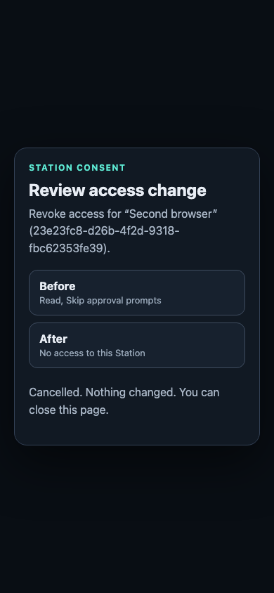

# Enroll an operator passkey

An operator passkey lets you sign in as this Station's operator from a paired
browser without pasting the operator credential. Enrollment requires confirmation
on the host. A session reads paired devices and the operator's own passkey and
current-session metadata, and requests step-up for writes. A device-access change
requires a fresh passkey confirmation on the separate consent origin for that exact action
([#3257 S4](https://github.com/kontourai/station/issues/3257)). There is no
step-up window. The host and separately granted device-administration channels
remain independent.

## Before you start

- Station must be reachable at an **HTTPS name**, not an IP address. WebAuthn
  scopes a passkey to a domain, so a Station reachable only by IP has no remote
  operator sign-in.
- Set `STATION_TRUSTED_CONSENT_ORIGIN` to the HTTPS origin that reaches the
  consent listener, as described in
  [Reaching the consent origin over HTTPS](deployment.md#reaching-the-consent-origin-over-https).
  The passkey's relying-party ID is that origin's host, so enroll from the
  same name you will use later. Without this setting enrollment is
  unavailable and the page and the CLI both say so.
- The browser must already be **paired** with this Station and open on the
  same host name as the consent origin. A passkey is not a way to pair.
- You need a shell on the Station host: confirmation is a host-side step.

## Enroll

1. In the paired browser, open `<consent origin>/operator/passkeys/enroll` and
   choose **Start**. The page shows a six-digit code, for example `482 913`.
2. On the Station host, confirm the code you see in the browser:

   ```bash
   station environment operator passkeys approve 482913
   ```

   Any paired device can open a request, and a device chooses its own name, so
   the name proves nothing. The host listing (`station environment operator
   passkeys`) therefore shows, for each request, the device id (first eight
   characters), when it was paired and its scopes, and it **never shows the
   code**. On a terminal, `approve` prints those details and asks you to
   confirm before it commits. Without a terminal, pass the id of the device you
   expect, which must match the requesting device or nothing is confirmed:

   ```bash
   station environment operator passkeys approve 482913 --device aaaa1111
   ```

   A device that names itself like the operator's own browser is shown as a
   paired device that calls itself that, never as the operator. You type the
   code from the browser, so confirming means comparing the two screens, not
   copying one. The code works once and expires after five minutes. Five wrong
   codes in five minutes lock confirmation (including the right code) until
   the window passes. `deny <code>` rejects a request, and also withdraws one
   you approved by mistake until the passkey has been created.
3. The page advances to **Create passkey**. Name it, choose **Create passkey**,
   and complete the browser or operating-system prompt. Station requires user
   verification (biometric or PIN), asks for no attestation, and accepts any
   authenticator, including a synced passkey. Only the public key is stored.
4. Enroll a **second** passkey, such as a security key or another device, so
   losing one does not lock you out. Each passkey needs its own host
   confirmation; one confirmation enrolls one passkey.

## Sign in from a paired browser

1. Open **Paired devices**. A browser without inventory access offers **Sign in
   as operator** when an HTTPS consent origin is available. If the Device
   credential is no longer live, the panel asks you to **Reconnect it** first;
   operator sign-in requires a paired Device.
2. Open that link, or go directly to `<consent origin>/operator/sign-in`.
   Choose **Sign in with passkey** and complete user verification (biometric
   or PIN). A passkey prompt on the app origin is never part of this flow.
3. Return to Paired devices. Its next refresh loads the inventory and shows
   the session's absolute expiry. Choose **Change access**, **Revoke** or
   **Remove record** to request a fresh passkey confirmation. The panel has no
   operator-credential paste field.
4. Choose **Sign out**, then confirm on the consent-origin page to end the
   session. Closing the browser window alone does not sign out.

The session uses `__Host-station-operator`, a Secure, HttpOnly,
SameSite=Strict cookie with Path=/ and no Domain. Cookies are scoped by hostname,
not port: the same-host app origin receives it too. While signed in, app-origin
plugin code can read the device inventory and the operator's passkey/session
metadata. It cannot run a passkey ceremony or mutate with operator-session
authority directly: a write only requests a transaction and cannot approve it. Do not treat HttpOnly as isolation from same-origin code using the
session to make allowed requests.

The server enforces **15 minutes without operator activity** and
**12 hours from sign-in**. Initial load, explicit refresh and user navigation
extend idle time. Automatic inventory polling validates expiry without extending
it. Expiry requires a new passkey assertion.
A different paired-device cookie cannot use the session. Revoking the bound
device or the signing passkey, resetting the environment, or rotating the
operator credential makes the session unusable, including after a restart.
Rotation keeps the enrolled passkeys. Remote revoke-all is not implemented
(follow-up); both `DELETE /api/operator/session` and
`DELETE /api/operator/sessions` remain refused. Use the consent-origin sign-out
for this browser, or the host to revoke bound Devices or rotate the credential.

Hosted tenant registries disable operator passkey routes. Stations with no
configured HTTPS consent origin, or reachable only by IP, have no remote sign-in;
the host channel remains available with no identity provider or passkey setup.

## Change device access from the browser

A browser on the Station host without a configured HTTPS consent origin can no
longer change device access from this panel. Use `station environment access …`
on the host instead.

1. Sign in as operator. Choose **Change access**, select permissions, and choose
   **Apply**. Revoking a device or removing its revoked record uses the same flow.
2. The panel opens a separate consent-origin review. If the browser blocks the
   new window, choose **Review access change** in the panel. Review the Device
   name and ID and the before/after access. Granting full access shows a warning.
3. Choose **Confirm with passkey** and complete biometric or PIN verification.
   One assertion applies one action. It cannot approve another transaction.
4. Return to the panel. It polls without extending the session and shows the
   updated Device and any full-access reset result. A review expires after five
   minutes. Choose **Cancel** on the review to deny the transaction immediately;
   the panel shows **Cancelled** and a later approval is refused. Cancelling only
   the operating-system passkey prompt or closing the review applies nothing;
   that pending request expires. A target or session that changed when a verified
   assertion is committed closes the transaction as `target_changed`, including
   changes detected while acquiring the mutation lock. Nothing is applied. The
   panel says **The device changed since you asked. Nothing was applied; try again.**
   Restoring the old state does not reopen a refused transaction: open a new
   request against the current state. An expired session, revoked bound Device or
   revoked signing passkey cannot confirm; sign in again as needed. Do not blindly
   repeat an indeterminate write.



Group changes and operator-managed personal-token API actions also require per-action
step-up. The passkey session cannot read `GET /api/pairing/people`, so **Settings →
People** and its token controls are unavailable to that session today. The Desktop
can list People through its independent home-possession grant, but that grant
cannot change groups or manage other people's tokens; signing in does not elevate
those independently admitted requests. Use an operator-credential connection for
these controls. A person's **Your access tokens** uses separate device-bound
self-service routes and does not request operator step-up. A newly minted token's secret appears **once**, in the consent-origin
commit response and review page. The transaction's later status reads contain
only token metadata. Copy the secret then; a lost response requires revoking
that token and minting another. Another operator session cannot read the action
or retrieve its secret. See the [target contracts](../design/operator-device-access.md#31-components).

## Manage passkeys on the host

```bash
station environment operator passkeys                 # list passkeys and pending requests
station environment operator passkeys approve <code> [--device <id-prefix>]  # confirm the code the browser shows
station environment operator passkeys deny <code>     # reject a request, or withdraw an approval
station environment operator passkeys revoke <id>     # revoke a passkey by the id in the list
```

These commands run only against a Station on this machine, the same as
`station environment access approve`. Revoking from the host needs no passkey.
The remote passkey-revocation API requires a fresh step-up from a **different**
active passkey. Using the passkey being revoked returns `commit_refused` with
**Use a different passkey to revoke this one**. This refusal keeps the transaction
pending: reopen the same review and use another active passkey before it expires.
Other `commit_refused` failures also stay pending; inspect the outcome before
retrying. Invalid assertions or nonce/authority refusals do not finalize the
transaction. Approved, cancelled, expired and `target_changed` requests cannot be
confirmed again. The review hides its action buttons after a submitted attempt;
a pending refusal requires reopening it for a fresh nonce. The host command
remains the recovery path when no other passkey is available.

Passkeys are kept in `authentication/operator-passkeys.sqlite` under the
Station home. The file is created when the first enrollment begins; a Station
without `STATION_TRUSTED_CONSENT_ORIGIN` never creates it. It is a private file (mode 0600 in a 0700 directory) that
holds each passkey's credential id, public key, signature counter, transports and label.
Operator sessions share this private store for reads and per-action step-up. Their
random cookie secrets are stored only as hashes, alongside device/passkey bindings
and expiry times.

## What can go wrong

| Message | Meaning |
| --- | --- |
| Enrollment is unavailable | `STATION_TRUSTED_CONSENT_ORIGIN` is not set. |
| The request with that code was not opened by the device you named | `--device` does not match the requesting device. Nothing was confirmed; list the requests and check who asked. |
| The device that opened this request is no longer paired | It was revoked or unpaired after asking. Nothing was confirmed. |
| No pending enrollment request has that code | The code is wrong, was already used, or expired. |
| Too many wrong codes | Wait for the five-minute window, then retry. |
| The passkey could not be verified for this Station | The browser's origin or the authenticator's relying-party ID did not match the configured origin, or user verification was skipped. Nothing was saved; start again. |
| Open this page from a browser paired with this Station | The browser has no paired-device cookie for this host name. |
