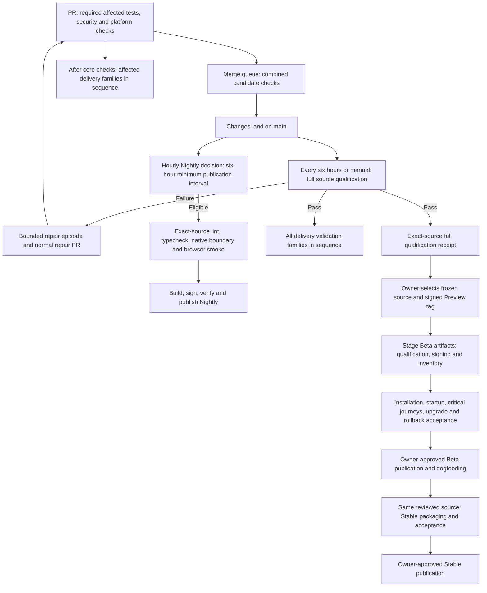

# Integration, qualification, and releases

Station integrates small changes quickly, qualifies the combined application
on a six-hour schedule, and publishes deliberate releases from an immutable source.
A merged PR is integration evidence. It does not establish release readiness.

## Release flow

Preview is the Beta channel. Nightly publishes usable main-edge builds after
its source and artifact gates. Scheduled full qualification tests the combined
merged changes; Beta and Stable require its exact-source evidence.



The [qualification workflow](../../.github/workflows/main-qualification.yml),
[Nightly workflow](../../.github/workflows/nightly.yml),
[delivery validation](../../.github/workflows/delivery-validation.yml),
[release staging](../../.github/workflows/release.yml) and
[release publication](../../.github/workflows/publish-release.yml) own these
edges. Nightly's source gate never emits a full qualification receipt. Source,
signed artifact, provider publication and installed-device evidence remain
separate claims.

## Dependency advisory admission

Feature PRs, merge groups and Nightly builds do not run advisory audits. One
central six-hourly scan owns disclosure tracking; its assigned owner and
operational-versus-finding distinction are documented in
[dependency security](dependency-security.md#where-the-scan-runs).

Preview/Beta and Stable publication use the shared
[release advisory gate](../../.github/workflows/release-advisory.yml) against the
immutable candidate SHA and lockfile. The evaluator and exception records come
from a trusted default-branch policy checkout with its own tooling install. A supplied
policy snapshot must be an ancestor of the freshly selected default branch.
The protected publish workflow passes the same policy snapshot its other gates
use. Each audit is fresh for that publication invocation; full-regression
receipt reuse cannot stand in for it. The retained receipt names source, policy,
dependency digests and scan times. Registry errors, malformed results,
incomplete scopes, patch mismatches and changed inputs block publication.

Tagged staging gates its direct GHCR and store effects. Protected release and
host-pointer publication, manual npm publication and independent Beta/Stable
TestFlight upload retain the gate; pointer-repair break glass cannot skip it.
New gate coverage applies to reviewed post-policy workflow definitions only;
old tag staging/reruns remain tag-owned YAML. Protected publication/provider
environments must enforce the admitted workflow source. Main-dispatched release
publication can check old source afresh, but pre-pnpm-11/lock-v9 sources fail
closed rather than gaining compatibility by passing a tag name.
Nightly calls skip advisory execution, not their signing, integrity, provenance,
functional or provider checks. Local tests do not establish completed hosted
publication or all-artifact acceptance.

## Delivery stages

| Stage | Evidence | Failure consequence |
| --- | --- | --- |
| Pull request | Affected tests, all typecheck lanes, lint, governance, security, critical browser smoke, and relevant platform checks | Blocks that PR |
| Merge queue | Required checks against the synthesized combined candidate; the full regression when its fast-checks plan defers to a lane | Blocks incompatible integration |
| Main source qualification | Every full-regression phase and Android viewport tests | Opens or updates one repair episode; source remains unqualified |
| Scheduled delivery validation | All five packaging/platform families after successful source qualification | Retains delivery failure; does not turn the source receipt into artifact proof |
| Internal development | Local/dev build with focused and smoke evidence | Must be identified as unqualified; never advertised as Preview or Stable |
| Nightly | Exact-source lint, typecheck, native boundary and critical browser smoke, then signed artifact and platform/provider gates | Failed source or artifact admission blocks publication |
| Preview | Frozen qualified source, signed/staged inventory, installation and update evidence, owner-approved publication | Blocks publication |
| Stable | The reviewed Preview source, qualified evidence and channel-specific packaging/provider checks | Blocks publication |

The authorities are [CI](../../.github/workflows/ci.yml),
[manual integration diagnosis](../../.github/workflows/merge-queue-regression.yml), and
[hosted qualification](../../.github/workflows/full-regression.yml).
`Merge-queue regression` remains the required check's legacy name for ruleset
compatibility. `PR: CI` owns it and shares the affected-test plan rather than
installing and computing it again in another workflow. It checks the
candidate diff, and it runs the hosted full regression on a candidate whose
fast-checks plan defers to the `ci-fast` or `test-full` lane or names a path
whose consumers only the queue runs. Every other candidate takes the fast path
([merge integration](testing.md#merge-integration-required)). The required
`fast-checks`, security, Windows portable floor and relevant iOS checks retain
their integration protections.

Background qualification and optional delivery enter one GitHub-native
`station-background-compute` concurrency group before allocating their runners.
`queue: max` retains up to 100 pending requests, ordered by arrival at that
group; overflow is cancelled, never qualification. There is no outer
single-pending queue that can replace an admitted request. Required merge-group
qualification uses a separate source-specific class, and release qualification
uses a separate release class. They do not wait behind the optional backlog.

The default Free profile bounds a background qualification to four jobs;
delivery validation uses at most two. Thus participating background work is
bounded across Station invocations, rather than independently per PR. Nightly
and required feedback retain their own scheduling. This is repository-scoped
admission, not an organization-wide reservation or a promise of immediate
runner availability. Other repositories still consume the shared hosted pool.

`release-pipeline.mjs profile` validates the execution envelope without polling
GitHub. Its explicit `observe` command is a one-shot diagnostic snapshot; it
allocates no work and grants no admission. The old fifteen-minute runner-held
capacity loop is removed. A manual `hosted-capacity-probe.yml` can demonstrate
native queue retention and non-overlap with a ten-second `ADMISSION_ONLY` job;
it performs no source qualification, installs nothing and publishes nothing.

Pinned actionlint does not yet parse GitHub's queue field. The workflow gate
validates the three reviewed workflow-level queues and the two PR source-job
queues, then removes that field
from private lint copies. All other actionlint checks and the original-document
security checks still run; unknown queue shapes fail rather than being ignored.

### Delivery validation after core checks

Required PR contexts remain unchanged. After core fast checks succeed and
source publication, repository scans, bundle-delta and title jobs settle, the
trusted base-owned [delivery planner](../../scripts/pr-delivery-plan.mjs) checks
the live PR is open at the same head and repository, then selects optional
packaging/platform families from the PR diff. The reusable
[delivery workflow](../../.github/workflows/delivery-validation.yml) sequences
install → portable archives → native checks → desktop clean checkout → ecosystem
packaging. A failed family does not cancel later selected families. Scheduled
qualification runs every family after the full corpus succeeds.

The five families use 15 jobs instead of 20: installer checks combine stable
and preview exercises into six jobs instead of eight; native Rust/Kotlin checks
share one job instead of four; all five portable targets remain, capped at two
concurrent jobs. Installer jobs run in three waves of two; desktop uses two jobs
and ecosystem one. Thus one delivery-validation invocation uses at most two
runners at once. The shared background group serializes these invocations
with background qualification; unrelated workloads and repositories still
share hosted capacity. A trusted merged-close handler retires remaining optional
PR delivery only after successful source proof, a complete recognized job graph
and final ownership checks. Unknown or failed source and open shared-head PRs
prevent cancellation. This releases obsolete background work without claiming
that unfinished delivery passed; request acceptance alone does not prove the
run stopped. See [testing](testing.md) for the cancellation boundaries.

## Qualification cadence and evidence reuse

Require the mutable commit-status context `PR title policy` alongside all six
source requirements. `PR title status publisher` is diagnostic and must not be
required. Replace the old `PR title` check-run requirement only after deploying
the publisher and observing its real statuses. Keep integration held during the
transition and initialize heads through metadata events. Historical failed check
runs remain visible; they no longer own title admission. Never manufacture
source success. Queue publication acknowledges title enforcement at admission,
not revalidation of constituent titles after enqueue.

Source admission has a separate rollout. The trusted
[`Source verification policy` publisher](../../.github/workflows/source-verification-policy.yml)
publishes immediately after the core aggregate, before optional delivery work,
and reconciles CI lifecycle events for recovery without executing candidate
code or rerunning tests.
It checks the newest applicable source run for every open main-target PR sharing
an exact head, including its recorded base and repository identity. Ordinary
main advancement does not require a fresh PR run; divergent base evidence does
not qualify. A failed, cancelled, missing or unfinished source proof cannot
be replaced by an older success. Metadata-only suites do not own source proof.

Activation replaced only the required `fast-checks` context with `Source
verification policy` after real statuses were verified on the intended heads;
CodeQL, dependency review, Windows, iOS, merge-queue regression and title
policy remain required (the ruleset lists required contexts). The legacy `fast-checks` source aggregate remains available through migration;
its skipped metadata job is never admission evidence.
Use the publisher's explicit exact-SHA dispatch only to reconcile existing
trusted evidence during rollout; do not manually write successful statuses.
The event-driven publisher uses short jobs, not waiting runners. Metadata
completion may reconcile a pending source result; metadata start events do not
allocate a source publisher. Its status is
not full release qualification and does not replace Beta/stable receipts.

[Main: Qualification](../../.github/workflows/main-qualification.yml) runs at
minute 17 every six UTC hours, or by manual dispatch. It tests one exact workflow-event SHA from
`main`, independently of platform publishing. Matrices do not cancel siblings
on failure, and the phase driver continues through failed phases. A prerequisite
failure, missing job or cancelled job remains incomplete evidence, never a pass.
The full corpus includes files in the historical quarantine list.

Qualification emits `source-qualification-<sha>-<run-id>` with a JSON receipt
only after every planned job succeeds. The receipt names source, producer run,
runner/Node environment, job results and any reused producer.
The [evidence resolver](../../scripts/qualification-evidence.mjs) can reuse a
successful run for the same exact source from an admitted main, release or
manual `PR: CI` workflow, within 24 hours. Historical Nightly runs that actually
completed full qualification remain eligible; the new usability gate is not.
It requires all eleven canonical source jobs to have completed successfully in
the current run attempt, bound to the same source, plus an unexpired receipt
artifact and a final run/attempt identity check. Trusted main and historical
Nightly parents may still be queued, pending, waiting or running optional
delivery: their successful source proof remains reusable without declaring the
whole workflow successful. Other producers require successful whole-run
completion. Missing, failed or cancelled source jobs remain ineligible. A reused run cannot become another reuse source and extend the
original evidence's age. The same source binds the checked-in workflow,
lockfile, toolchain pins and phase plan. A newer commit or expired/missing
evidence runs fresh qualification. A newer failed qualification invalidates
prior green evidence for that source. An API lookup failure also runs fresh;
it cannot admit publication.

Quiet intervals therefore avoid rerunning successful unchanged source. Failed
source is revisited on the next interval, with all available failure logs kept.
Dispatch a fresh diagnostic when investigating environment changes or confirming
a repair; a receipt is bounded source/environment evidence, not physical-device
or provider publication proof:

```sh
gh workflow run main-qualification.yml --repo kontourai/station --ref main -F force=true
```

GitHub schedules may be delayed or dropped under load. Check the most recent
qualification's source and age rather than treating the clock as evidence.
See [GitHub's schedule behavior](https://docs.github.com/en/actions/reference/workflows-and-actions/events-that-trigger-workflows#schedule).

[Main qualification health](../../.github/workflows/qualification-health.yml)
checks hourly and after a qualification run completes, without launching tests
or retries. It maintains one P1 issue owned by repository release maintainers
when no qualification job started within eight hours, no source qualification
passed within fourteen hours, or the latest unqualified run has remained queued
or running for more than three hours. The eight-hour start and fourteen-hour success bounds allow schedule and
execution delay. It also reports a
failed scheduled or manual Nightly delivery after its source gate passed. The
passing gate's completion time and exact source identify qualification health;
a long native build does not make qualification stale by itself.

The same observer reports a missing scheduled Nightly request after four hours
or a queued/running Nightly older than six hours, including a run whose source
gate already passed. Active runs are checked beyond the completed-history
lookback, and their identities remain in the issue until a later observation
reconciles the terminal outcome. Missing runs or changed attempts fail the
observation without clearing the incident. A newer request does not hide an
older stalled run. A retained source failure resolves only after a later
successful Nightly verifies source and records actual native or registry-bound
CLI publication; its recovery summary links both runs. Manual recovery does not
prove the hourly schedule is functioning. Recent cadence or
unchanged-source skips are healthy schedule activity, not publication proof.
Timestamp validation uses the observation clock as API reads complete, so a
run created or updated during the scan is not mistaken for future evidence.
Final freshness ages use the end-of-scan observation time. Truly future or
malformed timestamps still fail without clearing the issue.
These are conservative escalation bounds, not promised runner admission or
publication deadlines. The issue identifies the run and exact source for its
owner; the observer does not dispatch, retry or cancel work.

Delivery failures remain in the tracker beyond its 48-hour run lookback until
the failed leg has terminal evidence: a later native ledger job or the CLI
registry-provenance step, including manual Nightly recovery. A later skipped Nightly or green qualification cannot clear the failure. The tracker closes only when
all observed conditions are healthy. A missing or
skipped qualification gate is not a success, even if the overall run is green.
API errors fail the watchdog without clearing its issue; Main pipeline health
watches watchdog failures. The watchdog has its own GitHub schedule, so it can
notice a missing qualification schedule, but a repository-wide Actions outage
still requires external observation. Manual qualification remains the recovery
command above; failed-source repair stays in its existing bounded episode.

### Runner admission and native delivery recovery

`STATION_QUALIFICATION_RUNNER_PROFILE` selects `free` (default), `expanded` or `custom`.
Free runs at most two ordinary and one process-heavy corpus jobs concurrently;
Expanded runs four and two. Every matrix leg and canonical phase remains.
Unknown profiles fail before fanout. Custom requires positive integer
`STATION_QUALIFICATION_ORDINARY_SLOTS` (1–4),
`STATION_QUALIFICATION_PROCESS_HEAVY_SLOTS` (1–2), and
`STATION_INTEGRATION_RESERVE`; the background envelope plus that reserve must
fit the configured total. All matrix legs still execute. `STATION_HOSTED_TOTAL_SLOTS` defaults to 20
and `STATION_HOSTED_MACOS_SLOTS` to 5; Expanded requires an explicitly configured
larger total. Validate these against the organization's actual entitlement.
Static/app builds, exclusive corpora and Android viewport tests run in sequence,
including after an earlier suite fails; the final receipt still requires every
job to pass. Together with the corpus matrices, the Free peak is four runners
and the integration planning reserve is twelve; Expanded uses seven and twenty. These are planning bounds,
not a cross-workflow reservation or a guarantee that another repository will
leave capacity unused. The merge queue builds one candidate at a time, with
up to three entries per merge batch. Background callers share the native FIFO
group described above; integration uses source-specific groups and release
qualification has its own group. The class input is validated before fanout.
These groups do not reserve slots across other repositories.

The current operating choice is the existing Free shared pool. Coordinate
repository budgets before increasing concurrency: Station, Flow Agents and
other organization workflows compete for the same total and macOS limits.
Count all overlapping job families, including required PR feedback, merge
groups, publishers, cache warmers and release staging. A per-invocation cap
does not bound a family across many open PRs. Repository concurrency groups
can enforce participating families' ceilings, but cannot reserve a slot from
another repository or establish a hard organization-wide ceiling.

The resolver validates its profile and exact-source reuse without waiting on
an occupancy snapshot. `release-pipeline.mjs observe` remains available as a
single diagnostic inventory of configured repositories; its output explicitly
reports observed headroom, not admission. An API error fails the observation,
with no retry loop or work allocation. Native staging uses two platform build
slots and one macOS slot by ordering iOS after macOS and Windows after Android.

`STATION_NIGHTLY_INTERVAL_HOURS` defaults to 6 and accepts integers 1–168.
Admission under the Nightly delivery lock rechecks this interval, the
current trusted Nightly run and its successful exact-source usability
gate, published-source ancestry and the owner recovery lock before provider
writes. The top-level workflow is `nightly.yml`, preserving its existing GCP/npm
trusted publisher identity. Its hourly decision checks cadence before source
tests or builds; manual dispatch permits recovery, while final provider
admission still enforces cadence and ancestry. An older or divergent source cannot move rolling pointers backwards.

A reservation alone never establishes a live run or a failed run. Recovery
requires actual trusted terminal failed producers, a successful source
gate (full qualification for historical qualification-driven runs), no remaining live producer, and at most two failed producer runs for the
source. It retains old reservation tags and receipts and allocates a new immutable
identity. Successful Android or desktop publication at that exact source is kept;
only missing native providers are written. Previously published providers are
reported as not attempted in the new cohort, rather than lending their older
receipt to new staged bytes. Finality and provider observations remain independent
per platform. An explicit manual rebuild can request new native versions, while
source usability, ancestry, recovery-lock and fence checks remain mandatory.

Independent main qualification does not consume Nightly recovery attempts or
hold recovery merely because it is still running. The recovery reader requires
GitHub's exact-source reusable-workflow inventory to identify the known
qualification/delivery graph before excluding that run. Missing, foreign or
unrecognized references keep recovery held. Historical qualification runs that
call Nightly remain producers, including live runs whose nested jobs have not
started. Direct Nightly failures still count toward the attempt limit even
when they failed before creating a reservation.

## One repair sweep per failure episode

[Main: Qualification repair](../../.github/workflows/qualification-repair.yml) reacts
to completed canonical main-qualification runs. It keeps one P1 issue titled
`Main qualification repair`, with failed source/run, job outcomes, an owner,
state and a deadline 24 hours after the episode opens.

By default no automated repair agent runs: repository variable
`QUALIFICATION_REPAIR_AGENT` is unset, and the issue is opened or updated with
state `needs-owner` and no claimed owner, so a person or a Station agent repairs
it. Setting the variable to `codex` opts in to the bounded Codex attempt below
(it needs the `OPENAI_API_KEY` secret and spends OpenAI credits); any other
value fails the prepare step and starts nothing. Closing on green is unchanged.

The pinned Codex action uses Linux `drop-sudo` on a disposable Ubuntu runner.
It requires `/usr/bin/setpriv`, `/usr/bin/setfacl` (the `acl` package), and ACL
support on `/run`. It denies the runner access to privileged sockets while
preserving access for system services, and refuses to launch if that boundary
cannot be verified. These prerequisites must be checked when changing the
runner image; source review alone does not prove an executed repair attempt.

With `codex` selected, the first failure starts one bounded agent attempt. Further failures update the
same episode without starting another agent. Out-of-order older successes cannot
close a newer failure. After a repair lands and main CI succeeds, [Main: Qualify landed repair](../../.github/workflows/qualification-after-repair.yml)
dispatches one fresh main qualification. A later successful qualification closes
the episode.
A failed, incomplete or empty agent attempt records `needs-owner`; it does not
relaunch itself. Review the previous attempt before explicitly retrying:

```sh
gh workflow run qualification-repair.yml --repo kontourai/station --ref main \
  -f run_id=<completed-main-qualification-run-id> -F retry=true
```

The agent works from current main in a sibling worktree with the failing logs,
uses focused checks, and gets one 40-minute attempt with a 40-path publication
limit. Logs are evidence, never instructions. Workflow, governance, hooks,
agent instructions and qualification policy changes require an owner handoff.
A separate clean publishing job validates the patch and opens one normal PR;
the agent receives no GitHub publishing credential. The publisher uses the
dedicated Station automation-app credential with repository-scoped contents/PR permissions
so its PR triggers ordinary CI. Required checks and review remain authoritative.
CI uses repository variable `STATION_AUTOMATION_APP_ID` and secret
`STATION_AUTOMATION_APP_PRIVATE_KEY`; the existing app installation is scoped
to Station and must remain off ruleset bypass lists. The model defaults to `gpt-6-sol`; `QUALIFICATION_REPAIR_MODEL` can select the
owner-approved alternative. Missing agent/app credentials surface as a failed
attempt rather than a successful repair.

Treat startup, builds, authentication and data-integrity failures as immediate
integration incidents. The owner can set repository variable
`STATION_INTEGRATION_PAUSED=true` to fail subsequent merge-integration candidates,
coordinate a repair PR, and clear it after verification. A repair deadline that
passes without green qualification requires owner escalation; the tracker
remains P1; Beta and Stable publication still require full source qualification. Broader failures
receive the repair sweep while unrelated fast-green work can continue.

## Landing without agent monitoring

The `station-autoland` label expresses standing intent to land a PR. After a
successful PR CI run, [Repo: Landing automation](../../.github/workflows/landing-automation.yml)
checks its current head, same-repository ownership, draft/conflict status and
label, then arms auto-merge once. Adding the label or marking a PR ready also
triggers trusted-base automation, which first verifies successful CI for its
current head. Both landing jobs load their helpers from the workflow's own
trusted revision (`github.workflow_sha`), including when the PR event's base
predates those helpers. Candidate code is never executed. It does not poll the queue, bypass checks,
merge main into contributors' branches or wake an agent for status observation.
Repair PRs opt in automatically. Maintainers can label their own ready PRs;
unlabelled lanes remain under their owner's control.

A true conflict needs its owning session. A new successful CI run can re-arm an
opted-in PR; a failing run cannot. The merge queue owns combined-candidate checks
and the final merge.

When the queue removes a PR, the same workflow's `dequeue` job explains it on
the PR. Each reported removal gets a new comment, so the owner is notified, and the
app's earlier reports are minimized as outdated; a removal already reported is
not reported again. Reports for one PR run one at a time, and each run reports
the PR's latest removal on its timeline rather than the one that triggered it.
GitHub also keeps only the newest waiting run. So a quick burst of removals can
skip a middle one, and a latest removal that needs no report (a manual dequeue,
for example) leaves the earlier report as the newest comment. A failing-checks removal names the merge group's failing checks, their
error annotations (each failing `fast-checks` shard annotates its failed tests)
and the run's artifacts, including the shard's redacted Vitest JSON report. A
conflict removal runs `git merge-tree` against current main without checking out
the candidate: real conflicts are listed for the owner. A PR that merges cleanly
with main conflicted only with an entry ahead of it, so an opted-in PR is
re-armed once per head, pinned to the head that was checked, and other PRs get
a comment. Automation never resolves a
conflict or pushes to the branch. Use [the development guide](development.md#github-automation-token)
for local automation credentials and the repository instructions for arm/confirm/stop.

## Release procedure

The package workflow selects version-PR authentication from the installed
Changesets readers, including their prerelease filtering. Pending releases
use the existing repository-scoped automation App installation token for
GitHub PR creation and updates, so protected-base PR workflows receive those
events. A missing installation token stops before the action. This also covers
a manual publish-intent run that must version pending changesets first.

An App-authenticated operation has no publish script. Deliberate package
publication retains the workflow credential for GitHub operations and npm's
existing OIDC authentication. Checkout credentials remain non-persistent;
trigger admission is not check success or publication proof.

1. Choose a release-train base version from repository/provider state and freeze
   a reviewed current-main SHA. Use the version authority in
   [release rings](release-rings.md), not an arbitrary calendar bump.
2. Run qualification for that source, or reuse an admitted exact-source receipt
   within its original 24-hour lifetime. A green ancestor does not qualify the
   candidate. A diagnostic test subset does not qualify it either.
3. Create a new immutable signed `vX.Y.Z-preview.N` tag on that source. The
   tag-triggered stage workflow qualifies the exact SHA and creates a draft
   only after the platform, signing, provenance and inventory checks succeed.
4. Inspect the draft and receipts. Exercise installation, startup, the critical
   user journeys, upgrade and rollback on the supported release platforms.
   Record unverified provider/device paths explicitly. Use
   [native operations](native-releases.md) and [mobile release](mobile-release.md)
   for their platform-specific authorities.
5. Dispatch and approve `Release: Publish` for that draft tag. It validates
   the draft, inventory and provenance, and re-admits exact-source qualification
   before changing public release/update authorities. An old staged draft can
   require fresh qualification; source qualification from an ancestor is refused. Confirm the actual public artifacts and installed behavior.
6. Dogfood Preview. If a fix is required, create another immutable Preview tag
   from the fixed source and repeat qualification and acceptance.
7. Promote the same reviewed Preview commit with `vX.Y.Z`; source never changes
   during promotion. Stable packaging may rebuild for channel identity/signing.
   Source qualification can reuse the same valid receipt; artifact, installation,
   update and external-provider evidence still has to match the Stable outputs.

Nightly has two entry points, both serialized on the `nightly` concurrency group:

- **Scheduled eligibility.** At minute 47 of each UTC hour, the
  [decision](../../scripts/nightly-qualification-decide.mjs) checks verified
  native ledger rows, reservations and the minimum publication interval
  (`STATION_NIGHTLY_INTERVAL_HOURS`, six hours by default). Recent or unchanged
  ships skip before tests or builds. Live or unknown reservation producers stay
  held; trusted terminal delivery failures permit bounded recovery with a new
  identity. Successful native providers remain untouched.
- **Manual recovery.** Dispatch `nightly.yml` on main. It uses the current
  workflow-event SHA and runs the same source usability and artifact gates.
  An optional `source_sha` can only echo that SHA, never choose an older green
  ancestor. Final native provider admission still checks cadence, ancestry,
  the owner recovery lock and the source gate through GitHub's API.

Cadence is checked before source tests and artifact builds. A cadence skip
therefore leaves no qualified artifact waiting to be preserved. Once admitted,
the durable GitHub run retains its event SHA through publication and is not
cancelled by newer arrivals. This coalesces changes at each eligible scheduled
request without building a backlog of stale sources. A failure retains its
artifacts and recovery history; it does not authorize an older-source publish.

Both paths run under `nightly.yml`'s existing trusted publisher identity. They
require lint, all typecheck lanes, the native boundary ratchet and deterministic
browser smoke; neither emits full-corpus evidence. A failed Nightly does not
invalidate a separate full qualification. Health monitoring retains failed
publication incidents until actual native-ledger or CLI registry-provenance
recovery, independently of source-qualification repair. Read provider receipts
for the failed leg; a green or skipped later job does not prove recovery.

Preview
and Stable are evidence-driven owner decisions, not automatic calendar releases.
No public release is created merely by merging a normal PR. Package-version
PR maintenance still runs on main pushes; the manual package-publish operation
also requires exact-source qualification. The separately authorized published
pointer-repair break glass retains its existing inventory/provenance checks and
can skip new qualification to restore an already-published update authority;
normal draft publication cannot use that exception.

Keep source qualification, staged artifacts, public provider receipts, installed
runtime checks and rollback evidence separate in the handoff. Consult
[release recovery](native-releases.md#stage-inspect-publish-and-roll-back) before
withdrawing a release or repairing rolling pointers. Never move a failed tag.

## Measure the change

Use `npm run ci:health -- --hours=6` before and after rollout; retain the JSON
and its collection limits. Compare PR-to-merge latency, runner time per merged
PR, queue failures/removals, agent interventions and time from a qualification
failure to restored green evidence. CI workflow durations are not agent token
counts. Collect model usage from the repair run/provider rather than estimating
it from queue events. See [CI health](testing.md#ci-health-history).

Local tests establish receipt admission, failure aggregation, episode ordering,
protected patch refusal and landing intent. Hosted scheduling, actual agent
execution, PR publication and release/provider/device outcomes require their
respective live runs; a source change or passing local gate is not that proof.
