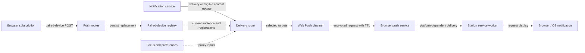

# Web Push notifications

Web Push is the browser delivery channel for a paired, subscribed device. A
supported browser can receive a notification while its Station tab is closed.
Delivery depends on the current audience, preferences, focus policy, browser,
and push service; pairing or a successful send request is not a phone receipt.

This guide covers browser Web Push, separately from the native Android FCM and
iOS APNs channels. Normal runtime
wiring disables Web Push when hosted-tenant execution is required: its routes
return 404, the delivery wiring is inactive, and the public handshake omits
`capabilities.webPushNotifications`. Personal-host operation and
[Device pairing](connections.md) are separate prerequisites from browser support.

## Registration and delivery

Solid arrows represent requests/events; dotted arrows represent state access.
The last delivery/display steps require real browser and service evidence.
Follow [push routes](../../src-server/routes/operations/push-routes.ts), the
[router](../../src-server/services/notifications/delivery/router.ts),
[channel](../../src-server/services/notifications/web-push-channel.ts), and
[service worker](../../src-ui/public/sw.js) for the actual callers.

### Keys and stored subscriptions

[VapidKeyService](../../src-server/services/notifications/vapid-key-service.ts)
loads and caches the keypair at
`<STATION_HOME>/security/vapid-keys.json`, generating it when absent. Persistence
uses a temporary file, fsync and rename. The implementation enforces the 0600
file mode on POSIX and rejects a symlinked or hard-linked key file. Its Windows
path does not configure or verify a private ACL; that custody needs separate
platform evidence.

The [private paired-device record](../../src-server/services/ssh/device-pairing-service.ts)
holds one `pushSubscription`; it is omitted
from the public `PairedDevice` view. `POST /api/system/push-subscribe` replaces
it. `POST /api/system/push-unsubscribe` clears the identified device’s
record only when its endpoint matches the request. Changes persist before
becoming live in the service's memory. Successful revocation clears the stored
subscription and removes the device from future listings. It does not delete
the browser's local PushManager object or recall a message already handed to a
push service or displayed on screen.

### Authentication and UI state

Subscribe/unsubscribe resolve the request credential to a paired device through
`identifyDevice`. An operator credential alone is insufficient, and so is a
personal access token (#3557: it is no device a notification reaches). A relay
alias of a paired device is refused for registration changes, including
unsubscribe. The route uses the same device admission for a fingerprint read. An
unidentified caller, a token or an alias reaching the route gets
`403 {error: 'device_pairing_required'}`. The
outer credential gate can reject earlier with
`401 {error: {code: 'authentication_required'}}`. Current audit reasons distinguish
`credential_invalid` and `credential_missing`; the response is not a unique
explanation of why authentication failed.

VAPID discovery uses the same authenticated Station route. A paired
device receives an opaque SHA-256 fingerprint of its current registration,
or a null fingerprint when it has no registration. A valid credential
without an eligible paired device receives a pairing-required state. The
fingerprint response stays private to the requesting authority and is not
cached. It contains neither the push endpoint nor the encryption keys.

The [SDK](../../packages/sdk/src/query-domains/chatRuntimeDevice.ts)
preserves the HTTP status for the VAPID read. The browser renders a sign-in
instruction after an authentication refusal, a pairing instruction when
pairing is required, an access refusal for a generic 403, and unavailable
for a 404. Transport failures remain retryable failures.

Production web builds also register the worker through
[WebOfflineShell](../../src-ui/src/components/WebOfflineShell.tsx), before the
access gate and independently of notification permission. Its anonymous app-shell
cache is described in [offline reading](../user/getting-started.md#read-recent-conversations-offline).
Registering this worker does not subscribe to push or grant notification consent.

[usePushNotifications](../../src-ui/src/hooks/usePushNotifications.ts) uses
the selected Station request authority. **Subscribed** requires an exact
match between the browser subscription and the Station registration, or
a successful registration response from that authority. Mount, browser
reconnect, window focus, and Station or authority changes check the
registration. These checks read the existing worker and Station state.
Registration writes and browser permission prompts occur through **Enable
push notifications**. Earlier Station responses without registration
status can still confirm an explicit successful registration.

Changing Stations or credentials leaves the browser subscription in place
until an explicit enable or unsubscribe. A browser subscription for a
different VAPID key stays active until the person chooses to switch. The
same VAPID key can be shared by separate credentials, so the displayed state
also requires that selected authority's exact registration.

Turning off **Push notifications** in Settings, importing an off preference,
or resetting device defaults unsubscribes the browser and attempts to clear
the registration. The separate **Unsubscribe** action does the same. Cleanup
uses only the authority that owned the registration and reports failure
when the local browser is off but the Station record could not be cleared.
Repeated Enable calls share one pending attempt. Disabling or unsubscribing
invalidates earlier attempts and fences late responses. A stored entry can
remain after local revocation until the Station observes the old endpoint is
gone. A registration check establishes state, while physical delivery
requires separate evidence.

## Who receives a push

`WebPushChannel.accepts` uses
[the category classifier](../../packages/shared/src/notification-priority.ts).
Current categories include approval requests, job failures/misses, unhealthy
scheduler notices, turn completion/stop/failure, pairing requests, pull request
agent feedback that paused or waits on a stopped agent, and the Agent
attention/failed/done/info categories. Lifecycle `needs_input` and
`review_pending` projections are not themselves notification delivery events;
a separate approval notification can represent related work.

The [audience resolver](../../src-server/services/notifications/delivery/audience-resolver.ts)
selects active personal-family devices with the required read eligibility. It
excludes delegated Stations, pending enrollment and account-bound devices from
this current family. Every named Session also requires the recipient's own
principal to be able to read it, including legacy notifications. Pairing alone
is not sufficient audience membership.

[NotificationService](../../src-server/services/notifications/notification-service.ts)
delivers a `principal` audience synchronously to a separate private feed after
a fresh check of that person's Project membership. A non-member is suppressed
without a write; a failed write is returned to the producer. The membership check
validates the supplied Project, not the producer’s authority, so every producer
must derive the Project from its own authority, never from request input. The feed keeps the
newest 100 records per person and scopes read and dismissal state to that person.
Future-scheduled principal writes are refused; expiry is settled when the feed
is next accessed. These records do not enter the owner feed or shared
notification stream and do not trigger push. The authenticated person reads,
marks read, and dismisses their own entries through the
[person notification routes](../reference/api.md#person-notifications). The
first producer is a Project room mention (#4799), shown under **For you** on
the Notifications page. A per-person notification preference, account-bound
Device push, other producers and a full inbox view remain future work.

The router consumes `NOTIFICATION_DELIVERED`. It also handles content changes to
previously seen, delivered, unread enveloped records on `NOTIFICATION_UPDATED`;
legacy records keep delivery-event behavior. Read/dismiss/settled changes cancel
pending escalation. Channel exceptions are caught so a push failure does not
throw through the synchronous in-app notification path. This is an error-isolation
property, not a guarantee of every browser's SSE/toast experience.

### Focus, preferences, and escalation

Focus applies within the same principal; unbound owner-device identities are
grouped, while tailnet-bound people remain distinct. A device whose credential
was minted with home-possession (the desktop app's local grant, the local
browser UI's bootstrap), or one of the owner's own devices holding
[owner-device standing](../security/remote-access-threat-model.md#owner-device-standing-2026-11-02),
reads as the operator for both its focus reports and
delivery, so its focus quiets the operator's other surfaces. Nothing yet ties a
tailnet identity to the operator, so the owner's own tailnet-bound phone stays
a separate person here. A focused document must
also have its own live event stream. Another tab's stream cannot vouch for it.
Stream leases expire after 90 seconds without successful keepalive writes; focus
reports have a 120-second lease. The client renews a focused report every 60
seconds while there was input in the last two minutes or the document shows a
chat whose turn is running; the second reason renews at most 60 times (one
hour) since the last input or window focus, counted per document across all
of its chats and turns, not per turn. Hiding or unloading a document reports
`hidden` once, and a document that never reported sends nothing. There are caps of 32 documents per device,
32 operator tabs, and 256 device streams overall. A document beyond a cap does
not qualify as live.

A live focused document suppresses `info`/`done` on the person's other surfaces
and can defer `attention`/`failed`. For an `info`/`done` record that names a
session, such as a finished turn, a document counts as focused only while it
shows that session. Its report lists the open chat's ids (`viewingSessionIds`,
sent as `[]` when no chat is on screen). A document showing another chat
neither quiets the other surfaces nor skips its own alert. With the
`project-overview` preview on, a document showing a Project page also counts as
watching that Project's finished turns (`viewingProjectId`), and each Project's
notification setting applies to its turn and approval alerts. A client that does
not send the field keeps the device-wide rule. A host built before the field
answers 400, and the client then reports without it
([notification delivery](../design/notification-delivery.md#finished-alerts-one-per-completion-episode)). Default escalation is three minutes. It is
one in-memory recheck of the current record, audience, registrations, focus and
preferences—not a delivery guarantee or general retry queue. Quiet hours, mute,
minimum urgency, silent interrupt, current focus, read/dismiss state or expiry
can still suppress it. Restart loses timers, and eviction beyond the router's
500 tracked records cancels the oldest pending escalation. Channel `retry`
outcomes currently have no general retry scheduler consuming them.

Turn-completion records carry an envelope (system source, the session's
readers, a session target). A client marks one read only when the person
attends to its chat: on screen in a focused window with input in the last two
minutes, or the record opened (from the inbox, or by opening its Web Push or
desktop alert, whose link names the record). A focused window nobody is
touching does not read it, so an unread failure still escalates. Accepted
gap: input made just before walking away still counts for two minutes, so a
failure landing in that window is read. A native Android or iOS alert tap
opens the session but does not name the record, so it does not read it. Reading cancels a pending
escalation and retracts alerts already sent for it. Read state is per record,
not per person: when several people can read a session, the first to read a
record cancels its escalation for all of them.

The focus check also has a transport limit: successful writes do not prove a
half-open socket is being read. A closed tab stops reporting focus, bounding its
lease; an open tab that keeps reporting focus with a half-open `/events` stream
can suppress longer. The current `/events` client supplies no stream-stall timeout.
These are source-level limits, not measured phone-delivery timings.

## Payload, expiry, and removal

The [composer](../../src-server/services/notifications/push-payload-composer.ts)
can rank several candidates by outcome and recency, but the live channel passes
only the notification that just triggered delivery. It does not replace that
fresh event with an older, higher-ranked unresolved notification. Multi-item
ranking is tested helper behavior, not a deployed digest surface.

| Outcome | Push-service retention TTL |
| --- | --- |
| Needs input or failed | 24 hours |
| Done | 15 minutes |
| Info | 4 hours |
| Running | 2 hours; currently reserved with no category mapping |

These are category defaults converted to seconds for the Web Push request.
They limit how long the push service may hold an offline delivery, not how long
a displayed OS notification remains. Stored `Notification.ttl` has its own
caller-overridable value and expiration measured from delivery. The composer
uses its category default, not that override or the stored record's remaining
lifetime.

The title and body are sent in display form (#3382): bidi controls and
invisible characters removed, controls turned into spaces, a multi-line title
joined onto one line with " ⏎ ". A device's hide-content preference
substitutes generic title/body text. The
browser still receives category, notification ID and destination URL. The URL
is the one every OS channel opens for the record (`notificationOpenLink`; see
[Opening a notification](../design/notification-delivery.md#opening-a-notification-on-the-station-that-sent-it)):
its path target, else its session (`/projects/<slug>?chat=...&dock=open`, or
`/?chat=...&dock=open` without a Project, for runtime and managed sessions),
else a validated relative `metadata.link`, else `/notifications`. It also
carries `openedNotification=<id>`, which the loaded page uses to mark that
record read and then removes, and `station=<environmentId>`, the sending
Station, so a page connected to another saved Station switches to it before
opening; the root route with these parameters is not an error. The current composed payload does not carry the legacy service
worker's approval-action fields, so those old action branches are not this
channel's live payload path.

On a tap, the worker closes that notification, focuses a window and posts it
the link (`station-notification-open`), so the running app opens it in place;
a window that does not acknowledge within 1.5 seconds is navigated to the link,
and with no window one is opened. It resolves the payload URL against its own origin and opens
`/notifications` instead for anything off it or not http(s). The server never
sends one: a link (an agent's included) is admitted only if its normalized path
stays on Station (`/..//host` and `/%2e%2e//host` are refused) and it carries no
fragment and no `openedNotification` (only the alert's own open link names a
record to read); the open link with the record id is rebuilt on Station's
origin, without a fragment, or falls back to the inbox. Notification action
requests go only to the worker's own origin, with their ids path-encoded. Navigation can fail; there is no replacement-window fallback
after a rejected existing-window navigation, and an app that acknowledged the
message owns the open from there. Verify the actual destination on
the target platform rather than claiming the URL alone proves successful display.

The channel captures the registration generation before sending. On a
404 or 410, it clears only the same active generation. A replacement
registration, including an explicit renewal of the same endpoint, survives
a delayed response from an older send.

## Manual phone checklist

The following checks are **NOT_VERIFIED** by this audit's fixtures. Use a supported
browser in a secure context with Service Worker/Push API support and permission.
Tailnet reachability alone does not establish those prerequisites. Native FCM/APNs
need their separate platform journeys.

1. Pair the browser with the intended personal-mode Station. Use its device
   credential, not only an operator credential.
2. In Settings → Notifications, expose the push controls, choose **Enable push
   notifications**, and grant browser permission. Check successful server
   registration as well as the local **Subscribed** label.
3. Close the tab. Make other surfaces' focus, quiet hours, mutes, urgency policy
   and Session read eligibility explicit; otherwise a missing push is ambiguous.
4. Trigger a uniquely identifiable approval/notification and observe actual
   arrival. Account for the configured escalation delay without treating it as
   a promise that delivery must occur.
5. Tap it and verify the emitted Session/work destination or `/notifications`
   fallback. Record navigation failure rather than treating it as impossible.
6. Open the connection manager's **Paired devices** panel and revoke that device.
   Trigger a new identifiable event afterward; distinguish it from older queued
   or in-flight pushes. Confirm the host no longer lists a subscription for the
   revoked device.
7. Exercise **Unsubscribe** separately from the Settings feature switch. Check
   both local and host state, including remount after a rejected registration.
8. Check denied permission and unsupported-browser states. The subscribe button
   can read **Notifications blocked by browser**; unsupported capability hides
   that control rather than proving the whole feature works elsewhere.

Record the exact build, Station/device identities, browser/platform, prerequisites,
and each observed result. Route/router/hook fixtures passed in this audit, but no
real push service, OS display, Windows ACL or physical phone journey was run.
The declared send metric records the request result, not a phone receipt, and
[OTel collection has its own limits](monitoring.md).
