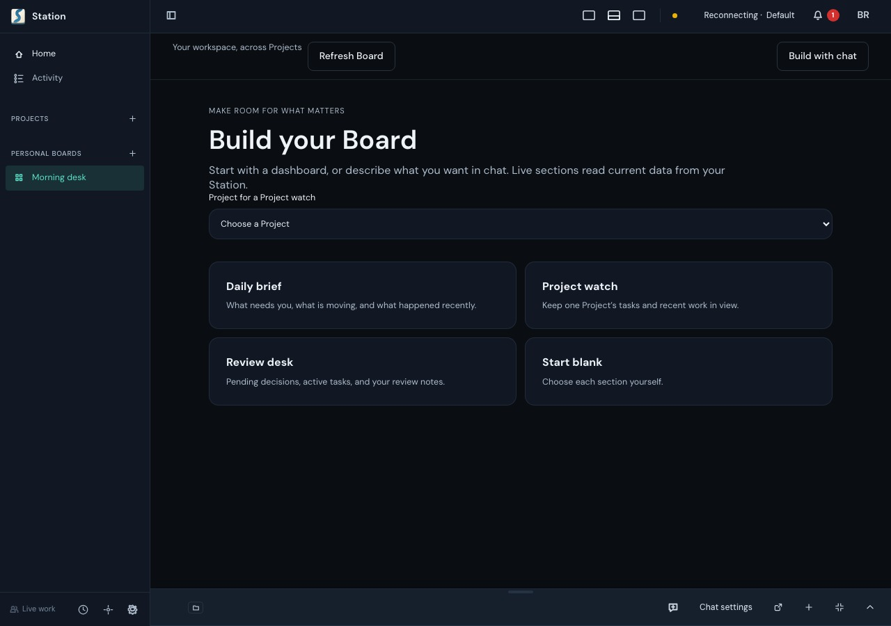
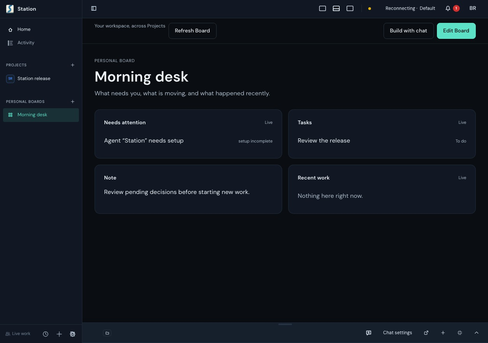
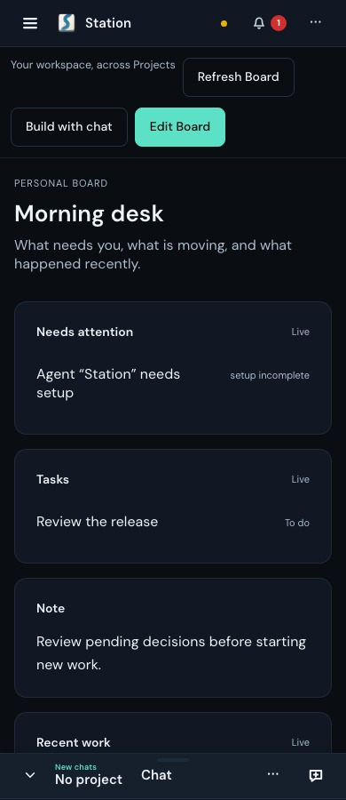
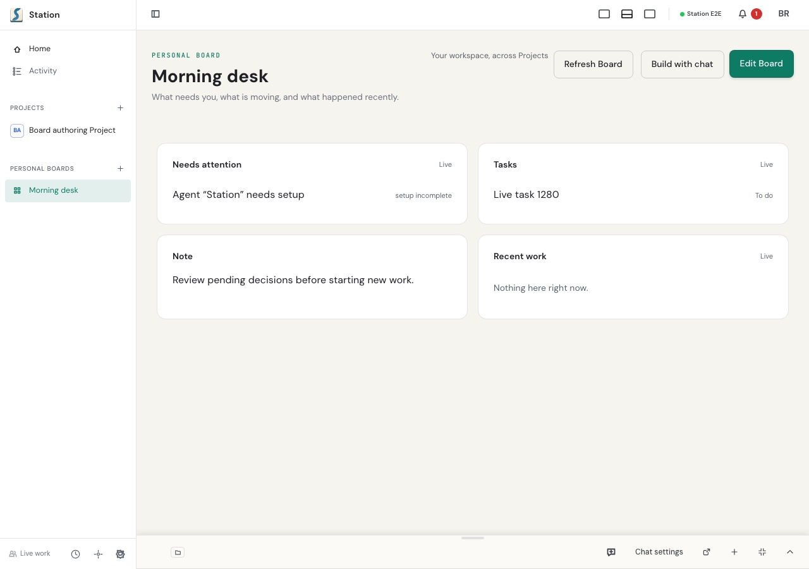
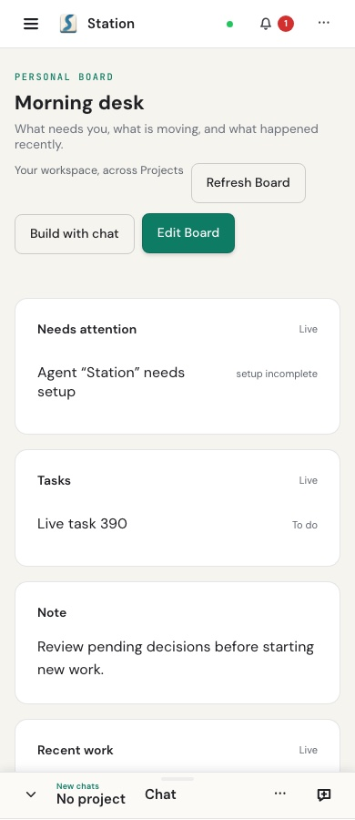

# Personal Board authoring review

Retention: until 2027-01-14

After that date, move the screenshots to the evidence archive release and keep
this README.

This work landed in #3742, squash-merged to main as `d345a6b32fb`. The commit
IDs in this record (`e6def2c99423de5d2602b53e8ea9dca56b932118`, `7c40cda25c8`)
are commits on that pull request's branch: they are not ancestors of main and
are listed in the pull request's commit history.

Captured from source checkout `e6def2c99423de5d2602b53e8ea9dca56b932118`
with the managed `e2e-product-1792177228399-opxf45` product-browser run and an
isolated temporary Station home, at 1280×900 and 390×900. These are actual
rendered screens, not mockups or Gallery reference updates. The source contains
the shared PageFrame and intrinsic two-column/stacked layout; the runner stopped
its isolated Station after all three cases passed (28.7 seconds of browser work).
The JPEGs are converted from that run's inspected PNGs.

## Before composing a Board

The empty Board offers templates and the chat handoff. This is the new setup
state before composing, not a screenshot of the prior implementation.

## After saving a dashboard

The dashboard was selected from Daily brief, edited through the UI, previewed
and saved. Its Task and Project were created through the real API in the
isolated home, using dotted Board and Project slugs. The attention item reports
that the built-in Agent needs setup; no Agent or external provider was
dispatched. The E2E header reports its own isolated instance connection.

## Phone layout

At 390 pixels the same saved sections stack in one column.

## Light theme

The same saved dashboard in the light theme, after CSS transitions settled.

## Verification scope

Controlled product browser journeys passed at 1280 and 390 pixels, including
preview-before-save, reload persistence, a real Task row, a separately arriving
proposal, explicit Apply and projectless chat picker. A third journey preserves
legacy tab selection when entering authoring and switching Boards. The mounted
browser checks one page heading, two desktop columns, phone stacking and
settled toolbar controls at least 44 pixels high and inside the viewport.
The phone capture shows the last card continuing below the visible area; it
does not prove physical-device scrolling or keyboard geometry.

Route tests cover ownership, schemas, stale revisions, reserved fields, rename,
promotion and retry recovery. A disabled save precondition produced the intended
409/200 failure; exact restoration passed 42 tests. Independent verification
removed the strong publication guard and observed the intended 403/200 failure,
then restored exact bytes and passed 42 tests. The later path-compatibility
slice passed 58 tests across route, MCP-routing and mounted editor owners;
its regression first rejected a valid dotted Project/Board and admitted
invalid leading punctuation. Authenticated internal callers
without an agent-origin marker are refused for both Apply and dismissal.

The screenshot-only cold-build run at `7c40cda25c8` reached its startup budget
before browser execution; it is not counted as a product-test pass. These
screenshots came from the separately started source-development runtime.
Physical devices, cross-process coordination, a model-generated proposal and
release-channel availability are not established by this packet.
