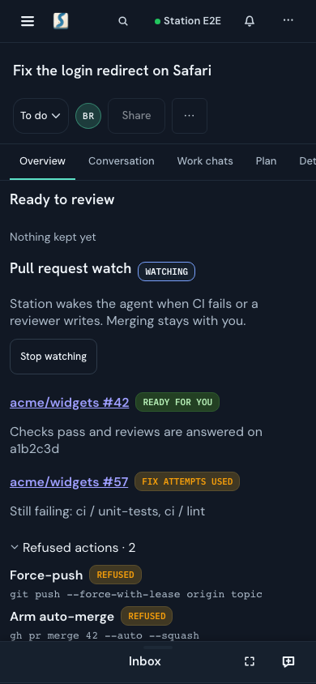
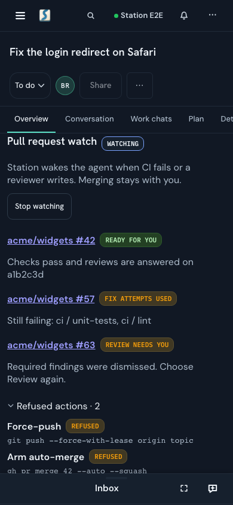
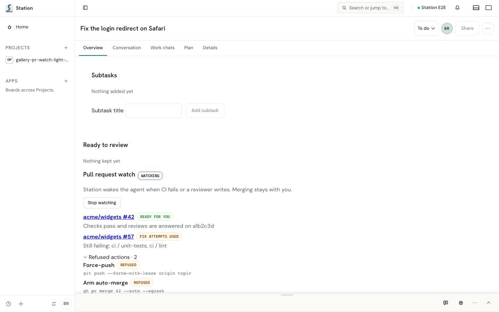
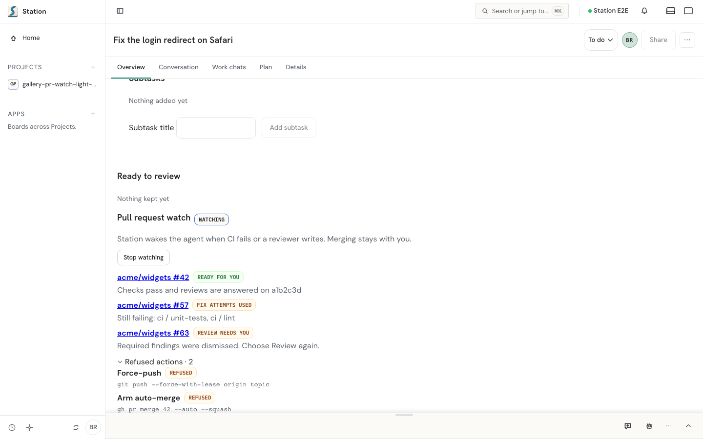

# Task watch and head review: visual evidence

> Historical capture evidence for this change, retained with its source revisions.

These local Gallery captures compare the Task watch panel before this change
at `60a0f52b1ad444b028dcc4d343708e40186479db` and after it at
`aafa10eaa9506be3986bfc39c28081c4432e7ea0`.

The before fixture has ready and spent-budget pull requests. The after fixture
also includes a dismissed required-finding case, so its recovery badge and
message are visible. This is a rendered-state comparison, not a pixel-equivalence
claim or a real reviewer-engine run. The fixtures have no Task execution;
Open chat navigation is covered separately by the mounted component test.

Both captures ran through `npm run test:e2e:screenshot`, on runner-owned homes
and ports. Four current Task-watch screens at 390/1440 in both themes rendered
and passed the Gallery findings check. These are the inspected phone/dark and
desktop/light examples.

| Before | After |
| --- | --- |
|  |  |
|  |  |

`captures.json` binds these image bytes to the two source revisions. It records
capture evidence only; it does not establish hosted, device or release behavior.
