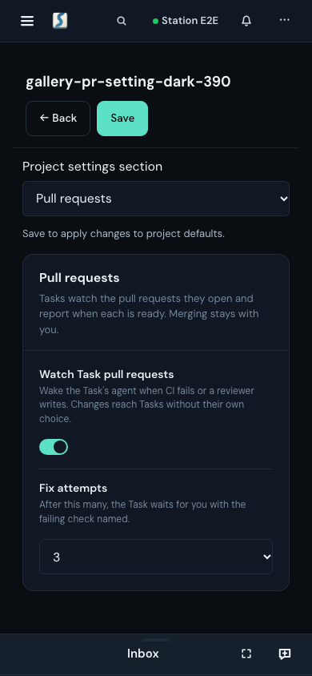
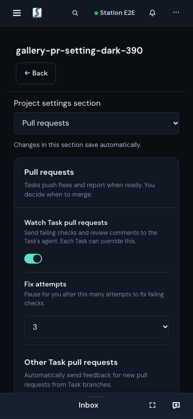
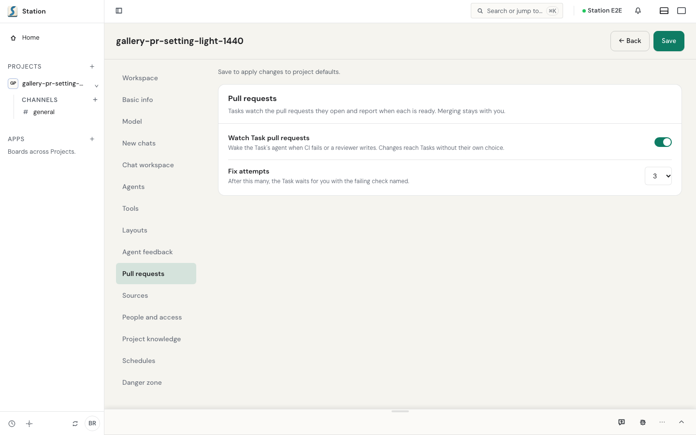
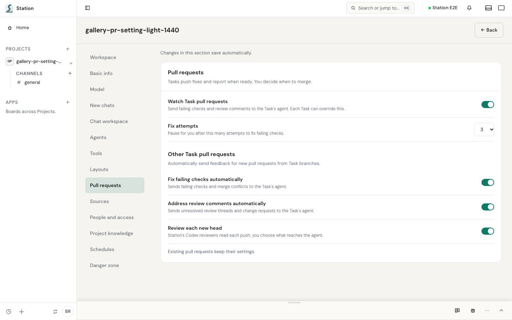
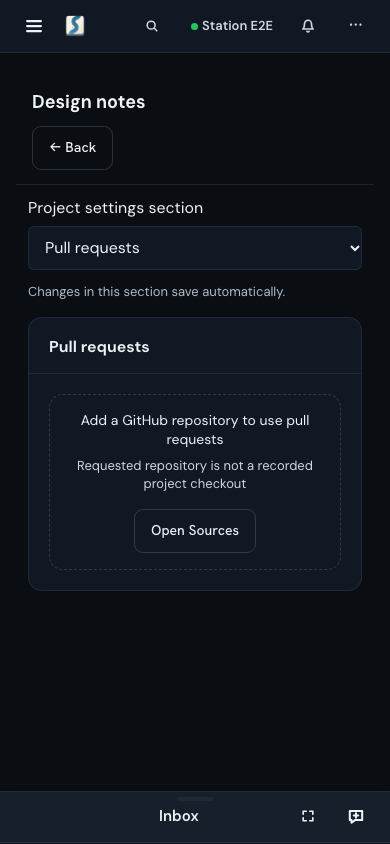
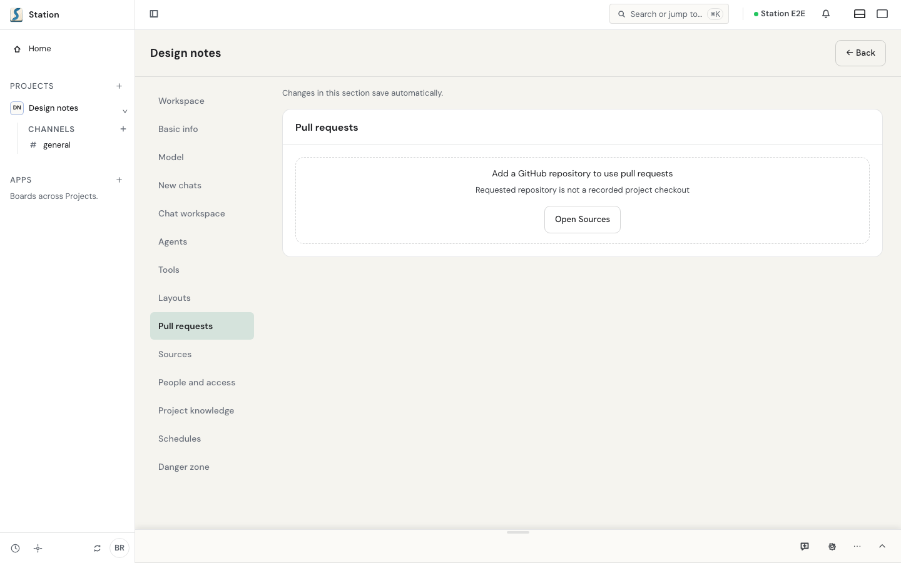

# Project pull request settings: visual evidence

> Historical capture evidence, retained with its source and fixture revisions.

Before captures use `60a0f52b1ad444b028dcc4d343708e40186479db`. After captures
run the application at `11be299bd79457c6972ca44ae6a584386ea31b93`, with the
Gallery fixture committed as `70caf068a12a6cef36bfbd6db46eb9d1b42c41d7`.
The fixture change adds repository setup scenes and a real browser spacing
assertion; it does not alter the application. `captures.json` binds the files.

The Project now has one Pull requests section. `PageSectionGroup` supplies the
subgroup heading size and space above it. The Gallery checks that the subgroup
starts at least 16 pixels below the preceding row. The auto-saving section has
no redundant Save button. A Project without a repository gets Open Sources.

Eight scenes (repository present or absent, 390/1440, dark/light) rendered and
passed the Gallery findings check with no findings. Repository and settings
reads use the isolated Station's real HTTP routes. These images do not prove
paid reviewer runs, hosted deployment, or physical-device behavior.

| Before | After |
| --- | --- |
|  |  |
|  |  |

Repository setup:

