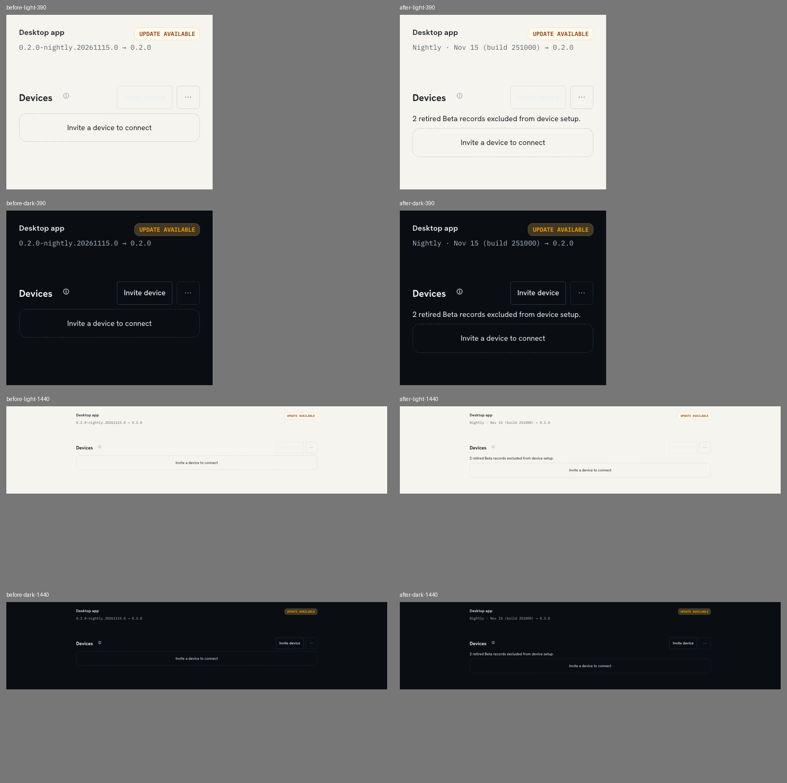

# Release candidate UI review

Retention: until 2027-05-15

Retained for #4929 and #3857 review. These PNGs compare the actual
`StatusSummary` and `RelayOperatorPanel` React components before the change
(at `d026736c3be7ec51b7cad1ea6ba81eaf67be4409`) and after it, using the same
current styles and fixed fixture inputs. The before component keeps the raw
Nightly version; the after component shows a readable date/build and retains
the raw version in the code element title. The after device panel reports two
retired records without exposing them as actionable devices.

The fixture supplies query results and current host authority, bundles the
components with esbuild, then opens a private file document in headless
Playwright Chromium. It uses no Station server, user browser profile or app
ports and refuses HTTP requests. `capture.json` records source hashes,
rendered text, exact version titles, widths and absence of page errors or
horizontal overflow. All eight before/after PNGs at 390 and 1440 pixels in
light/dark were opened and inspected. The contact sheet crops the relevant
upper portion; individual captures retain the complete 900-pixel viewport.

This is isolated component/browser layout evidence. It does not prove a live
SDK response, application navigation, native shell, device setup, installation,
release publication or provider outcome. The low-contrast light-theme Invite
device button is visible in both versions under these fixed fixture styles;
this review does not claim that inherited shared-button styling is repaired.

