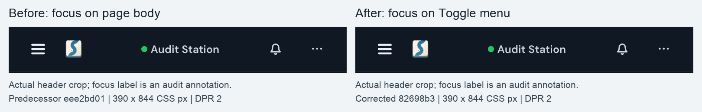

# Sidebar focus audit

Retention: through 2027-02-05; follow the repository evidence-archive process afterward.

This packet records #4662's bounded current sidebar and adjacent navigation audit.
The separate Stations-manager opening finding remains in #4665. This is not
multiplayer execution or an exhaustive whole-product usability qualification.

## Source and capture identity

The corrected runtime used `82698b3027b8d1b73ed4dc2331d05fe035458c82`
(product source `a8bc3b5aae09103c4d9966112b69688fce2a34ed`). Its CLI ran in
`--watch` mode with the source server and Vite UI. The predecessor used
`eee2bd01acebf99a3e96b2ab031b72d6c8cb18cb`; its sidebar source is byte-identical
to base `a4db7072077619fe09fd9c1c8cb0369908669dad`.

Each runtime used a separate disposable home and an explicit environment
allowlist without inherited provider credentials. The generic saved connection
label was changed through the normal Stations manager. Sample Task content and
one operator profile are observations, not evidence of two independent people
or an actual generated result.

[Capture identities and transformations](capture-manifest.json) retain hashes,
actual PNG dimensions, CSS viewports, scale and source revisions. All published
images were opened and inspected. Full Home frames retain a machine-name label
and are excluded; only their unchanged header pixels appear in the annotated
comparison. No DOM or source replacement produced the before/after states.

## Actual focus transition

Both builds focused the connected Home button at 1440 by 900 CSS pixels, then
changed the actual viewport to 390 by 844. The header pixels are identical;
the labels outside them report browser state, not a painted focus ring.
Fixtures differ: the predecessor home is empty; the corrected home has the
disposable Project and Task. This is not pixel-equivalence proof.

| Observation after closing navigation at the breakpoint | Predecessor | Corrected |
| --- | --- | --- |
| Active element | `body` | `Toggle menu` button |
| Navigation `aria-hidden` | `true` | `true` |
| Navigation `inert` | `false` | `true` |

Real Project-row and Customize-footer cases also replaced the focused node and
restored the visible trigger. Outside textarea focus stayed on the same connected
node. Native keyboard input opened the drawer, Tab reached Home, Escape returned
to Toggle menu, and the next Tab reached the Station home link. Isolated sidebar
transitions emitted no retained-focus warning in the cleared Console.

Desktop collapse, the Project-views popup and collapsed utilities returned focus
correctly after Escape. Task Overview, Conversation, Work chats, Plan and Details
rendered; arrow keys moved through the narrow tab list. A human-message draft
survived drawer and Task-tab navigation, then rendered in room history.

## Desktop and narrow renders

| Viewport | Dark | Light |
| --- | --- | --- |
| 1440 by 900, DPR 2 | [Desktop](task-desktop-dark.png) | [Desktop](task-desktop-light.png) |
| 390 by 844, DPR 2 | [Narrow](task-mobile-dark.png) | [Narrow](task-mobile-light.png) |

These actual empty Task views use disposable content. Their title does not imply
that a provider produced a shared result. Missing AI setup showed a refusal;
no provider was invoked. The Task itself was seeded through the authenticated CLI.

## Touch, offline and loading

| Actual controlled browser state | Inspected capture |
| --- | --- |
| Dark touch drawer | [Drawer](drawer-touch-dark.png) |
| Light touch drawer | [Drawer](drawer-touch-light.png) |
| Offline human send retains an unknown outcome and draft | [Offline](offline-message.png) |
| Online retry leaves one matching visible history entry and clears the composer | [Recovered](recovered-message.png) |
| Slow Task read shows real Overview skeletons | [Loading](throttled-loading.png) |

Chrome's iPhone16 profile measured 393 by 852 CSS pixels at DPR 3, coarse pointer,
no hover and one touch point. Native page taps emitted touch pointer events and
`touchstart`. All eleven visible drawer buttons measured at least 44 by 44 CSS
pixels. Visible Task tabs were 44 pixels high and at least 48.65625 pixels wide.
Both drawer themes closed to Toggle menu with hidden/inert navigation.

DevTools Offline caused actual disconnected fetches, a cannot-connect header,
an offline-copy action and a retained human-message draft. The failed send showed
an unknown outcome. After restoring normal networking, the normal Retry action
produced exactly one matching visible history item and an empty composer.
This does not establish wire proposal identity, restart or provider retry behavior.

The 3G preset showed Loading view, then actual Overview skeletons. Restoring normal
networking returned populated Task content and Connected state. These controls do
not cover every query's loading/error/partial-state combination.

## Open finding and checks

Opening Manage Stations once emitted a retained-focus warning for the header
connection control under the hidden app wrapper. A warm repeat did not re-emit
it. The existing connect modal hides/inerts background before its deferred
initial-focus timer; #4665 owns that separate ordering repair and re-audit.

The implementation's five focused owners passed 62 tests in 7.68 seconds.
Its clean-commit detached-node fault made the Project-row and two fallback cases
fail with focus on body; byte restoration returned 62 passes. Root's final-head
focus owner run passed 8 tests in 2.82 seconds. Fresh independent Sol source review
found no blocker at `a8bc3b5`. These source checks are separate from this browser
packet and from later hosted checks.

Both owned runtimes stopped through the CLI, and all eight owned ports were
verified clear. The owned preview/incognito surfaces were closed and the original
browser restored. A broken browser-tool blank-tab allocation had no matching
native window; it was left to the tool's automatic cleanup contract.

Physical devices, native shells, actual providers, independently authenticated
collaborators, shared-result access/revocation, packaged UI, Gallery comparison
and release qualification remain unverified by this packet.
