# Task code review delivery evidence

Retention: keep this #4656 delivery receipt until replacement evidence is accepted. These historical frames do not qualify later source.

This personal-host Task review foundation adds committed-code review through the existing independent-review owner. It does not enable invited-member execution or complete Multiplayer #4647.

## Source and execution

- Source review: `75a9e13c304b88d194e26da44204350e10df1ca3`; fresh-context, same-family source review found no actionable bounded finding after the publication/reader corrections.
- After captures: `bf8e31df0ca4737a47b4d01a9f43c2bff8d0cb60`, whose product source matches that reviewed commit. `npm run test:e2e:extended -- --spec=tests/task-code-review.spec.ts`: four journeys passed in 56.8 seconds. Actual checkout reads; reviewer transport/results were controlled fixtures. Keyboard Open Agents, lost acknowledgement/reload, touch retry, partial history, stale revision and denied-refresh recovery were exercised.
- Base context captures: `d026736c3be7ec51b7cad1ea6ba81eaf67be4409`. `npm run test:e2e:screenshot -- --screens=task-capabilities-dark-desktop,task-capabilities-dark-mobile,task-capabilities-light-desktop,task-capabilities-light-mobile`: selected four scenes passed in 55.3 seconds.
- Both isolated Station instances stopped with successful lifecycle cleanup. Browser: worktree-pinned Chromium; 1440px and 390px, dark and light. All published frames were opened for visual inspection.
- The base gallery and after journey use different sample Tasks and preview choices. They provide baseline context and new-feature evidence, not a pixel-matched visual comparison or evidence that existing capabilities were removed.

The [manifest](manifest.json) retains exact image bytes, hashes and source identities. It contains no credentials, private transcript or native caller proof.

## Inspected frames

| View | Base context | New setup recovery | Controlled review state | Denied read |
| --- | --- | --- | --- | --- |
| dark, 1440px | 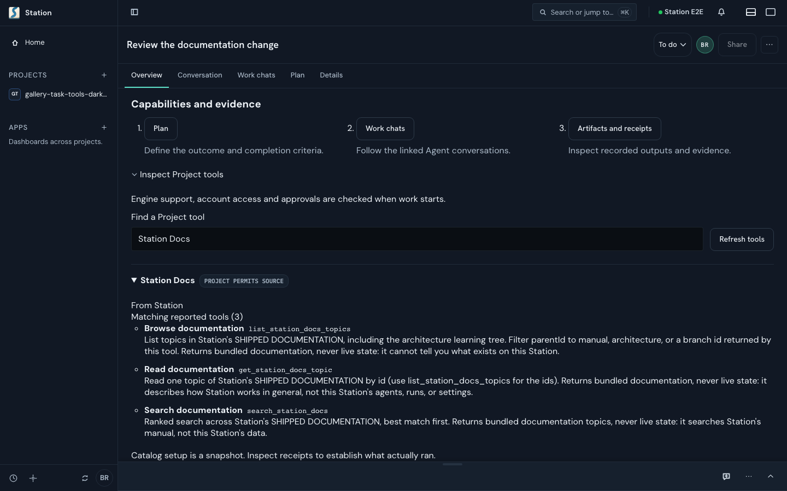 | 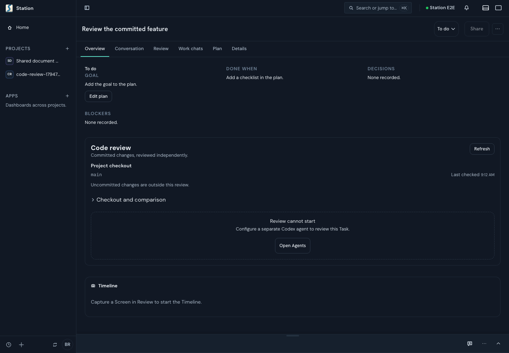 | 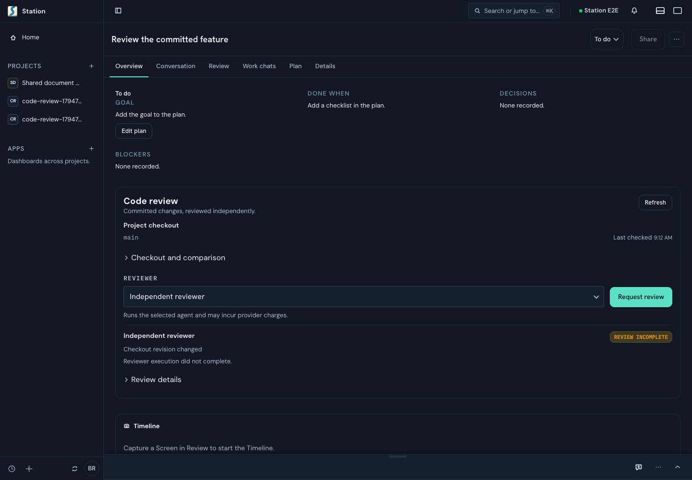 | 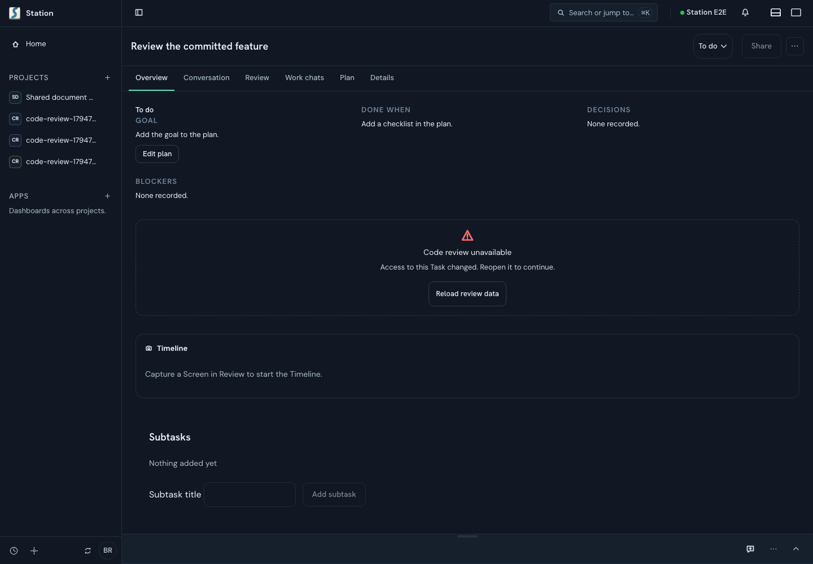 |
| dark, 390px | 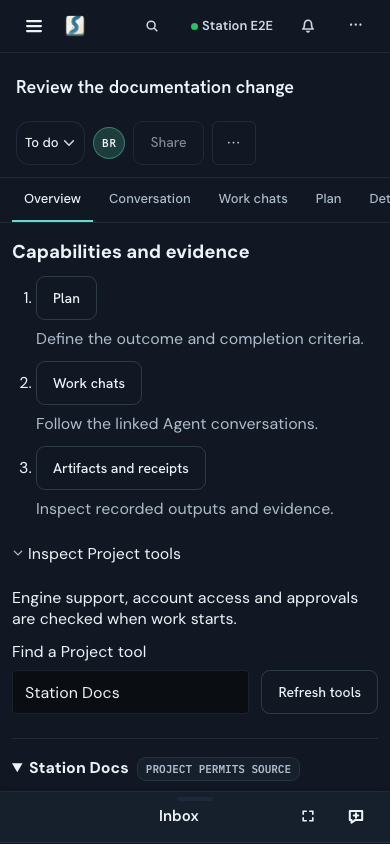 | 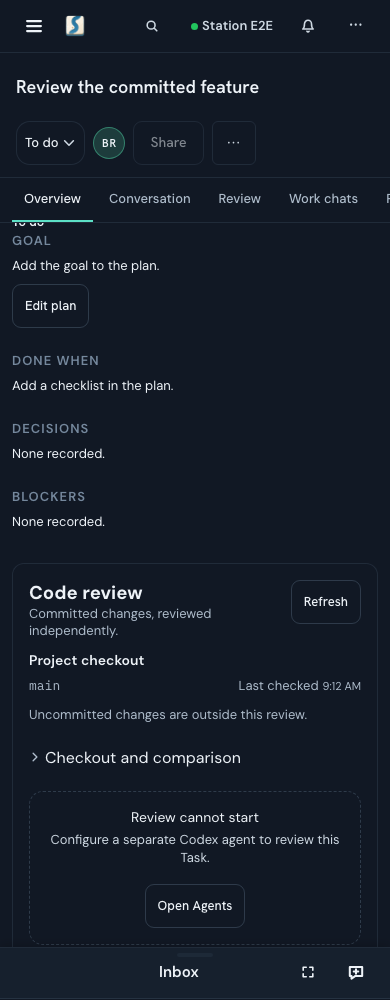 | 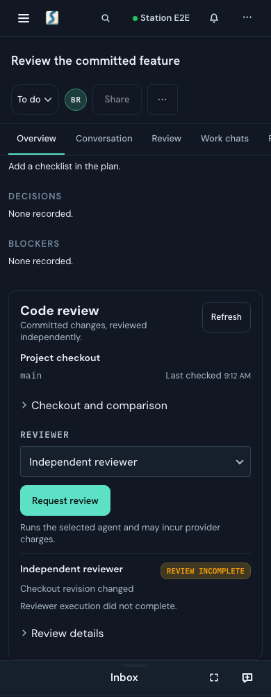 | 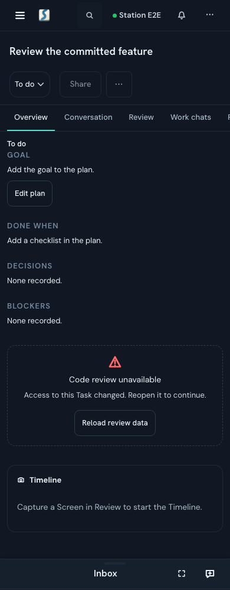 |
| light, 1440px | 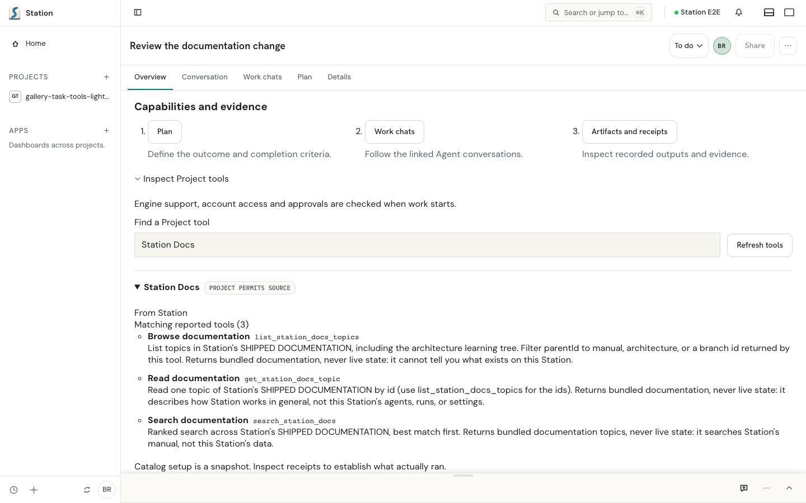 | 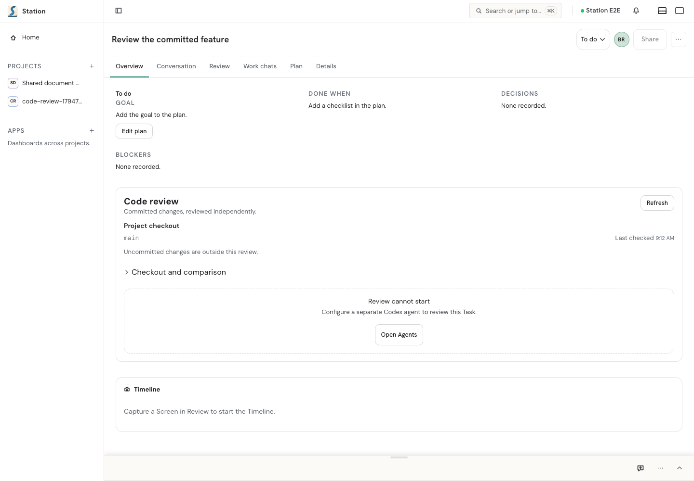 | 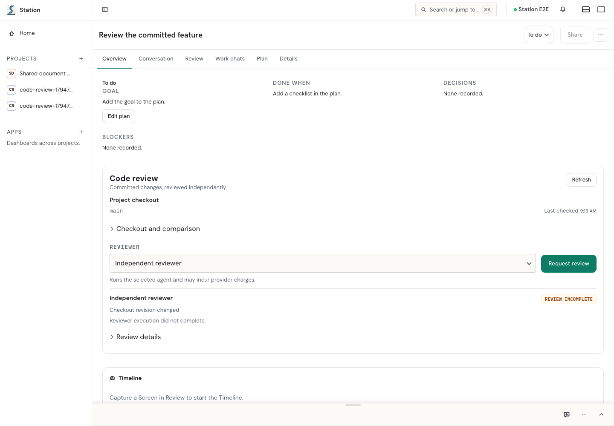 | 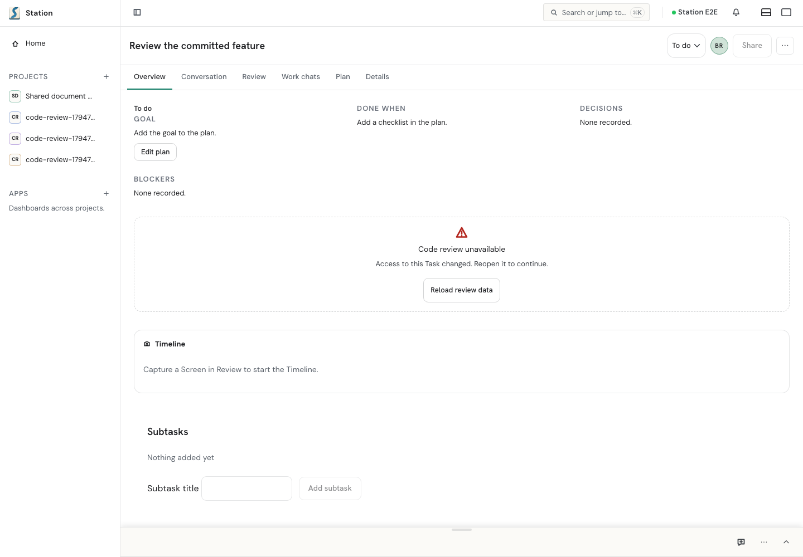 |
| light, 390px | 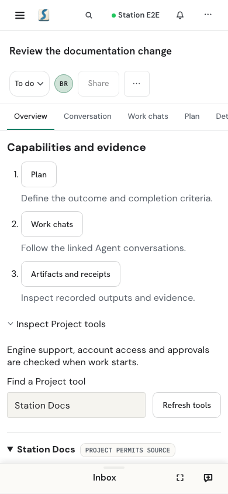 | 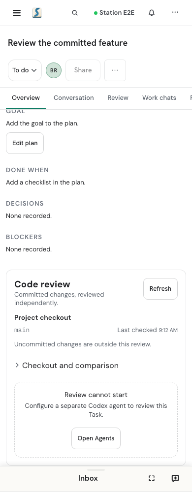 | 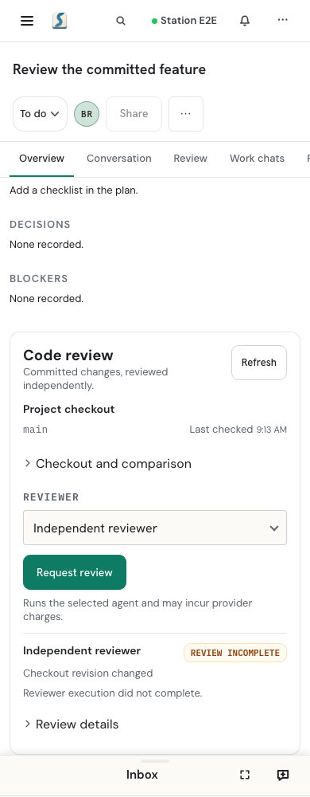 | 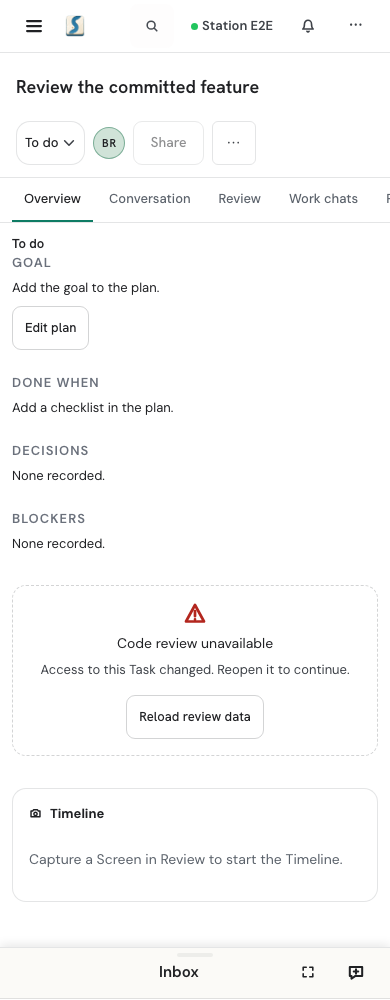 |

## Failure and restoration evidence

Real owner regressions failed before the corrections for member access through Project readers, private Task ancestry reaching another reviewer, replacement-root publication, revocation after temporary-file sync and safe-workspace cleanup. The repaired five-owner batch passed 54 tests; the publication/reader module also passed 8 tests independently. Server-test, SDK, UI and browser-fixture typechecks passed.

Two distinct SDK faults were checked. Removing Project identity from the cache key exposed old Project data; removing denial masking exposed cached data after 403. Each intended assertion failed, exact original bytes were restored and the owner tests passed again. The denial-mask control was performed by a separate same-family verifier on the shared filesystem.

Committed-range readiness at `bf8e31df0ca4737a47b4d01a9f43c2bff8d0cb60` reported 0 failures and 0 warnings. That receipt includes connected-agent, governance, lint, hygiene, component-style, documentation-truth and verification-policy checks. It does not substitute for hosted PR/merge-queue qualification.

## Limits

No actual reviewer-provider invocation, two-human collaboration, invited-member execution, physical device, native shell, hosted deployment, packaging or release was qualified by these frames. Findings, revision freshness, unknown execution and gate verdicts remain separate. Original earlier branch/recovery/guard artifacts remain historical and were not executed or repinned for this delivery.
