# Station conversation review captures

Retention: until 2027-04-30

These PNGs contain isolated Station homes and controlled sample data. They are
review assets, not a release receipt or current screenshot baseline.

| Files | Source revision | Executed scenario |
| --- | --- | --- |
| `before-focus-fix-*` | `8ea8a9793dd4` | The earlier nine-case macOS browser run passed in 14.3 minutes. This is the shared UI before the final focus fix, not the original polling peer body. |
| `after-focus-fix-*` | `58540d40b24e` | Both desktop/mobile Inbox cases passed in 2.7 minutes after the focus fix. |
| `relay-preview-off-*` | `e051ccd80f` | The relay browser case passed again in 1.2 minutes, including the corrected preview-off heading and retained text/draft behavior. |
| `relay-idle-*` | `7568bb46d788` | The merged-code real Device/peer-grant HTTP/SSE chat case passed; the full run passed 8 of 9 cases in 13.9 minutes and exposed the subsequently fixed mobile Search race. |

All sets include dark/light themes at 390px and 1440px. Inbox scenarios use
explicit read-only attached-session HTTP fixtures and real browser actions.
The relay scenario uses real pairing and grants with a deterministic HTTP model.
The original nine-case run also covered streaming, approval, refusal, uncertain
delivery, reconnect, preview-off retention, Activity/attached continuation, and
owner/member/guest history recovery. Historical captures do not qualify native
shells, physical devices, external providers, releases or multiplayer deployment.

The focus regression failed deterministically against the earlier implementation:
Search waited for an animation frame, which could steal focus from a selected row.
The fix focuses the mounted field in its layout commit. The controller test
passed all 16 cases after the fix; the browser recheck retained stale-response,
committed-route, focus, snooze, dismissal and touch-target assertions.

## Inspected views

| View | Before final focus fix | After final focus fix |
| --- | --- | --- |
| Phone, dark | 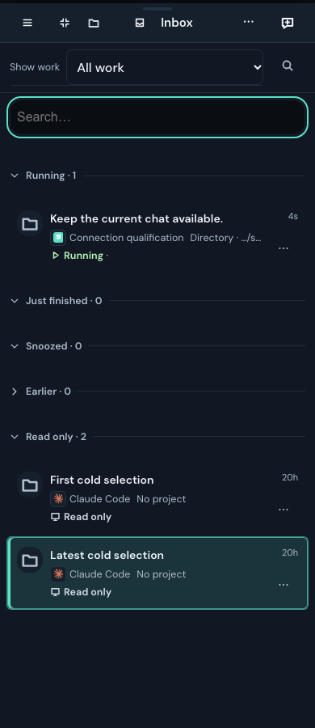 | 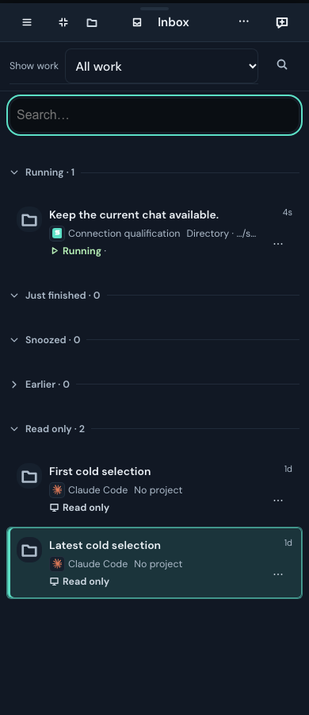 |
| Phone, light |  | 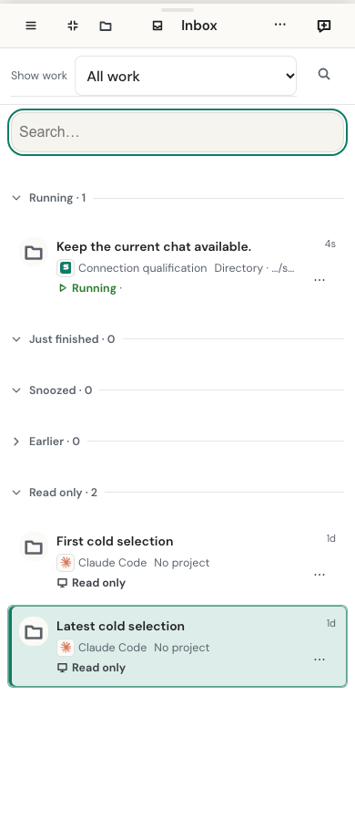 |
| Desktop, dark | 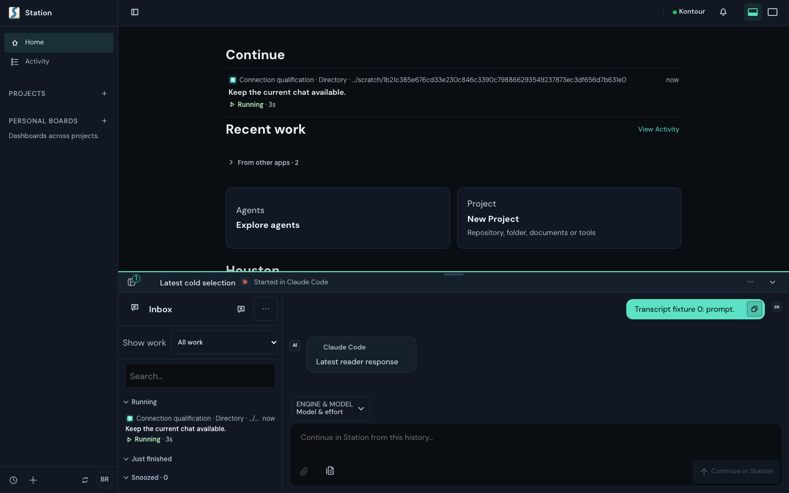 |  |
| Desktop, light | 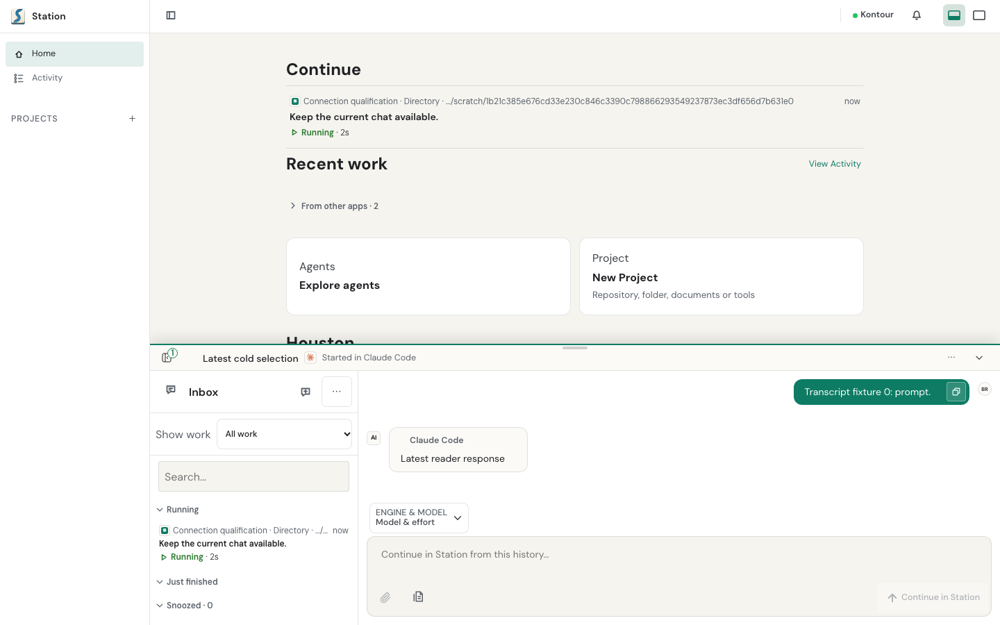 |  |

The relay idle views retain the ordinary writable composer and Via indication:

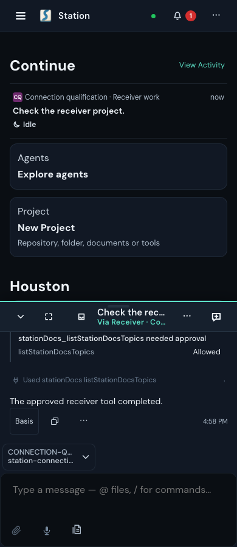
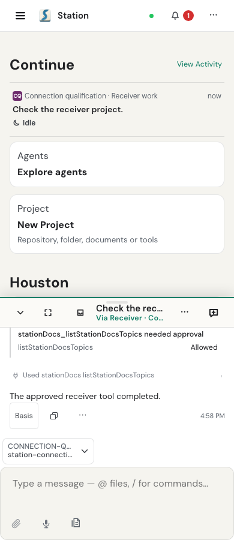
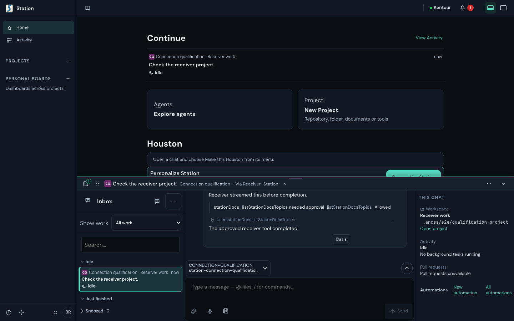
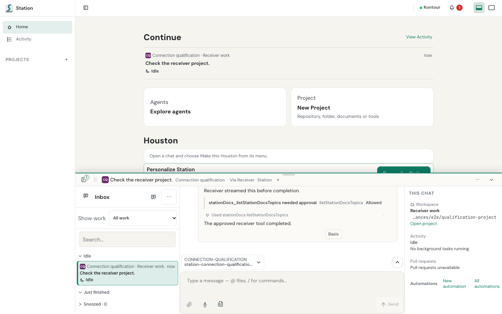

The reviewed preview-off heading names the disabled feature:

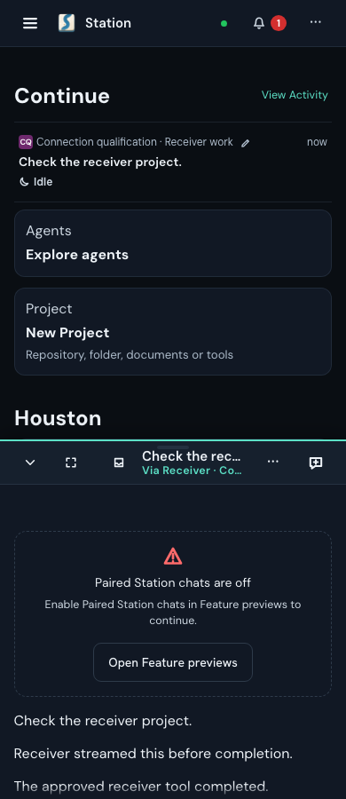
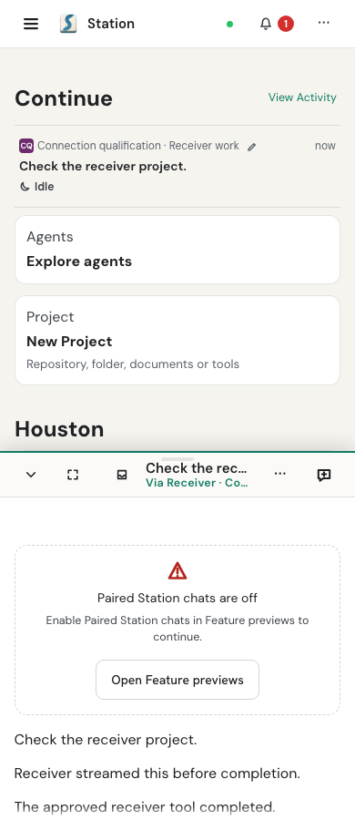
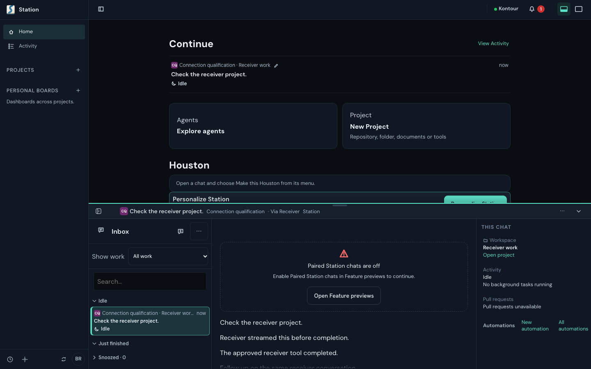
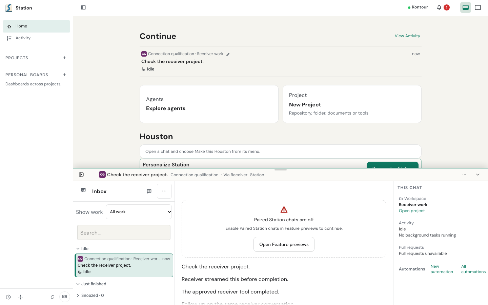
